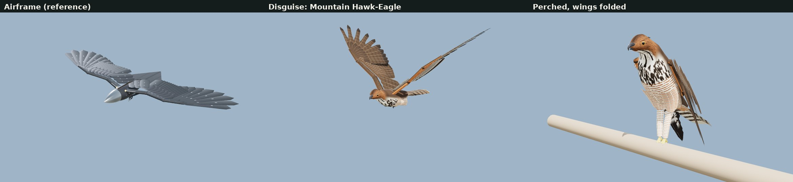
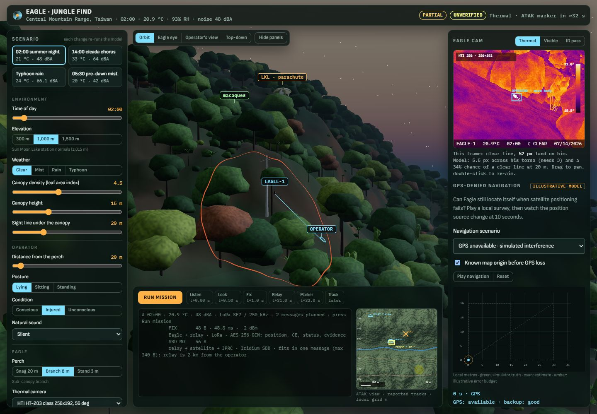
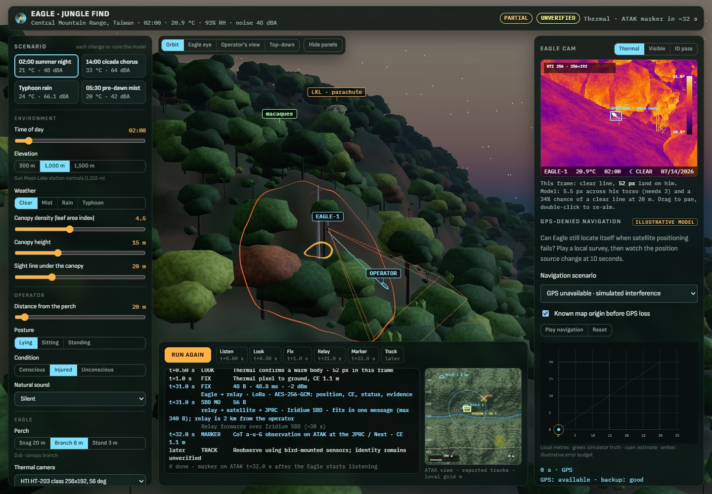
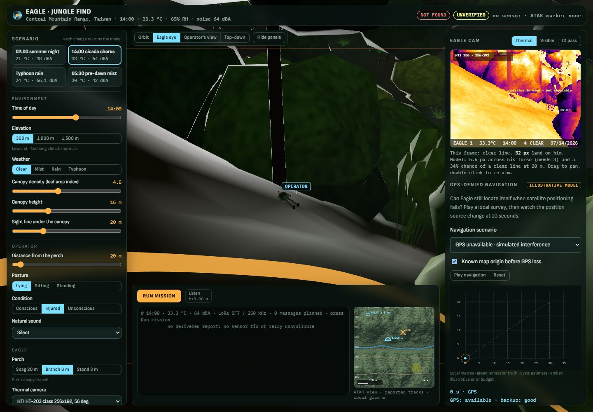
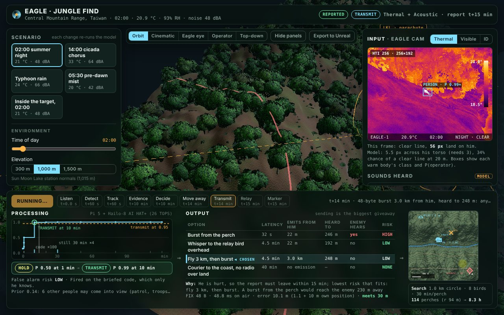

# Eagle: finding isolated people when GPS, cell and radio are down

**Code Metal hackathon · Team 32**

A person is cut off under dense forest canopy: a downed aircrew member, or a hiker trapped by a wildfire. There is no GPS fix, no cell signal and no radio contact. Searchers need to know **where they are, to within a few metres**, and need a way to **tell them what to do next**, without broadcasting their position to anyone else who is listening.

**Eagle** is a small perching drone built for that job. It flies in, perches with its motor off, and listens. When it finds the person, it sends a position fix out through a high-altitude relay to the coordinator's map, and carries a short text message back down to a tag the person carries.

This repository holds the software we build for it. The first piece is a physics-based 3D simulator of the full mission. The second is an Unreal Engine demo of the wide-area thermal search over real terrain, with live ATAK markers.

The Eagle itself is modelled as a flapping-wing drone built to a Mountain Hawk-Eagle's size (1.6 m wings) and dressed as one; it flies, lands, folds its wings and takes off in the simulator, in a standalone viewer and as glTF for Unreal ([eagle-drone.md](docs/eagle-drone.md)).



Version 2 of the simulator covers the harder case, where the person carries nothing at all: the Eagle has to find him by heat and sound and decide on board when it is sure. The **Eagle starter kit** is the perch and base-station software and radio firmware, tested in simulation, and the **thermal camera probe** gets USB thermal cameras working.



## How Eagle works

1. **Perch.** The Eagle lands on a branch, snag or stand near the last known location and shuts its motor off. Silent, it hears more and is harder to find.
2. **Listen.** A microphone array listens for a whistle code, voice or the tag's buzzer; a thermal camera looks for a warm body.
3. **Poll.** One short, authenticated LoRa challenge to the person's tag. The tag replies at the lowest power that will reach the Eagle, and the Eagle stays silent (EMCON) while unknown people are close enough to intercept the reply.
4. **Fix.** Bearings from the mic array and thermal camera, plus the perch height, give a position with an error estimate.
5. **Relay.** The fix goes to a relay drone at altitude, then out over Iridium satellite (or carried out physically, with no emission over land), and appears as a marker on the coordinator's ATAK map.
6. **Talk back.** The coordinator's reply ("rally point, time, acknowledge with two taps") comes back the same way and shows on the tag's e-ink screen.

The scenario we design against is personnel recovery in Taiwan's Central Mountain Range. The same approach applies to finding people cut off by wildfire.

### When the person carries nothing (simulator v2)

Version 2 drops the tag. The Eagle works only from what it can see and hear, and every emission near him is a risk:

1. **Input.** The thermal camera is the primary sensor. The microphone array listens for a briefed tap code on a tree trunk, a whistle or a cough.
2. **Processing.** An evidence gate on board keeps the odds that this is him rather than a soldier, a farmer or an animal, and sends nothing until P reaches 0.95.
3. **Output.** One 48-byte encrypted report, never from the perch by default: the Eagle flies 3 km away first, whispers to the relay overhead, or carries the fix out, whichever is safest in the time he has.

## Run the simulator

1. Open [`simulator/index.html`](simulator/index.html) and click **Download raw file**.
2. Open the downloaded file in Chrome, Edge, Safari or Firefox. No install, no build, no server. It needs internet on first load for three.js and fonts.
3. Pick a scenario on the left, then press **Run mission**.

To run just the physics model, with Node 18 or newer:

```bash
node simulator/run-model.mjs                    # results for all four scenarios
node simulator/run-model.mjs night opDist_m=80  # change any setting
```

Simulator v2, for a person who carries nothing, opens the same way: [`simulator/v2/index.html`](simulator/v2/index.html). Its model runs on its own with `node simulator/v2/model_table.js`. Reference: [`docs/simulator-v2.md`](docs/simulator-v2.md).

**Demo for judges:** in simulator v2 press **Present ▶** (or **P**). Ten cards walk through the story with live numbers from the model: → next, ← back, A auto-advance, Esc exit. Run sheet: [`docs/demo-runbook.md`](docs/demo-runbook.md). To draw on a stronger computer and show it on a laptop on the same network, run `node simulator/v2/serve.mjs` on that computer ([Remote GPU](docs/simulator-v2.md#remote-gpu)).

## Run the Unreal demo

A second demo flies the Eagle over real Taiwan terrain in Unreal Engine 5: a thermal search through canopy gaps, a confirm orbit, perching, a comms pellet and authentication, with each step appearing live on ATAK. It needs Unreal Engine 5.7 with the free Cesium for Unreal plugin and a free Cesium ion account. Setup, run of show and troubleshooting: [`unreal-sim/README.md`](unreal-sim/README.md).

## Run the Eagle starter kit

The perch and Nest software runs in simulation, with no hardware:

```bash
cd eagle-kit
python3 -m venv .venv && source .venv/bin/activate
pip install -r requirements.txt pytest matplotlib
python -m pytest -q        # tests that need optional packages skip themselves
python apps/sim_demo.py    # find loop: whistle code, bearing, fix, one encrypted burst, ATAK marker
python apps/life_demo.py   # signs of life for several people
```

Hardware, calibration and the five-minute demo: [`eagle-kit/README.md`](eagle-kit/README.md). To get a USB thermal camera working: [`thermal-probe/`](thermal-probe/).

## Results so far

Model estimates from the simulator, not field measurements. Operator lying injured 20 m from an Eagle on an 8 m sub-canopy branch, carrying the tag:

| Scenario | Ambient | Found by | Fix error | ATAK marker |
|---|---|---|---|---|
| 02:00 summer night | 20.9 °C, 48 dBA | RF tag + acoustic + thermal | 3.2 m | 34.4 s |
| 14:00 cicada chorus | 33.3 °C, 64 dBA | RF tag + acoustic (thermal fails) | 3.2 m | 34.4 s |
| Typhoon rain | 24.1 °C, 66 dBA | RF tag + acoustic + thermal | 3.2 m | 34.4 s |
| 05:30 pre-dawn mist | 20.2 °C, 42 dBA | RF tag + acoustic + thermal | 3.2 m | 34.4 s |

What we have learned:

- **Thermal fails in the afternoon.** At 14:00, sun-warmed leaves are as warm as a clothed body (-0.7 °C apparent contrast against a 2.3 °C threshold). Sound and the tag carry the find.
- **Distance from a single perch kills accuracy.** Fix error grows from 3.2 m at 20 m to 42.5 m at 80 m. A second perch brings it back to 6.2 m.
- **Under the canopy, sight lines limit the thermal camera, not its resolution.** A 640×512 core reaches 23 m, the same as a 256×192 one.
- **Staying silent costs time.** A patrol 60 m away holds the poll for 139 s; the marker arrives at 173 s instead of 34 s.
- **The satellite hop dominates.** Iridium latency is 30 of the 34.4 s to the marker.





### Simulator v2: the person carries nothing

Same place and perch. He is injured, carries nothing and taps the briefed code; a patrol is 230 m from the perch. Model estimates, not field measurements:

| Case | Decision | Way out | ATAK marker | Fix error |
|---|---|---|---|---|
| 02:00 night | TRANSMIT at 10 min | fly 3 km, then burst | 14.5 min | 10.1 m |
| 14:00 cicada chorus (heat fails) | TRANSMIT at 10 min | fly 3 km, then burst | 14.5 min | 10.5 m |
| Silent, only coughs | TRANSMIT at 80 min | fly 3 km, then burst | 84.5 min | 10.1 m |
| Unconscious, silent | keeps watching (P 0.92 after 2 h) | none | not sent | – |
| Conscious and hiding | TRANSMIT at 10 min | courier, no radio over land | 50 min | 10.1 m |

- **Never transmit from the perch.** A burst there would be heard 246 m away, past the patrol; flying 3 km first costs 4.5 min.
- **The briefed code carries the decision.** Without it the gate takes 80 min on coughs, or never opens for an unconscious man.
- **Without GPS, the Eagle's own position is most of the error:** 10 of the 10.1 m.



## Repository map

| Path | What it is |
|---|---|
| [`simulator/index.html`](simulator/index.html) | Eagle Jungle Simulator: the whole app in one file (physics model, 3D scene, interface) |
| [`simulator/run-model.mjs`](simulator/run-model.mjs) | Runs the simulator's physics model in Node, no browser needed |
| [`unreal-sim/`](unreal-sim/) | Unreal Engine 5 demo: live thermal search over real Taiwan terrain, with ATAK markers ([setup](unreal-sim/README.md)) |
| [`simulator/v2/`](simulator/v2/) | Eagle Jungle Simulator v2: the person carries nothing (heat and sound, evidence gate, four ways out), with a presenter mode for demos, remote GPU and an Unreal scene import |
| [`eagle-kit/`](eagle-kit/) | Eagle starter kit: perch and Nest software, encrypted LoRa messages, ATAK output, signs of life, radio firmware ([setup](eagle-kit/README.md)) |
| [`thermal-probe/`](thermal-probe/) | Finds, views and streams a USB thermal camera |
| [`docs/simulator.md`](docs/simulator.md) | Technical reference: architecture, every equation and constant with its source, message protocol, limitations |
| [`docs/unreal-sim.md`](docs/unreal-sim.md) | Technical reference for the Unreal demo: architecture, detection model, thermal view, CoT messages, verification |
| [`docs/simulator-v2.md`](docs/simulator-v2.md) | Technical reference for simulator v2: model, sources, results, export to Unreal, presenter, remote GPU, performance, limitations |
| [`docs/demo-runbook.md`](docs/demo-runbook.md) | Run sheet for a live demo of simulator v2: setup, the ten presenter steps, fallbacks, likely questions |
| [`docs/eagle-kit.md`](docs/eagle-kit.md) | Technical reference for the kit: find loop, messages and keys, signs of life, verification |
| [`docs/thermal-probe.md`](docs/thermal-probe.md) | Technical reference for the thermal camera probe |
| [`docs/build-log.md`](docs/build-log.md) | Dated record of every build: what, why, decisions, verification, open issues |
| [`docs/how-we-document.md`](docs/how-we-document.md) | Our documentation process, commit format and pre-push privacy checklist |
| [`docs/images/`](docs/images/) | Screenshots |
| [`LICENSE`](LICENSE) | Apache-2.0 |

## Status

| Piece | State |
|---|---|
| Mission simulator | v1 working: 24 inputs, 4 scenarios, full mission playback |
| Physics model | v1: acoustic, thermal, radar, RF, fix accuracy, LoRa airtime; sources cited, estimates labelled |
| Unreal live thermal demo | v1: code complete and tested without Unreal (18 tests; every Unreal API name checked); first run in the editor next |
| Mission simulator v2 (no tag) | Working: heat and sound, evidence gate, four ways out, search time; 5 presets; scene export to Unreal; presenter mode, adaptive quality, remote GPU on a local network |
| Eagle starter kit | v2 in simulation: find loop, encrypted messages, ATAK output, signs of life for up to 10 people; 183 tests pass; not yet on hardware |
| Thermal camera probe | v1 tested with a simulated camera; not yet run with the HTI imager |
| Hardware (Eagle, tag, relay) | Not in this repo yet |
| Field validation | Not started |

Next: terrain masking in the RF model, the Eagle's own poll in the silence decision, detection probability and false alarms, fully offline build. See [build-log.md](docs/build-log.md).

Next for simulator v2: frame rates measured on the team's laptops, and a relay (TURN) server so remote GPU works across networks.

## Team

Team 32: Mitch Kirby ([@mitchkirbyEC](https://github.com/mitchkirbyEC)) and Alex Bartolomei, Ember Corps.

## License

[Apache-2.0](LICENSE).
