<div align="center">

<h1>Fennec</h1>

<h3>Operator down: locate. Stay covert.</h3>

Disguised, perching eagle drones that report recovery-grade information to inform the command's next step.

<b><a href="https://canva.link/02k57fkmh9afe6c">Open the pitch deck</a></b> &nbsp;·&nbsp; <a href="#the-mission-step-by-step">Walk the mission</a> &nbsp;·&nbsp; <a href="#what-runs-today">See what runs today</a> &nbsp;·&nbsp; <a href="#find-the-code">Find the code</a>

<br><br>

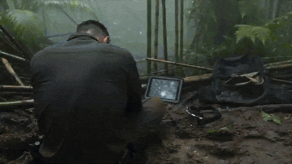

<sub>Concept film. Rendered, not field footage. No sound. <a href="docs/images/pitch/00-concept-film.mp4">Full-quality MP4</a></sub>

</div>

## Operator down

A fighter jet goes down over Taiwan's mountain jungle. Recovery forces have to **find** the aviator, **confirm** whether they are alive and in what condition, and **report** the fix without exposing them or the drone.

It is too big to sweep and too dangerous to transmit:

- **20,340 km²** inside a 50-mile circle from the last known position, 57% of Taiwan's main island *(computed)*
- **75 km²** for the first search, once the evasion plan and terrain shrink the circle *(modelled)*

## The product

**Perch. Listen. Decide. Whisper.**

Fennec is a one-way eagle drone that hides in plain sight. It flies in alone, perches like a real raptor, searches with sensors and compute on board, and sends one sealed 15-byte burst per person found. The aviator carries nothing that transmits. No pilot, no video feed, no chatter.

*Fennec* is the system. The *Eagle* is the bird, and the engineering notes further down use that name.

## The niche

Today's options are loud, deaf, or leave a radio trail. Fennec is the only option built to be all three things a covert recovery search needs.

| Option | Gives you | Costs you | Silent | Persistent | Decides at the edge |
|---|---|---|:-:|:-:|:-:|
| Aircraft | Fast coverage | Loud and transient | – | – | – |
| Ground teams | Human judgment | Slow and exposed | ✓ | – | ✓ |
| Beacon / SATCOM | Known signal | Persistent RF trail | – | ✓ | – |
| **Fennec** | **A sealed fix from a bird nobody notices** | **Still bench-stage** | **✓** | **✓** | **✓** |

## The fit

Personnel recovery is a standing joint mission. Recovery units own it, Fennec fleets are the deployable layer, and program partners are the procurement path. The offer is the hardware fleet, the mission software and the sustainment behind them.

## Why it's relevant

- **The search itself is the risk.** On contested ground, a loud aircraft or a radio trail can lead the threat to the person being recovered.
- **Edge AI makes a quiet searcher possible.** Person detection and a face check already run offline on a Raspberry Pi with a Hailo accelerator. No cloud, no link.
- **It carries beyond this mission.** The same sensing questions apply to wilderness and wildfire searches.

## The mission, step by step

<sub>Stills from the concept film, except step 7, which is the simulator's thermal view.</sub>

<table>
<tr>
<td width="360">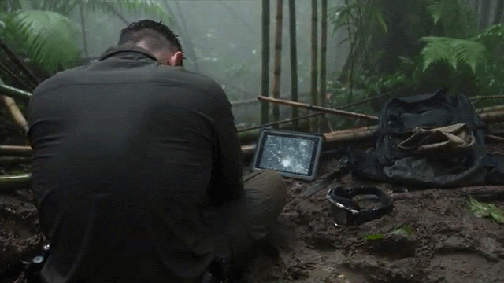</td>
<td><b>1. Operator down</b><br>The aviator is alone in the jungle with comms gone, carrying nothing that transmits.</td>
</tr>
<tr>
<td>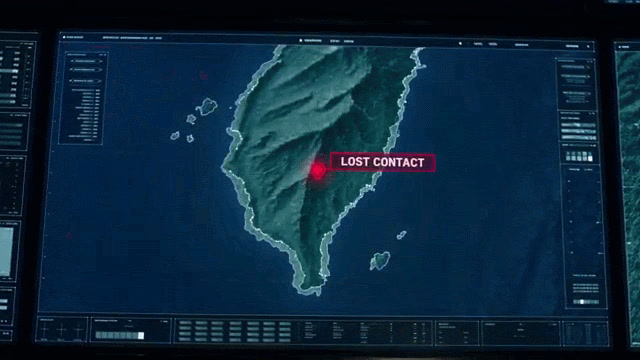</td>
<td><b>2. Command loses contact</b><br>The last known position goes up on the board at command: LOST CONTACT. With nothing coming from the aviator, that point is all command has.</td>
</tr>
<tr>
<td>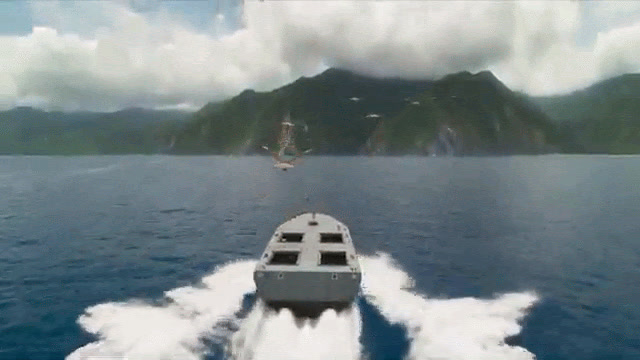</td>
<td><b>3. Launch</b><br>A SOCOM autonomous craft runs in and releases the birds about 20 km offshore.</td>
</tr>
<tr>
<td>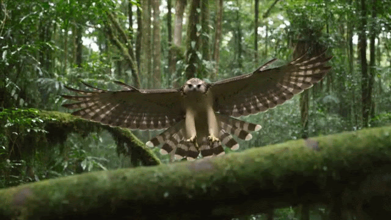</td>
<td><b>4. Fly in</b><br>Each bird flies alone to the last known position and drops a prey relay at the midpoint. No pilot, no video feed, no chatter.</td>
</tr>
<tr>
<td>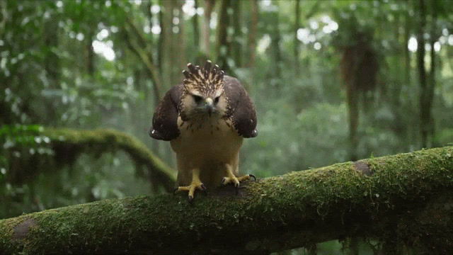</td>
<td><b>5. Perch</b><br>The bird lands on a branch, folds its wings and shuts off the motor. It has serpent-eagle markings and copies a real raptor's routine, which is to spend nearly all day perched.</td>
</tr>
<tr>
<td>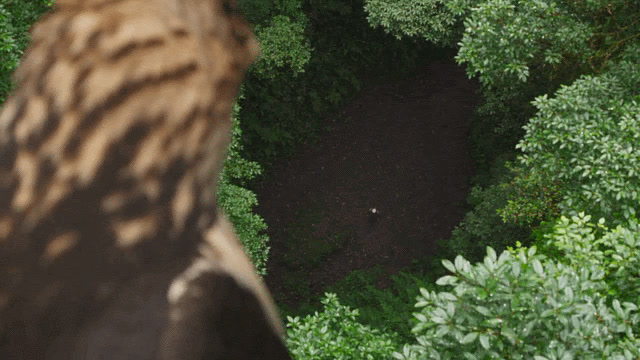</td>
<td><b>6. Listen and look</b><br>The Fennec Ear, a four-mic bar (33 mm spacing) in a 90° V, boosts the whistle band by +9 to +14 dB <i>(modelled)</i>. Thermal and visible cameras watch the ground below. A briefed tap or whistle helps, but the aviator doesn't have to make a sound to be seen.</td>
</tr>
<tr>
<td>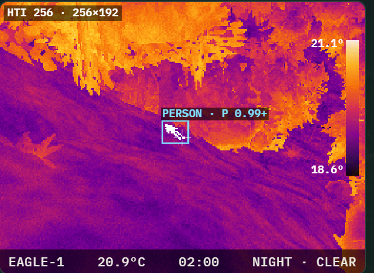</td>
<td><b>7. Decide</b><br>All on board. The bird speaks only when the gate passes: 3+ briefed-pattern events in 3 minutes, bearings within ±10°, mean confidence 0.9 or more <i>(design rule)</i>. Raw audio and thermal never leave it.</td>
</tr>
<tr>
<td>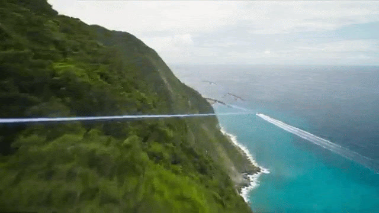</td>
<td><b>8. Whisper</b><br>The Fennec Fix packs who, where, how sure and when into 64 bits, sealed to 15 bytes (AES-128-CCM). It goes out twice after a hop of 2 km or more. The first path that closes carries it: the delivery craft, the midpoint relay, a relay eagle, a courier or Iridium SBD.</td>
</tr>
<tr>
<td>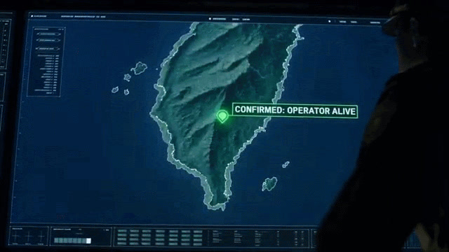</td>
<td><b>9. Command knows</b><br>A live marker appears in TAK: CONFIRMED: OPERATOR ALIVE. Command now has what it needs to decide the next step.</td>
</tr>
<tr>
<td colspan="2"><b>10. Authenticate, guide, recover</b><br>After the fix, the bird answers an ISOPREP challenge so the aviator can trust it, then guides night walks to a boat pickup or partner link-up, or helps them hold in place. Spent birds wipe their keys and dive into water or a ravine.</td>
</tr>
</table>

## What runs today

Built over the hackathon weekend. Every range, gain and link number is still a model; the ear A/B test will be the first measurement.

### Dashboard simulation

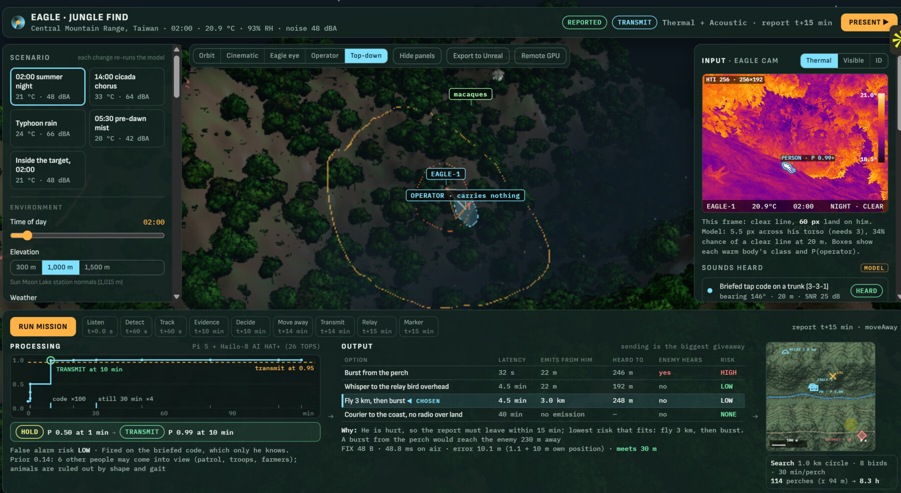

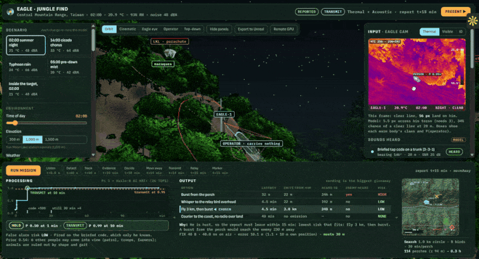

The whole mission on one screen: pick a scenario, watch the Eagle's thermal view, see the probability climb from HOLD (P 0.50) to TRANSMIT (P 0.99), and see which way home it chooses and why. All outputs are modelled. The simulator still sends the older 48-byte FIX; the 15-byte Fennec Fix is on `pi-runtime`. [Full-quality MP4, no sound](docs/images/pitch/10-dashboard-simulation.mp4)

### Bench demo and face check

<table>
<tr>
<td width="300">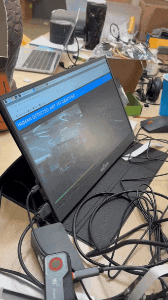</td>
<td>
<b>Real camera, real compute.</b> The Pi's screen starts at HUMAN DETECTED: NOT YET IDENTIFIED and flips to TARGET FOUND: MITCH once his face matches the enrolled profile. One person, indoors. Accuracy and range are not measured yet. <a href="docs/images/pitch/11-bench-demo.mp4">Full-quality MP4, no sound</a>
<br><br>

<br>
<sub>Local face-matching test against reference photos. The 0.61 cutoff is a setting, not a measured score. People in the background are blurred.</sub>
</td>
</tr>
</table>

### Status

| Piece | Status | Branch |
|---|---|---|
| Person detection on Raspberry Pi + Hailo, real camera | **Ran on the bench** | `sar-integration` |
| Face check and on-screen verdict | **Ran on the bench.** One person, indoors; accuracy not measured | `sar-integration` |
| HT-203U thermal camera | **Streams on the Pi.** The thermal detection in the dashboard is modelled | `sar-integration` |
| 15-byte Fennec Fix and on-board decision gate | **Code and tests.** Not yet run on the Pi | `pi-runtime` |
| Dashboard simulator and eagle drone model | **Runs in software.** Modelled | `eagle-drone-model` |
| Unified browser mission and Unreal demo | **Software models** | `main` |
| Flight, branch perch, radio range, field audio | **Not done yet** | Next |

## What's next

**Bench demo** (now) → **Field audio** → **Perch and flight** → **Recovery exercise** with a partner.

Gates: detection confidence, acoustic range, flight mass, partner validation.

We're seeking a recovery partner, field-test access and the path to a flight-weight prototype.

## Find the code

| To see | Go to |
|---|---|
| Unified browser mission and Unreal demo | This branch: [simulator/](simulator/), [unreal-sim/](unreal-sim/) |
| Dashboard simulator and eagle drone model | [`eagle-drone-model`: simulator/v2](https://github.com/CodeMetalForge-Hackathon/team-32/tree/eagle-drone-model/simulator/v2) |
| Pi edge kit: detection, face check, thermal, on-screen verdict | [`sar-integration`: pi/field](https://github.com/CodeMetalForge-Hackathon/team-32/tree/sar-integration/pi/field) |
| On-board decision gate and 15-byte Fennec Fix | [`pi-runtime`: eagle-kit/eagle](https://github.com/CodeMetalForge-Hackathon/team-32/tree/pi-runtime/eagle-kit/eagle) |
| All pitch images and silent videos | [docs/images/pitch/](docs/images/pitch/) |

---

# Eagle: finding people who carry no technology

**Code Metal hackathon · Team 32**

Eagle is a bird-inspired search-and-rescue concept for finding an isolated person under forest canopy. The missing person carries **no technology**. All sensing, processing and radio equipment is on the bird or the relay/base infrastructure.

## How it works

1. Navigate the forest and verify a reachable structural support.
2. Perch with propulsion off to observe using the bird's thermal/visible cameras and microphones. Detection requires no cooperative response.
3. Combine sensor evidence and geometry to estimate the observed person's location.
4. Send observations from bird to relay and onward to the coordinator. A failed modeled link retains the observation on the bird.
5. Depart along the checked corridor after the observation/transport stage. Distinguish human detection from individual identity verification.

The simulations currently report **identity UNVERIFIED**. Thermal imagery and natural sound alone do not establish who a person is. Visual recognition must be implemented and validated before identity claims are made. Optional voice, shouting or mouth whistles are natural sounds, not required signals. The default person is silent.

The reference scenario is Taiwan mountain forest; the same sensing questions apply to wilderness and wildfire searches. The physical prototype's body is 16.5 inches beak to tail; the separate full-size design reference uses a 1.65 m span and provisional 2.4 kg mass. These are different development stages, not measured flight performance.

## Run the browser simulator

**[Unified Eagle mission](simulator/index.html).** One aircraft, scene and mission clock connect dense Fushan forest navigation, support verification, observation/listening, modeled relay/storage and departure. Twelve viewpoints include nose, gimbal, chase, shoulders, overhead and perch approach. The former forest-lab URL redirects here. [Integration and limits](docs/unified-mission.md) · [Site analysis](docs/taiwan-forest-analysis.md).

Serve the repository with `python -m http.server 8770 --bind 127.0.0.1` and open `http://127.0.0.1:8770/simulator/` in Chrome, Edge, Safari or Firefox. Browser scripts are bundled locally; external fonts are optional. Headless sensor model:

```
node simulator/run-model.mjs
node simulator/run-model.mjs night opDist_m=80 --json
```

Original headless silent-person estimates are below. The unified mission additionally gates observations on verified support and modeled geometric line of sight; its results can therefore be **NOT FOUND** even when this statistical baseline predicts thermal evidence.

| Scenario | Evidence | Result | Identity | Marker |
|---|---|---|---|---|
| Summer night | Thermal | PARTIAL | UNVERIFIED | 32 s |
| Cicada afternoon | None | NOT FOUND | UNVERIFIED | None |
| Typhoon rain | Thermal | PARTIAL | UNVERIFIED | 32 s |
| Pre-dawn mist | Thermal | PARTIAL | UNVERIFIED | 32 s |

The delivered scenarios have 1.1 m local geometric error under default assumptions; this excludes bird navigation/map-origin uncertainty. These are model estimates, not field measurements. Thermal contrast can fail in daytime, vegetation blocks sight, and radio communication is separate from person detection.


## Unreal demonstration

The [Unreal demo](unreal-sim/README.md) searches real Taiwan terrain through canopy gaps, accumulates thermal views, perches to observe and holds a relay orbit. It requires no electronics on the missing person. Its geometry-based human observations remain identity-unverified. The fake-engine tests do not replace real editor or flight validation.

## Project map

| Path | Purpose |
|---|---|
| [simulator/](simulator/) | Browser model, visualization, runner and regression checks |
| [unreal-sim/](unreal-sim/) | Unreal Editor demo, headless mission and tests |
| [docs/simulator.md](docs/simulator.md) | Current sensing, communication and mission reference |
| [docs/unreal-sim.md](docs/unreal-sim.md) | Unreal geometry, scene and CoT reference |
| [docs/navigation-demo.md](docs/navigation-demo.md) | GPS-denied navigation and separate multicopter SITL viewer |
| [docs/forest-navigation.md](docs/forest-navigation.md) | 3D forest planning, landing/perching states and hardware integration gaps |
| [docs/unified-mission.md](docs/unified-mission.md) | Shared flight/observation/transport clock, scene and twelve viewpoints |
| [docs/coastal-relay-sizing.md](docs/coastal-relay-sizing.md) | Assumption-based inland-to-boat relay count and deployment energy |
| [docs/build-log.md](docs/build-log.md) | Change record and limitations |
| [docs/how-we-document.md](docs/how-we-document.md) | Documentation workflow |

## Checks and status

```
node simulator/test-sensors.cjs
node simulator/test-navigation.cjs
node simulator/test-forest.cjs
node simulator/test-mission.cjs
python -m pytest unreal-sim/tests
```

Browser and Unreal demonstrations are software models. Actual sensing, identity verification, communications propagation, flight power and perching require hardware/field validation. No person-worn or delivered electronic endpoint is part of the mission.

Team 32: Mitch Kirby and Alex Bartolomei, Ember Corps. [Apache-2.0](LICENSE).
