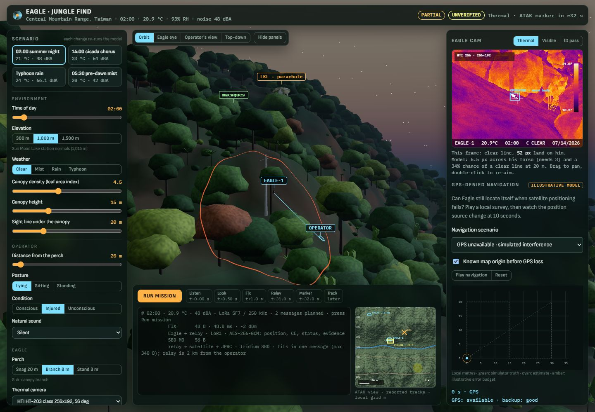

# Build log

Every build gets an entry here: what we built, why, how it works, what we decided and why, how we checked it, and what is still open. Newest first. The template is at the bottom and in [how-we-document.md](how-we-document.md).

---

## 2026-11-07 · Unreal live thermal demo v1

**Files:** [`unreal-sim/`](../unreal-sim/) · **Docs:** [unreal-sim.md](unreal-sim.md), [unreal-sim/README.md](../unreal-sim/README.md)

### What
An Unreal Engine 5 project that flies one hawk-eagle-sized Eagle over real Taiwan mountain terrain
(Google Photorealistic 3D Tiles through Cesium for Unreal). The Eagle searches three evasion-plan
cells with a white-hot thermal camera, sees a hidden person only through canopy gaps, confirms them
by circling, perches on a tree above them, drops a comms pellet, authenticates them and holds a relay
orbit. Each step appears on ATAK as a Cursor-on-Target marker. It runs from an **Eagle Sim** menu in
the editor, with an auto director that cuts between chase, thermal, perch and overview cameras.

### Why
The browser simulator answers the physics questions at one perch. Judges and partners also need to
see the wide-area search that comes first, on real terrain, with the ATAK picture a coordinator would
watch. Unreal with Cesium gives real terrain at any site in Taiwan without building a map by hand.

### How it works
- The mission is plain Python with no Unreal dependency (`eagle_sim/core`): flight, detection
  geometry, airborne optical sectioning, CoT. It talks to the scene through a ten-method engine
  interface, so the same code runs in Unreal, in the tests and headless.
- In Unreal (`eagle_sim/ue`), detection uses real line traces: trees block the Visibility channel,
  terrain blocks everything, and terrain probes pass through the trees.
- The thermal look is a post-process material on the Eagle's camera only. Warm bodies are drawn from
  the Custom Depth stencil where nothing stands in front of them.
- Everything runs in the editor world on one tick callback: no Play-In-Editor, C++ or Blueprints, and
  the whole scene (materials, level, forest) is generated by script, so the repo holds no binary assets.

Full detail: [unreal-sim.md](unreal-sim.md).

### Key results (modelled)
- **Detection range** for a person with a 640 × 512, 32° thermal core: 172 m (3 pixels across a 0.45 m torso).
- **Reference run** (seed 32): cue at 206.9 s, confirmed at 248.5 s from 8 views over 120°,
  authenticated at 266.2 s, relay orbit at 275.4 s; about 1 min 50 s on screen at the default speed.
- **Muntjac decoy** in the first cell is detected and rejected without a cue.
- **Cooperative SWIR beacon:** confirmed at 230.5 s instead of 248.5 s in this three-cell area.

### Decisions and trade-offs
| Decision | Why | Cost |
|---|---|---|
| Python in the editor, no C++ | No Visual Studio or compile step; anyone with Unreal can open it | Runs in the editor rather than as a packaged app |
| Mission logic engine-free, behind an interface | Testable in seconds without Unreal; a headless backup can drive ATAK | Two adapters to keep in step |
| Scene generated by script | No binary assets in git; change `config.py` and rebuild | First build takes 1–3 minutes |
| Google Photorealistic 3D Tiles via Cesium ion | Real terrain anywhere in Taiwan | Needs internet and a free ion account; attribution must stay on screen |
| Stylised trees for canopy | Exact, controllable occlusion that matches the tests | Looks less real than the terrain |
| Thermal view as a stencil post-process | Clear, deterministic picture of what the camera can see | Not radiometric; the browser simulator covers contrast physics |

### Verification
- 18 tests pass, including an end-to-end run of the Unreal code against a stand-in `unreal` module:
  build, terrain streaming, 1,220 tree parts, start, fly to the relay orbit, camera cuts, labels,
  pellet landing and all CoT types arriving over UDP.
- All 332 Unreal Python references checked against the UE 5.6 Python API stub; Cesium calls checked
  against the Cesium for Unreal v2 headers.
- Headless mission into the CoT listener over UDP: 53 events received.
- **Not yet run in a real Unreal Editor**; see the checklist in [unreal-sim.md](unreal-sim.md#verification).

### Open issues / next
- First run on the demo laptop: confirm the menu, build, thermal view, text orientation and ATAK markers; add screenshots.
- Record a backup video of a full run.
- Feed the browser simulator's thermal contrast model into the Unreal thermal view (time of day).
- Detection probability and false alarms instead of pure geometry.
- Route CoT through the relay and satellite path instead of straight to ATAK.

---

## 2026-11-07 · Eagle Jungle Simulator v1

**Files:** [`simulator/index.html`](../simulator/index.html), [`simulator/run-model.mjs`](../simulator/run-model.mjs) · **Docs:** [simulator.md](simulator.md)



### What
A browser-based 3D simulation of one full personnel-recovery mission: the Eagle perches with its motor off near an injured operator in Taiwan mountain jungle, detects him by sound, heat and an authenticated LoRa tag poll, computes a position fix, relays it via a relay bird and Iridium SBD to an ATAK map, and carries the coordinator's text back to the operator's e-ink tag.

### Why
The problem we are solving: locate an isolated person with no GPS, cell or comms, and deliver critical information to them when comms are down. Before building hardware we need to know which sensors actually work under canopy, at what range, at what time of day, and what each radio emission costs in exposure. The simulator answers those with physics rather than guesses, and lets us show the whole concept of operations in one screen.

### How it works
- A pure-function physics model (`EagleModel`) computes environment, acoustic, thermal, radar, RF, fix accuracy, LoRa airtime, the message list and the timeline from 24 settings.
- A three.js scene renders the terrain, jungle, actors and weather, and draws the model's ranges as overlays.
- The Eagle cam renders the scene from the drone's camera through a thermal shader at the chosen sensor's resolution, so you can see whether the body actually stands out.
- The mission player animates the timeline and prints every message with size, airtime and power.

Full detail: [simulator.md](simulator.md).

### Key results (model estimates)
- **Night, 20 m, sub-canopy perch:** found by all three sensors, identity authenticated, fix error 3.2 m, ATAK marker in 34.4 s.
- **14:00 cicada chorus:** thermal fails (sun-warmed leaves are as warm as the body: -0.7 °C apparent contrast vs a 2.3 °C threshold); the tag and the whistle still find him.
- **Fix accuracy collapses with distance from a single perch:** 3.2 m at 20 m, 42.5 m at 80 m. A second perch brings 80 m back to 6.2 m.
- **Under the canopy, sight lines limit thermal, not the sensor:** a 640×512 core reaches 23 m, the same as a 256×192 one.
- **A patrol 60 m away** puts the Eagle in EMCON hold for 139 s; the marker arrives at 173 s instead of 34 s.
- **Iridium latency is 87% of the time to marker** (30 of 34.4 s).

### Decisions and trade-offs
| Decision | Why | Cost |
|---|---|---|
| One self-contained HTML file, no build step | Anyone (judges included) can open it on any machine | Depends on CDNs for three.js and fonts on first load |
| Physics in a separate pure-function block | Testable and runnable without a browser (`run-model.mjs`); the UI can't drift from the numbers | Two code styles in one file |
| Every constant in `PARAMS` with its source, estimates labelled | Reviewers can check and challenge each number | Some inputs (biophony, whistle level) are still estimates |
| Pass/fail thresholds instead of probability curves | Simple to explain and verify for v1 | No false-alarm or detection-probability statistics yet |
| Seeded forest with a gap matching the model's 34% clear-line chance | The default scene shows the case the camera can see | The 3D scene is one realisation, not the distribution |
| Taiwan Central Mountain Range, July climate | The scenario we are designing against | Other seasons and terrain need new climate inputs |

### Verification
- Model runs headless in Node 22 via `run-model.mjs`; all four presets and the what-if cases in [simulator.md](simulator.md) were generated by it.
- Page loads in headless Chrome (SwiftShader WebGL) with zero console errors or failed requests; screenshots in `docs/images/` are from that run, including a full mission.
- Phone layout checked at 390×844.

### Open issues / next
- Add terrain masking to the RF model (currently flat ground).
- Include the Eagle's own poll in the EMCON decision (it reaches ~413 m in the default scene).
- Detection probability and false-alarm modelling (wildlife as decoys).
- Vendor three.js and fonts so the simulator runs fully offline.
- Field-validate: acoustic ranges, thermal contrast and LoRa path loss under real canopy.

---

## Template

```markdown
## YYYY-MM-DD · <what was built> <version>

**Files:** <paths> · **Docs:** <links>

### What
One paragraph: what it is and what it does.

### Why
The problem it addresses and the question it answers.

### How it works
3-6 bullets. Link to the detailed doc.

### Key results
Numbers, with units, labelled as measured or modelled.

### Decisions and trade-offs
| Decision | Why | Cost |
|---|---|---|

### Verification
How we know it works: tests, runs, screenshots, measurements.

### Open issues / next
What is still wrong or missing.
```
