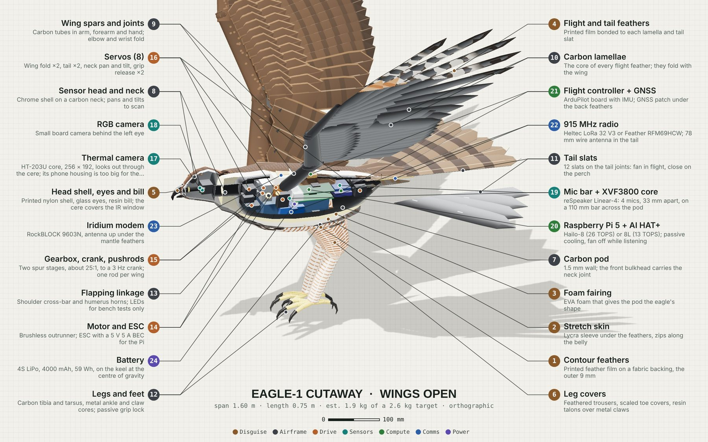
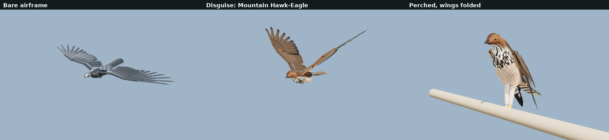
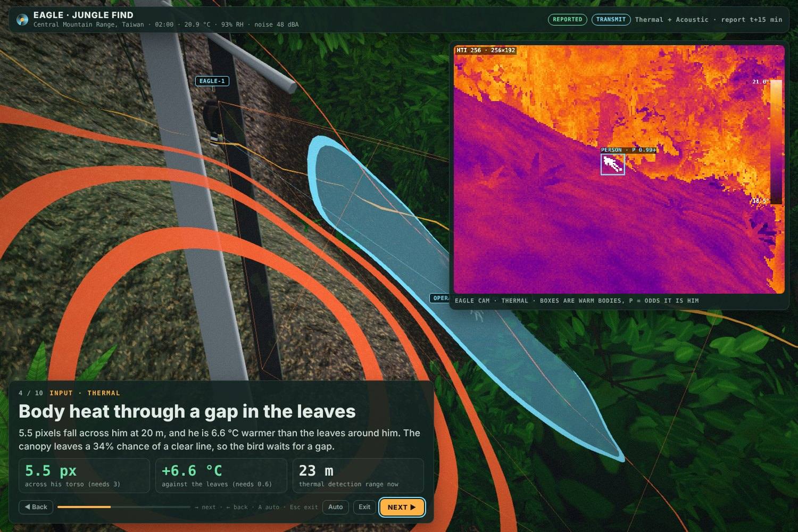
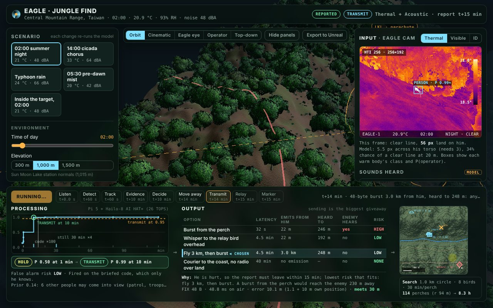

# Build log

## 2026-11-08 · One simulator: main's navigation inside the realistic-Eagle page

**Files:** [`simulator/v2/index.src.html`](../simulator/v2/index.src.html), [`simulator/v2/model.js`](../simulator/v2/model.js) (v3), [`simulator/v2/build.js`](../simulator/v2/build.js), [`simulator/forest-model.js`](../simulator/forest-model.js) (`createFromWorld`, per-world radius), [`simulator/v2/eagle_drone.js`](../simulator/v2/eagle_drone.js) (`land()` `opts.final`) · **Docs:** [simulator-v2.md](simulator-v2.md#source-of-truth-merged-simulator)

Problem: the navigation work (unified mission, PR #2 on main) and the realistic Eagle (eagle-drone-model branch, published page) had diverged, and several project decisions (silent operator, Linear-4 mics, the Pi's gate, the 15-byte Fennec Fix, two bursts, onward links, energy) lived only in docs. Merged eagle-drone-model into main's history and made `simulator/v2/` the source of truth: main's three navigation modules are inlined unchanged and plan on boxes built from the page's own trees; the Eagle flies the planned route, verifies the support, retries or aborts; the sensing model (v3) runs from the support it holds. Added main's viewpoints (chase, nose, shoulders, front, overhead, belly, support, high oblique), route / collision-box / canopy-cutaway overlays, navigation and energy cards, the gate chips and the onward-link line. Validation: main's Node tests pass; new `check_nav.js` (14 cases) and `check_mission.js` (nominal, grip failure, moving support, blocked, position loss, 9 views) pass in headless Chromium with no console errors; presenter expectations updated to model v3. Limits: boxes are conservative stand-ins (finer leaves are not collision geometry); position errors are illustrative; energy figures are placeholders.

## 2026-11-07 · Unified Eagle mission and twelve viewpoints

Connected the forest state machine to the existing Eagle observation, fix and relay/storage model through one mission clock. Reused the original Eagle/person actors and thermal/visible/ID rendering in the same dense Fushan forest, with an explicit z-up to Three.js y-up transform. Supported observation now uses actual modeled separation/height and a same-scene thermal center-ray gate. Eagle holds its perch through the observation/transport timeline, then departs. Blocked routes and pose loss cannot generate observations. Failed modeled links retain observations; coordinator markers require delivery. The default person remains silent and identity unverified.

Added twelve shared-state viewpoints, pause/step/reset/speed/export, canopy/collider inspection and a local mission map with modeled fix uncertainty. The former forest route redirects to the main mission. The independent explanatory survey and forest modal are not mounted; their motion components remain unit-testable. Locally vendored the existing r128 OrbitControls/Sky/BufferGeometryUtils so browser scripts do not depend on CDNs.

## 2026-11-08 · Simulator v2: the realistic eagle up close in Cinematic; flights clear of the hillside; published

**Files:** [`simulator/v2/index.src.html`](../simulator/v2/index.src.html) (built into `index.html`), [`simulator/v2/eagle_drone.js`](../simulator/v2/eagle_drone.js) (v1.2) · **Docs:** [simulator-v2.md](simulator-v2.md), [eagle-drone.md](eagle-drone.md#in-simulator-v2)

### What
Cinematic mode now shows the Hawk-Eagle model up close and at its real speed, and every Eagle flight in the simulator keeps clear of the hillside and the tree crowns. From 3 m beside the branch, Eagle-1 glides in over the valley towards the lens, swoops up, flares, hops round to face the operator and folds its wings; the camera orbits it at 1.75–2.5 m; it drops off the branch and flies out over the valley; then a cut finds it flying head-on at a camera just past the send point, and the intercept ring spreads as the camera rises 40 m and follows its front edge inland (for the courier it passes over a camera at the coast and is gone). Run mission and presenter card 3 use the same arrival. The published Eagle Jungle Simulator page now runs this build.

### Why
- Mitch was still seeing the old block eagle in the simulator he runs in the browser: the realistic model was in simulator v2 on the `eagle-drone-model` branch, but the published page had not been updated, and the cinematic only saw the bird from 9–60 m.
- Seen up close, two faults showed. The arrival came in from behind the perch and passed through the hillside above it: its path was laid out as if the ground were flat, but the default perch sits inside the forest on a slope of 25–35°, with crowns up to 60 m above it within 60 m uphill. And the old fly-away crossed the 472 m to the send point in under 11 s (over 40 m/s).

### How it works
- **Open side.** `openDir()` samples the crowns (`canopyTopAt`) and the ground around the branch, 48 directions from 4 to 52 m, and picks the direction whose crowns stay lowest under a 1-in-4 glide slope. Arrivals glide in from 70 m out and about 22 m up on that side, at least 3 m over the crowns (`overCrowns()` points), then `land()` swoops up onto the branch.
- **Hop-turn.** A bird lands facing the way it flew in, so `land(..., { faceAfter })` turns it on the branch afterwards: wings half open, a 4.5 cm hop, about 0.85 s. The simulator keeps `flight.hold` until `eagleD.settling` clears, so the Eagle cam's aim does not snap the bird round.
- **Take-off.** A drop on the open side to pick up speed, a climb-out, then on to the destination at least 9 m over the crowns, climbing early before a rise and sinking slowly after it.
- **Camera.** Tracking shots aim at the bird each frame, eased (time constant about 0.18 s). Shots can set the lens from the bird's distance: it narrows to 8° while the bird is far off, so the bird stays about a fifth of the frame. A follow shot behind the bird was tried and dropped: over this terrain it showed a small bird against a busy slope. A first arrival camera beside the perch looked through the white snag's trunk; the camera now sits on the side of the branch away from both trunks.
- **Nothing sped up.** 12 m/s in level flight. The burst is a cut, which stands in for the rest of the flight: the bird is placed 60 m short of the send point and flies it, and the ring fires when it gets there (checked each frame in `stepCine`, so it cannot fire after the cinematic stops). In the cinematic the ring spreads over 3.2 s instead of 1.4 s, and the crane aims at the ring as drawn (it runs slower on a slow frame rate); the crane stays low and looks inland, so the frame never shows past the edge of the map.
- **One clock.** The shots and the bird advance by the same frame time (up to 1 s a frame; the bird in 0.1 s steps). Before, the shots ran on `performance.now()` and the bird at most 0.25 s a frame; in Chrome on a laptop, with the window in the background, the shots ran about 2.5 s ahead and cut away before the landing.

### Key results
- Seven shots (six without an enemy), 51.2 s (44.2 s): dawn crane, arrival, perch orbit, thermal, the target, the release, the burst (or the coast).
- Arrival path in the default scenario: at least 2.6 m over the crowns until it reaches the perch tree (the old path passed about 2 m below the hillside surface on its way in).

### Verification
- Cinematic in headless Chromium under a fixed-step clock, jumping straight to each shot: frames of the arrival, landing and hop-turn, perch orbit, take-off and burst checked by eye, with the bird's and camera's heights logged against the crowns and the ground; no console errors.
- `tests/test_present.js` and `tests/test_remote.js` pass.
- Published page opened in Chrome on a laptop GPU: the glide-in against the sky and the landing play as in the headless frames.

### Open issues / next
- Watch the whole cinematic at full frame rate on the demo laptop; tune the tracking offsets if the bird turns tighter than modelled.
- The send point `W.away` is clamped to the corner of the 800 m map; the model puts it 3.0 km out.

---

## 2026-11-08 · Eagle: airframe refitted inside the disguise; cutaway with every part

**Files:** [`simulator/v2/eagle_drone.js`](../simulator/v2/eagle_drone.js), [`simulator/v2/cutaway.js`](../simulator/v2/cutaway.js) (new), [`simulator/v2/eagle_viewer.src.html`](../simulator/v2/eagle_viewer.src.html), [`simulator/v2/build.js`](../simulator/v2/build.js), [`simulator/v2/assets/`](../simulator/v2/assets/) (re-exported) · **Docs:** [eagle-drone.md](eagle-drone.md#fit-the-airframe-inside-the-disguise)

### What
The airframe now fits inside the eagle disguise in every pose, and the viewer has a cutaway: a still, to-scale section through the bird with 24 numbered parts (disguise layers, airframe, drive, sensors, compute, radios, power) and a parts list with sizes and estimated masses. It opens in its own window from **Cutaway view ↗**.

### Why
Mitch's x-ray screenshot showed the airframe poking out of the eagle: the chrome nose above the head, the diamond tail out to the sides, the wing panels past the feathers. A disguise only works if the drone fits inside it, and the team needs to see what goes where and whether the real parts fit.

### How it works
- One envelope for everything: the eagle's body and head rings are shared constants. The pod is the body less the disguise stack (feathers 9 mm, skin 1 mm, foam 5 mm); the sensor head is the head less 5 mm; each lamella and tail slat is its feather's core (14 mm shorter, vanes 85 % as wide).
- Nose cone → chrome sensor head on the neck (it turns with the head); fixed diamond tail → 12 tail slats on the tail joints (they close with the feathers). The disguise gained a feathered ankle that covers the leg joint when the legs tuck.
- 20 internal parts are rigid meshes on the bones at real or placeholder sizes; the pushrods re-aim at the humerus horns every pose. Skin and foam are extra lofts from the same envelope.
- The cutaway renders once with clipping planes in the body frame: the near side is cut back in steps so each layer shows. An ID render (surface and body region per pixel) moves each numbered dot onto the part it names, or drops it if that part is hidden from that side. Labels sit in two columns; leader crossings are reduced by swapping label slots. The 3D context is released after the still.

### Key results
- Airframe outside the disguise, worst over 8 views and 9 poses (measured, silhouette test): tail 92 → ≤ 2 mm, head 54 → 0 mm, wings 37 → ≤ 2.5 mm, legs 4.3 → ≤ 1 mm; 2 mm is one pixel. One 3.5 mm sliver remains mid-fold.
- All 20 parts (23 with mirrored pairs) fit their spaces with no overlaps; tightest 0.8 mm (grip servos).
- Estimated mass 1.90 kg against the 2.6 kg target.
- Findings: the HT-203U phone housing (68.6 × 45.7 × 12.7 mm, listing) does not fit the head, so the core comes out; a Pi Camera 3 board is too big for behind an eye; the 110 mm mic bar fits only across the pod's widest point; the Iridium patch has to sit outside the carbon, partly under the folded wings when perched.

### Decisions and trade-offs
| Decision | Why | Cost |
|---|---|---|
| Change the reference airframe's nose and tail | Neither can fit inside a perched eagle | The bare airframe looks less like the render |
| Lamellae as feather cores, not wider panels | The feather film wraps them, so they never show | Less carbon area per wing than the render suggests |
| Mic bar across the pod, ports through the wall | The only place a 110 mm bar fits | Needs acoustic windows; motor noise is close |
| Masses as estimates, labelled per row | Most parts are not chosen yet | The total is a budget, not a weight |

### Verification
- Silhouette fit test (headless, `render/fit.js`, not in the repo): numbers above, both skins.
- Parts fit test (`render/partfit.js`, not in the repo): every part inside its space, no overlaps.
- Cutaway in headless Chromium at desktop width and phone width, light and dark: both poses render (10 s and 22 s on SwiftShader), 24 parts labelled, no console errors, no sideways page scroll.
- Viewer: the context-loss tests and the desktop/phone layout check still pass. `.glb` files re-exported; Khronos validator 0 errors. `tests/test_present.js` passes.

### Open issues / next
- Choose the real motor, gearbox, servos, battery and flight controller, then replace the placeholders.
- Measure the HT-203U core out of its housing; pick the RGB camera module.
- Acoustic windows for the mic bar; whether the folded wings block the Iridium patch.

---

## 2026-11-08 · Eagle viewer: bring the 3D view back when the browser drops it

**Files:** [`simulator/v2/eagle_viewer.src.html`](../simulator/v2/eagle_viewer.src.html) (built into `eagle_viewer.html`), [`simulator/v2/build.js`](../simulator/v2/build.js) · **Docs:** [eagle-drone.md](eagle-drone.md#viewer)

### What
The viewer now recovers when the browser takes away its WebGL context: it rebuilds the 3D view on its own, and if the browser keeps refusing it shows still renders of the model with a **Restart 3D view** button. It also uses less graphics memory.

### Why
On a team laptop the viewer's 3D stage turned white with a small broken-image icon in the corner while the readout kept updating. That is what a page looks like after the browser drops its WebGL context to free graphics memory (several 3D tabs open, the simulator in another tab, a laptop GPU). The page never asked for the view back, so it stayed blank until reloaded.

### How it works
- The renderer is built by a function. On a lost context the stage shows a short notice; if the browser restores the context, the page rebuilds the reflection map and shadow map and carries on.
- If the browser has not restored it after 2.5 s, the page builds a new renderer and canvas, keeping the camera angle and the bird's place in the loop.
- After three tries it stops and shows the still renders (`docs/images/eagle-drone-model.jpg`, embedded at build time) and **Restart 3D view**; 20 s of good frames resets the count.
- Less graphics memory: pixel density capped at 1.5× (was 2×), shadow map 1024 px (was 2048), default GPU choice instead of asking for the discrete GPU, no drawing while the stage is scrolled out of view.

### Key results
- Measured in headless Chromium (SwiftShader): after a context the browser never restores, the view was back when checked 6 s later (rebuild set at 2.5 s); after a restored one, back when checked 2.5 s later.
- Estimated graphics memory on a 1280×720 stage: about 220 MB at 2× (drawing buffer about 150 MB of it), about 110 MB now (drawing buffer about 85 MB at 1.5×, shadow map 8 MB instead of 33 MB).

### Decisions and trade-offs
| Decision | Why | Cost |
|---|---|---|
| Rebuild after 2.5 s instead of waiting for the browser | Browsers never hand back a context dropped for "too many contexts" | A rebuild can push another 3D tab over the browser's limit |
| Stop after three tries and show a button | A browser that keeps refusing is not asked forever | One click to restart |
| Pixel density 1.5× | The drawing buffer is most of the page's graphics memory (estimate above) | Slightly softer edges on high-density screens |

### Verification
- `recover.js` (headless Chromium, not in the repo): context lost then restored → same canvas, live, notice gone; context lost and never restored → new canvas after 2.5 s, live; lost four times in a row → final notice and Restart button, Restart brings it back; no WebGL at all → still renders and Restart, no uncaught errors. All pass, no page errors.
- Viewer at desktop and phone width, light and dark: no console errors, no horizontal scroll.

### Open issues / next
- Simulator v2 has the same weakness (no recovery from a lost context); the same change would carry over.

---

## 2026-11-08 · The Eagle as a 3D model: hawk-eagle size, folding wings, flight and perching

**Files:** [`simulator/v2/eagle_drone.js`](../simulator/v2/eagle_drone.js), [`simulator/v2/index.src.html`](../simulator/v2/index.src.html) (built into `index.html`), [`simulator/v2/eagle_viewer.src.html`](../simulator/v2/eagle_viewer.src.html) (built into `eagle_viewer.html`), [`simulator/v2/assets/`](../simulator/v2/assets/), [`simulator/v2/tools/export_glb.js`](../simulator/v2/tools/export_glb.js) · **Docs:** [eagle-drone.md](eagle-drone.md)

### What
A 3D model of the Eagle: a flapping-wing drone built to a Mountain Hawk-Eagle's size, with the bare airframe from the team's [reference render](images/eagle-drone-reference.jpg) underneath and a full bird disguise on top (Mountain Hawk-Eagle by default, Crested Serpent Eagle as an option). It flaps, glides, soars, lands on a perch with a flare, folds its wings along its back like a perched eagle, scans with its head and takes off again. It replaces the primitive birds in simulator v2, runs in a standalone viewer, and exports as glTF with eight animation clips for Unreal or Blender.

### Why
The demo needs to show what the Eagle is: an eagle-sized drone that perches in the canopy and passes as a bird. The old perched and flying models were separate shapes with no wings that moved. The disguise only works if size, wingbeat, perching posture and wing fold match the real bird, so those are set from published measurements.

### How it works
- One skeleton (95 bones) with shoulder, elbow and wrist joints; every flight feather is a bone that rotates with the fold, so the wing spreads for flight and stacks for perching. Fold: shoulder sweeps 86° and rolls 54°, elbow closes to 168°, wrist to 166°.
- Three skins on that skeleton, painted at load into one texture: hawk-eagle, serpent eagle, bare airframe (carbon lamellae on the same joints). X-ray shows the airframe through the disguise.
- Procedural animation from a small set of pose numbers: stroke at 3.0 Hz with upstroke wrist flex and primary slots; take-off (crouch, spring, unfold, hard strokes); landing (swoop below the perch and up, flare, feet forward, two balancing beats, fold); head scanning on the perch.
- Simulator v2: one bird perches and flies; **Run mission**, presenter card 3 and the cinematic open with the arrival and landing; take-offs climb forward off the perch; the relay banks and flaps in its orbit; a disguise selector; Eagle cam at the bird's eye; the thermal and ID passes pose the skinned bird.
- `tools/export_glb.js` runs the same code in headless Chromium and writes one `.glb` per skin.

Full detail: [eagle-drone.md](eagle-drone.md).

### Key results
- Measured on the model: span 1.60 m, length 0.75 m, folded wing 0.51 m, tail 0.34 m, tarsus 0.115 m, all inside the published Mountain Hawk-Eagle ranges (1.34–1.75, 0.69–0.84, 0.49–0.52, 0.34–0.36, 0.113–0.118 m).
- Wingbeat 3.0 Hz, modelled from golden eagles' measured 2.2–2.8 Hz scaled to a lighter bird. Eyes sit 0.40 m above the branch when perched, body centre 0.258 m.
- One skinned mesh per bird, 10.7k–12.6k triangles, one draw call per material (two or three); animation update 0.07 ms a frame per bird (measured, headless CPU).
- `.glb` files 2.4–2.8 MB each; Khronos glTF validator: 0 errors. Reloaded with three.js's GLTFLoader, all eight clips play with correct poses.

### Decisions and trade-offs
| Decision | Why | Cost |
|---|---|---|
| Mountain Hawk-Eagle size and plumage by default, serpent eagle kept as a skin | The size the team asked for; the old livery stays one click away | Hawk-eagles are less common than serpent eagles, so the better cover may be the serpent eagle; that is a mission call |
| Every feather a bone, rotating with the fold | A real fan fold that reads as a bird from any angle, and the same mechanism on the airframe | 95 bones per bird |
| Procedural animation, not keyframes | Flights follow any path the simulator gives and react to turns and climbs | Looks only: no lift or stall model |
| Textures painted in code at load | No image files to ship; skins stay editable as code | 30–120 ms per skin at load (measured, headless) |
| One bird for perched and flying | The arrival, perch and take-off are continuous | Simulator code that hid one model and showed the other had to change |
| Bird animated on wall-clock frame time | Flights keep pace with the mission on slow GPUs | Choppy flapping below 4 frames a second |

### Verification
- Render sheets of every pose and skin from a headless harness (perched, spread, mid-fold, upstroke, downstroke, flare, landing filmstrip, take-off); fixed what they showed (a flat tail seen edge-on, primaries drooping below the tail, inside-out eyes and tubes, legs tucked through the back).
- Simulator v2 in headless Chromium: loads and runs with no console errors; the mission goes from arrival to perched and folded, to take-off and fly-away; `tests/test_present.js` passes (10 steps, 12 numbers checked against the model).
- Viewer at desktop and phone width, light and dark: no console errors, no horizontal scroll; measured span 1.60 m.
- `.glb` files: Khronos glTF validator 0 errors; round-trip load and playback of every clip.

### Open issues / next
- Watch the arrival and landing on the team's laptops at full frame rate (headless ran at about 1 frame a second).
- Import the `.glb` into Unreal 5.8 and swap it into the scene importer and the live thermal demo.
- The airframe's lamella wing, linkage and legs are placeholders for the real mechanism.
- Disguise choice: hawk-eagle (the size we built to) or serpent eagle (the more common bird) for the mission.

---

## 2026-11-07 · Eagle Jungle Simulator v2: presenter, adaptive quality, remote GPU

**Files:** [`simulator/v2/index.src.html`](../simulator/v2/index.src.html) (built into `index.html`), [`simulator/v2/serve.mjs`](../simulator/v2/serve.mjs), [`simulator/v2/tests/`](../simulator/v2/tests/) · **Docs:** [simulator-v2.md](simulator-v2.md#presenter-mode), [demo-runbook.md](demo-runbook.md)

### What
Three additions to simulator v2 for live demos. **Presenter mode** (**Present ▶** or **P**) hides the panels and walks through the story in ten cards, with camera moves, effects and a large visual where it helps; every number on the cards comes from the model at that moment. **Auto quality** starts from the GPU the browser reports and keeps the frame rate up by trading effects and render resolution. **Remote GPU** lets a computer with a strong graphics card draw the scene and stream it to a laptop on the same network, with the laptop still in control.

### Why
The v2 jungle lagged badly on the team's laptop, and judges need a guided story rather than a screen of panels. The model is unchanged.

### How it works
- Presenter: ten scripted steps of camera shots, effects and cards. The card text and numbers are functions of the current settings and model result, so changing a setting changes the story. Presentation clickers work (Page Up and Page Down).
- Auto quality: three levels set shadow-map size and refresh rate, vegetation density, post effects and how often the Eagle cam is drawn. Every 1.5 s it measures the frame rate; below 40 fps it drops ambient occlusion and bloom, then lowers the render resolution down to half, then the level; above 55 fps it raises the resolution again.
- Shadows and the Eagle cam are redrawn only as often as they need to be, and only when the Eagle cam is on screen.
- Remote GPU: two WebRTC video tracks (scene and Eagle cam) come from the GPU computer; the laptop sends its camera pose about 60 times a second and every setting change back, and draws only the panels and labels. `serve.mjs` serves the page and passes the connection offer and answer over Server-Sent Events, with no packages. Inside claude.ai, whose sandbox blocks the video connection, the Remote GPU panel says so and points to `serve.mjs`.

Full detail: [simulator-v2.md](simulator-v2.md) (Presenter mode, Remote GPU, Performance and quality, Automation hooks). Live demo run sheet: [demo-runbook.md](demo-runbook.md).

### Key results
- The model and its numbers are unchanged; the presenter shows them as computed (night: a burst from the perch heard 246 m away, 5.5 px and +6.6 °C on thermal, P 0.14 → 0.99 in 10 min, 10 m fix; 14:00: 108 h to search the circle). Modelled.
- Remote GPU in a headless test on one machine: the host's camera followed the viewer's to within 1 cm. Frame rates on the team's laptops are not measured yet.

### Decisions and trade-offs
| Decision | Why | Cost |
|---|---|---|
| Presenter numbers computed live, not scripted | The story cannot drift from the model | The card text has to read well for any scenario |
| Auto quality: effects first, then resolution, then level | Smooth on integrated graphics without anyone touching a setting | A softer image on weak laptops |
| Remote GPU over WebRTC, with a small LAN server for signalling | No install beyond Node; the video goes straight between the two browsers | Needs one network (no TURN relay yet); does not run inside claude.ai |
| The laptop keeps the camera and draws its own labels | Dragging feels local; labels stay sharp | Labels are delayed to match the video, by about half a round trip plus 90 ms |

### Verification
- `simulator/v2/tests/test_present.js` (headless Chromium, software WebGL): no console errors; all 10 presenter steps; 12 card numbers checked against the model; leaving restores the settings. Passed.
- `simulator/v2/tests/test_remote.js lan` and `room`: 12 checks each, all passed, including the viewer stopping its own rendering, the host following the viewer's camera to within 1 cm, mirrored presets, sliders and missions, and the viewer drawing locally again when the host stops.
- `index.html` rebuilt from the new `index.src.html` and the unchanged `model.js` exactly as `build.js` does.

### Open issues / next
- Measure frame rates on the demo laptop (with Chrome set to its discrete GPU) and on the desktop.
- Remote GPU across two different networks needs a TURN relay; until then use one network (a phone hotspot works), or Chrome Remote Desktop.
- Vendor three.js and the fonts so the simulator runs fully offline.

---

## 2026-11-07 · Eagle Jungle Simulator v2: the person carries nothing

**Files:** [`simulator/v2/`](../simulator/v2/) · **Docs:** [simulator-v2.md](simulator-v2.md), [simulator/v2/unreal/README.md](../simulator/v2/unreal/README.md)

### What
A second version of the simulator in which the isolated person carries nothing that transmits. The Eagle finds him with its thermal camera (primary) and microphone array (secondary). An onboard evidence gate decides when it is sure it has found him, and the model picks the safest of four ways to get one 48-byte report out: a burst from the perch, a whisper to the relay overhead, flying 3 km before transmitting, or carrying the fix out. The page shows this as input, processing and output panels over a 3D jungle with a ridge outpost, patrols, local farmers and wildlife, plays a mission for each way out, and exports the scene for Unreal Engine.

### Why
Version 1 assumes a tag. In the case we design for, the person may carry nothing that works, and every transmission near him is a risk. The mentors' recurring question was what evidence justifies claiming he has been found before anything is sent. Version 2 makes that claim explicit, as a probability that must reach 0.95, and makes the risk of every emission visible.

### How it works
- `model.js` is one pure function with no dependencies: heat contrast and canopy line of sight; sound levels and foliage loss against ambient noise; a Bayesian evidence gate (prior odds × one likelihood ratio per clue); four ways out, scored on latency, where the emission happens and how far away it can be heard; position error; search time.
- Radio loss: plane-earth plus Weissberger through the trees; ITU-R P.833-10 with one end above the canopy.
- `index.src.html` is the page; `build.js` inlines the model, so the numbers on screen are the model's.
- **Export to Unreal** writes the scene as JSON; `unreal/ue_import_scene.py` places it in an Unreal Engine 5 level.

Full detail: [simulator-v2.md](simulator-v2.md).

### Key results (modelled)
- **02:00 night, injured, taps the briefed code:** TRANSMIT at 10 min (P 0.99), flies 3 km and bursts, ATAK marker at 14.5 min, fix error 10.1 m.
- **A burst from the perch would be heard 246 m away**, past the patrol 230 m from the perch.
- **Silent, only coughs:** 80 min to decide. **Unconscious:** the gate holds at P 0.92 and sends nothing, unless a radar pellet confirms breathing (120 min).
- **14:00 cicada chorus:** heat fails (-0.7 °C contrast against a 2.3 °C threshold), the tap code is heard to 26 m instead of 94 m, and the search needs 13 times as many perch stops.
- **Error budget:** 10 of the 10.1 m is the Eagle's own position without GPS; with a magnetometer alone it is 30.1 m, missing the 30 m target.

### Decisions and trade-offs
| Decision | Why | Cost |
|---|---|---|
| No tag: heat and sound only | The realistic worst case; nothing on him can give him away | Slower, less certain decisions; an unconscious, silent person may never be reported |
| A probability gate (P ≥ 0.95) before any emission | Answers "how do you know it's him?" with a number and its evidence | The likelihood ratios are assumptions until tuned on recorded data |
| Never transmit from the perch by default | The burst is heard beyond the nearest patrol | 4.5 min more to the marker |
| Briefed tap code every 30 min after dark | A cheap signal that carries no radio and counts ×100 as evidence | He must be conscious and briefed |
| Model inlined into the page by a build step | The page cannot drift from the model; `model.js` still runs in Node | `index.html` must be rebuilt after edits |
| Separate v2 folder; v1 kept | v1 (with a tag) stays documented and runnable | Two simulators to maintain |

### Verification
- `node simulator/v2/model_table.js` runs all 5 presets and 7 what-if cases; the numbers above come from it.
- In-forest radio loss is within 2 dB of a LoRa range measurement in Brazilian rainforest.
- Page loaded in headless Chromium with software WebGL: no console errors except the Google Fonts request the test sandbox blocks, no horizontal scroll at 1280 px or 390 px; presets, all four missions, the cinematic and the export exercised.
- The page's real export (`unreal/sample_scene.json`, 25 actors) passes `python unreal/test_ue_import.py`.

### Open issues / next
- Tune the likelihood ratios and sound levels on recorded data (tap code under canopy, cicada chorus, rain).
- Detection probability and false-alarm rates instead of pass/fail ranges.
- Frame rate on a real GPU; Safari and iOS.
- Run the scene import inside the Unreal Editor.
- Feed v2's thermal contrast into the Unreal live thermal demo.

---

## 2026-11-07 · Unreal live thermal demo v1

Validation: forest-component and original sensor/navigation regressions; new mission tests for support/evidence/delivery gates, recovery, aborts, long courier holds and export; unified browser checks for shared pose/clock, twelve viewpoints, thermal rendering, redirects and mobile widths. Updated screenshots in unified-mission.md. Live VIO/depth/contact/radio, the separate ArduPilot SITL controller and Unreal runtime integration remain outside this browser change.

## 2026-11-07 · Dense understory and overlapping canopy

Expanded Fushan crown envelopes and layered meshes from isolated crowns into overlapping cover. A 1 m sample grid reports about 78% modeled crown-footprint coverage; the interface explicitly distinguishes this from measured canopy closure. Added 911 retained low-cover, fern and sapling placements, removing the broad ground-level vegetation exclusions while retaining immediate launch/landing/contact footprints. Taller represented understory affects collision checks. One hundred context trees and extended rendered ground outside the active flight bounds remove the bare diorama edge. Added denser litter and wider, more detailed fern fronds, with instanced leafy shrubs.

Enlarged crowns blocked the old ridge terminal descent; lowered the approach to enter beneath them instead of removing geometry. All 18 baseline/valley/ridge scenarios passed their termination, clearance, support and recovery checks. Density checks require over 850 understory placements and projected crown coverage between 70% and 90%. Camera, display layers and mobile/browser checks are in check-forest.cjs. Updated screenshots document the result. All density/coverage settings remain procedural, not a surveyed Fushan reconstruction.

## 2026-11-07 · Fushan evidence and ecological reconstruction

Replaced the default generic block display with a Fushan-informed perspective forest. Added primary-source context from TFRI and published canopy, understory-light and typhoon studies. The site analysis explicitly separates historical measurements, engineering inferences and invented local geometry; actual tree census and topographic stake data have not been obtained. A coarse DEM spot check was not adopted because registration to the surveyed plot was unresolved.

Added deterministic valley and shorter-ridge scenes with sloping ground, broadleaf crowns, branches, understory ferns and fallen wood; the original blocks remain selectable. The planner now handles per-world bounds, terrain clearance and reachable grid attachment. A local Three.js renderer adds shaded world geometry, drone POV, canopy cutaway, collision-envelope inspection and visual mist. No measured sensor degradation or wet-grip physics is implied. Standalone rendering uses a pinned local Three.js r128/MIT bundle; parent simulator retains its existing version.

Verification is recorded in test-forest.cjs and check-forest.cjs: baseline plus both Fushan presets, terrain/obstacle clearance, support-gated motor shutdown, failure/reselection, perspective rendering, camera controls, scene switching, layers and responsive widths. Updated screenshots show the forest, cutaway and drone viewpoint. This is an ecological reconstruction with synthetic pose/contact and a complete map, not a surveyed digital twin or hardware-validated navigation system.

## 2026-11-07 · Orbitable forest camera

Replaced the forest lab's fixed oblique projection with an interactive orthographic 3D camera. Mouse/touch orbit, wheel/pinch zoom, right/shift-drag and two-finger pan, top/side/overview presets, reset and drone-follow controls allow inspection of the same mission from different viewpoints. All obstacle faces use camera-depth sorting; the drone's arms and rotor rings now project from world geometry. Transparent obstacles and always-visible route overlays retain explanatory visibility. Camera input is independent of mission state and works while paused or playing.

Validation: browser tests passed for changed image pixels after orbit, no time advance while dragging, zoom, pan, camera presets, follow selection, keyboard navigation and actual Chromium touch pinch/pan. Existing six forest scenarios and main-simulator/mobile integration checks passed without JavaScript errors. Refreshed desktop/mobile screenshots. Planning, synthetic contact assumptions and the separate SITL boundary are unchanged. See forest-navigation.md for interaction details and rendering limitations.

## 2026-11-07 · Forest navigation, landing and perching lab

Extended the existing navigation area with a focused forest lab and standalone entry page. Six-connected 3D A* plus exact inflated-box segment tests compute clearance-checked routes. A kinematic state machine separates inspection, approach, contact, support verification, perch/ground landing, release and departure. Six selectable scenarios cover nominal branch, moving-branch rejection, grip-failure retreat/reselection, clearing landing, blocked canopy and pose/depth loss. Readiness notes distinguish code running here, the separate ArduPilot service and candidate open-source/hardware integrations.

Validation: all six forest model scenarios passed, including continuous trajectory clearance and support-gated motor shutdown. Browser playback, stepping, reset, main-simulator insertion and mobile overflow checks passed with no JavaScript errors. Desktop/mobile screenshots saved as forest-navigation.png and forest-navigation-mobile.png. Existing navigation and sensing regression checks passed. Exact slab intersection replaced sampled segment checks after the clearing test exposed a corner-clearance miss. See forest-navigation.md for constants and modeled timings.

Limits: complete synthetic map and exact pose; no real perception, moving-branch physics, aerodynamic/contact dynamics, EGO-Swarm runtime or forest-to-autopilot bridge. No actual aircraft or SITL validation is claimed for this extension. No third-party implementation was copied or installed.

## 2026-11-07 · No equipment on the missing person

The missing person carries no technology. Both demos now use observations originating on the bird. The browser defaults to a silent person; its radio is bird-to-relay transport, never person-detection evidence. Unreal searches, confirms human-shaped thermal observations, perches to observe and holds a relay orbit. Identity stays unverified; neither demo automatically classifies a person as friendly.

Removed person-side electronic protocols, cooperative electronic cues, delivery-device sequences, controls, visuals and obsolete documentation/results. Optional radar is mounted on the bird and gated by slant range. A failed browser relay stores the observation without claiming delivery. Updated runners, scene adapters, menus, tests and screenshots.

Validation: browser sensor regression and navigation regression passed; 18 Unreal/core tests passed; browser playback and mobile layout passed; all six tracked screenshots refreshed. Checks cover silent/unconscious people, no automatic identity, failed relay delivery and blocked sight lines. Real Unreal Editor rendering and field performance remain separate acceptance work.

Current modeled outputs: silent-person night/rain/mist have thermal-only PARTIAL evidence, identity UNVERIFIED, local geometric CE 1.1 m and a 32 s marker using the default modeled link. Afternoon contrast fails and the silent person is NOT FOUND. These supersede prior scenario results.

Added coastal-relay-sizing.md as a separate assumption study: a 60 km example requires 3–5 intermediate repeaters only if tested usable hops are 10–15 km. Neither terrain feasibility nor these radio ranges is established. Deployment energy and replacement inventory are separate constraints; the existing simulator remains a single-hop model.

## 2026-11-07 · GPS-denied navigation demonstration

Added a deterministic navigation panel and separate ArduPilot SITL viewer. Scenarios cover baseline, unavailable GPS, degraded canopy, position inconsistency and backup loss. Synthetic visual/inertial fallback is illustrative; SITL external position uses simulator truth. See navigation-demo.md.

## 2026-11-07 · Thermal camera probe v1

**Files:** [`thermal-probe/`](../thermal-probe/) · **Docs:** [thermal-probe.md](thermal-probe.md)

### What
A command-line tool that finds a working mode for a USB thermal camera, shows a live false-colour view with hot-spot boxes, and streams it as H.264 to other screens.

### Why
Our HTI thermal imager shows up as a USB camera, but OpenCV could not open it with default settings, which blocked every thermal demo. Low-cost thermal cores often need one particular backend, size or pixel format, and some stack the picture and the raw data in one frame.

### How it works
- Tries every camera × backend (DirectShow, Media Foundation, V4L2) × size × format (YUY2, Y16, colour conversion on and off) and ranks the modes that work, preferring ones that carry raw 16-bit data.
- Decodes double-height frames (picture above 16-bit raw data).
- Falls back to ffmpeg when OpenCV cannot open the camera; streams H.264 to MediaMTX for WebRTC or VLC.
- Prints a config block for the Eagle kit's thermal input.

### Key results
- With a simulated camera: the split-frame mode is found and decoded, hot spots are boxed, and the H.264 output runs at 768 × 576. No measurements with the real camera yet.

### Decisions and trade-offs
| Decision | Why | Cost |
|---|---|---|
| Scan every combination instead of writing a driver per camera | Works with an unknown camera at the venue table | Slower than opening a known mode (`--quick` tries the likely ones) |
| OpenCV first, ffmpeg as the fallback | OpenCV gives raw frames on most cameras; ffmpeg opens the rest | Two code paths |
| MediaMTX for streaming | One small server gives both WebRTC and RTSP | One more program to run |

### Verification
- `python thermal-probe/test_probe.py`: a simulated camera plus real ffmpeg; covers decoding, mode selection, hot spots, the ffmpeg reader and the H.264 output.

### Open issues / next
- Run it on Windows with the HTI imager and record the working mode.
- Calibrate raw values to °C for that camera.

---

## 2026-11-07 · Eagle starter kit v2: find loop, encrypted link and signs of life

**Files:** [`eagle-kit/`](../eagle-kit/) · **Docs:** [eagle-kit.md](eagle-kit.md), [eagle-kit/README.md](../eagle-kit/README.md)

### What
The software for a real perch and base station. Version 1: the perch hears a briefed whistle or tap code, measures its direction with a microphone array, turns bearing and perch height into a position, can poll the person's tag, and sends one 48-byte FIX, encrypted with AES-256-GCM, by LoRa to the Nest, which puts a Cursor-on-Target marker on ATAK. Version 2 adds signs of life: a status for each of up to ten people (RESPONSIVE, BREATHING, MOVING, WARM_ONLY, RF_ONLY, UNKNOWN) from thermal, sound, radar, Bluetooth and vision, sent home in LIFE frames of 128 bytes or less.

### Why
To turn the concept into something we can bench-test at the venue with off-the-shelf parts (Raspberry Pi, USB microphone arrays, Heltec LoRa boards, thermal and radar modules), and to show that a find can travel as one short, encrypted, low-power burst.

### How it works
- Direction by GCC-PHAT; range = perch height / tan(depression); two perches can cross their bearings.
- Messages are defined once, in `eagle/protocol.py`: CHALLENGE 20 B and REPLY 21 B (HMAC), FIX 48 B and LIFE up to 128 B (AES-256-GCM), BEACON 15 B. The firmware headers mirror them, and the tests fail on drift.
- Power control by reciprocity: each burst goes out at the lowest power that reaches the receiver.
- A duress bit only the Nest can read; replay windows on every receiver.
- Signs of life fuse thermal blobs, sound bearings, radar vitals, Bluetooth (allowlist only: bystanders are counted, never logged) and person detections into one list.

### Key results (modelled)
- Find loop in simulation: position error 0.94 m from one perch 8 m up (1.15 m crossed with a second perch); one FIX at +7 dBm, 48.8 ms on air; a receiver 1.6 km away does not see it.
- Signs of life: 4 of 4 statuses right, positions within 0.17 m. Ten people over six random layouts: 47 of 47 tracked, 59 of 60 statuses right, no false tracks, two LIFE frames (161.5 ms).

### Decisions and trade-offs
| Decision | Why | Cost |
|---|---|---|
| LoRa at SF7 and 250 kHz | Short airtime (48.8 ms for a FIX) with 3 dB more sensitivity than 500 kHz | A fixed 250 kHz channel only suits a brief low-power demo under 47 CFR 15.247 |
| One canonical byte layout in Python, mirrored in C | Firmware and host cannot drift silently | Two copies to keep in step (tests catch drift) |
| Allowlist-only Bluetooth scan | Never stores bystanders' identifiers | Unknown devices are only counted |
| Simulation first | Bench-testable without hardware | Hardware paths are unverified |
| Optional tag mode kept | Fast, authenticated identity when a tag exists | Not available when the person carries nothing (see simulator v2) |

### Verification
- `python -m pytest -q` in `eagle-kit/`: 183 passed, 1 skipped (it needs a YAMNet model file), with the optional pyroomacoustics and pymap3d installed.
- Firmware sketches compiled and run on the host against stub libraries.

### Open issues / next
- Live audio, real radios, the ESP32 toolchain and TAK over TLS.
- The thermal cameras, Bluetooth scan, radar serial link and YAMNet inference on hardware.
- A 500 kHz channel for anything beyond a brief demo.

---

## Template

## 2026-11-07 · Initial demonstrations

Established browser environment/acoustic/thermal/local-fix models and the mission display. Established Unreal Editor Python integration with Cesium terrain, canopy occlusion, multi-view thermal observations and CoT markers. Requirements and outputs are superseded by the current no-person-equipment implementation above. Current technical references are simulator.md and unreal-sim.md.

## Entry format

Record the problem, resulting behavior, implementation choices, validation evidence and remaining limits. Distinguish modeled outputs and field measurements. Follow how-we-document.md.
