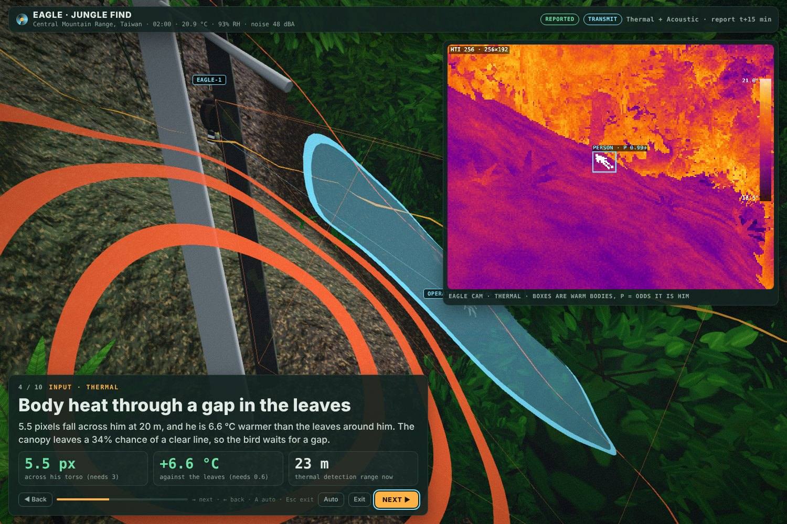
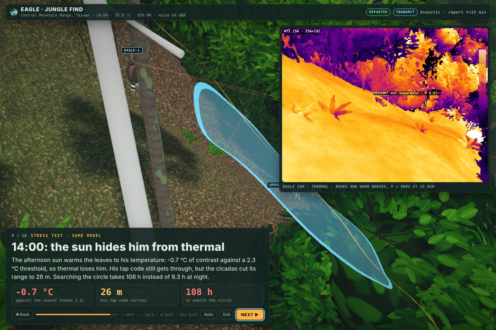

# Demo run sheet: Eagle Jungle Simulator v2

For a live demo to judges or partners, about five minutes with the presenter. Everything on screen is a model estimate, not a measurement; say so once at the start.

## Before you go

1. **Give Chrome the fast GPU.** On a laptop with two graphics chips (for example a Surface Book with an NVIDIA GPU in the keyboard base), Windows often runs Chrome on the slower built-in one. Settings → System → Display → Graphics → find Google Chrome → GPU preference **High performance**, then quit and reopen Chrome. Keep the laptop on mains power: on battery, Windows slows the GPU down.
2. **Open simulator v2** (the downloaded [`simulator/v2/index.html`](../simulator/v2/index.html), or the team's published link) and let it settle for 20 seconds. Settings → Display shows what auto quality chose, for example `auto · med` or `auto · med · 72% res`. A low level with a low percentage means the laptop is struggling: check step 1.
3. **Rehearse once** with **Present ▶**. Step 7 plays the mission and needs about 25 seconds; let it finish.
4. **Close what you don't need**: other tabs, video calls, sync apps. Turn on Do not disturb so no notifications pop up over the demo.
5. **Record a backup video** of one full presenter run (Win+G, then record) in case the venue's screen or network lets you down.

## Run of show

| # | Card | Say (one line) | Number to land |
|---|---|---|---|
| 1 | Find a downed aviator who carries nothing | He is hiding in the jungle with nothing that transmits, because anything that transmits can be found. | 0 emitters on him |
| 2 | Anything that transmits gets found | The red ring is how far one radio burst beside him would carry; the patrol is inside it. | 246 m |
| 3 | Perch, motor off, listen | The Eagle lands under the canopy and goes silent. | 0 W while it listens |
| 4 | Body heat through a gap in the leaves | Its thermal camera sees him through a gap; each box is a warm body with the odds that it is him. | 5.5 px, +6.6 °C |
| 5 | 6 microphones hear his tap code | He taps a briefed code; the array hears it over the insects and takes a bearing. | 25 dB above the noise |
| 6 | It only talks when it is sure | Every clue multiplies the odds; it sends only above 0.95, so it never gives itself away for a sleeping farmer. | 0.14 → 0.99 in 10 min |
| 7 | Sending is the biggest giveaway | It flies 3 km before it transmits, so any direction finding points away from him. | 3.0 km from him |
| 8 | A marker on ATAK, nothing on him | The rescue cell gets his position, and eight birds can cover the whole circle in one night. | 10 m, 15 min, 8.3 h |
| 9 | Stress test | Same model at 14:00: the leaves are as warm as he is and the cicadas drown the code. Search at night. | 108 h instead of 8.3 h |
| 10 | Find him without a beacon | Perch, listen, decide, report from far away. | |

Keys: → or Space next, ← back, 1–9 and 0 jump, A auto-advance (it loops, good for a booth), Esc exit. A presentation clicker works: it sends Page Down and Page Up. After Esc the panels come back for questions; change any setting live and every number moves with it.

## If something goes wrong

| Problem | Do this |
|---|---|
| Choppy | Wait 10 seconds on Auto: it lowers the resolution by itself. Or Settings → Display → Quality → **Low** |
| Stuck on "Growing the jungle…" | It cannot reach the internet for three.js: switch to a phone hotspot, or play the backup video |
| Step 7 seems to pause | The bird is flying 3 km before it transmits; give it the full 25 seconds, or press → |

## Using the desktop's GPU (same network only)

If the demo laptop and a computer with a strong graphics card are on the same network:

1. On the GPU computer run `node simulator/v2/serve.mjs`, then open `http://localhost:8080/#host`. Keep that window visible and the computer awake.
2. On the laptop open the address it printed, ending in `#view`. The badge in the toolbar shows the stream's frame rate, bit rate and delay.
3. Present as usual. If the stream drops, the laptop draws the scene itself after 3 seconds.

Venue Wi-Fi often isolates devices from each other; a phone hotspot or a small travel router with both computers on it avoids that. Remote GPU does not work from the claude.ai link: its sandbox blocks the video connection. To show another computer's whole screen from anywhere, use Chrome Remote Desktop (its host needs a one-time install, with an administrator prompt, on that computer).

## Likely questions

- **Why not give him a beacon?** Anything that transmits from him can be direction-found. Here nothing is on him, and the bird's one report goes out 3 km away.
- **How does it know it is him and not a patrol member?** Patrol members move together on the trail. He is alone, off the trail, still, and taps the code only he was briefed on (×100 to the odds).
- **What if he is unconscious?** Thermal sees him but the bird never gets sure enough to send. A radar pellet dropped beside him adds his breathing, but then the false-alarm risk is high. That is an open design question.
- **Are these numbers measured?** No. They come from a physics model; every constant and its source is in [simulator-v2.md](simulator-v2.md). Field validation is next.
- **Why does thermal fail in the afternoon?** The sun heats the leaves to body temperature: −0.7 °C of contrast against a 2.3 °C threshold.
