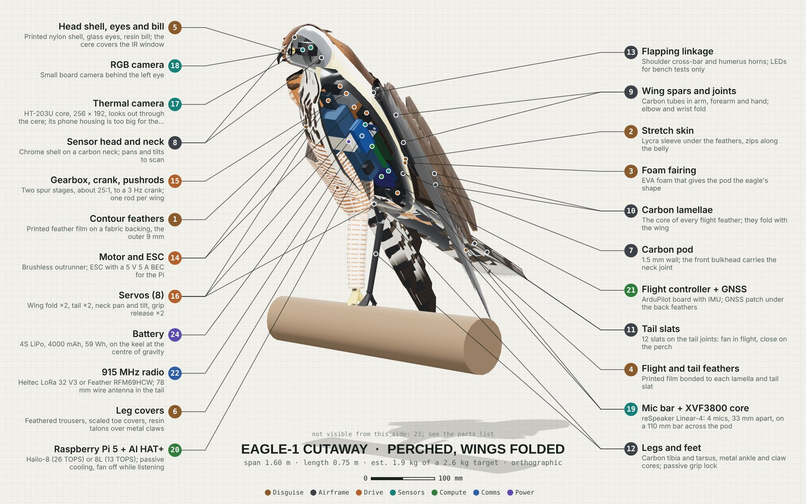
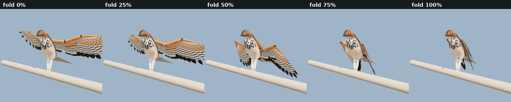

# Eagle drone model

The Eagle as a 3D model: a flapping-wing drone built to a Mountain Hawk-Eagle's size, with the bare
airframe from the team's reference render underneath and a full bird disguise on top. It flies,
glides, soars, lands on a perch, folds its wings along its back, scans with its head and takes off
again. The same model runs in simulator v2, in a standalone viewer, and as glTF files for Unreal or
Blender.


| File | What it is |
|---|---|
| [`simulator/v2/eagle_drone.js`](../simulator/v2/eagle_drone.js) | The model: skeleton, three skins, procedural animation. Plain JavaScript on three.js r128 (works with newer three.js); browser (`window.EagleDrone`) or Node (`require(...)(THREE)`) |
| [`simulator/v2/eagle_viewer.html`](../simulator/v2/eagle_viewer.html) | Standalone viewer: the full loop on a snag, single maneuvers, skins, x-ray, slow motion, and the cutaway at `#cutaway`. Built from `eagle_viewer.src.html` by `build.js` |
| [`simulator/v2/cutaway.js`](../simulator/v2/cutaway.js) | The cutaway view: a still, to-scale section through the bird with every part numbered, and the parts list. Inlined into the viewer by `build.js` |
| [`simulator/v2/assets/`](../simulator/v2/assets/) | `eagle_drone_hawkEagle.glb`, `eagle_drone_serpentEagle.glb`, `eagle_drone_airframe.glb`: skinned meshes with eight animation clips |
| [`simulator/v2/tools/export_glb.js`](../simulator/v2/tools/export_glb.js) | Rebuilds the `.glb` files from `eagle_drone.js` in headless Chromium |
| [`docs/images/eagle-drone-reference.jpg`](images/eagle-drone-reference.jpg) | The reference render of the bare airframe |

## Size: built to a Mountain Hawk-Eagle

The design point is an adult Mountain Hawk-Eagle (*Nisaetus nipalensis*, 熊鷹), a forest eagle of
Taiwan's mountains. No Taiwan-only measurements were found, so the Japanese sample (the race Taiwan birds
probably belong to) sets the proportions. Drone values are measured on the model in its spread
flight pose.

| | Drone (measured on the model) | Mountain Hawk-Eagle (published) |
|---|---|---|
| Wingspan | 1.60 m | 1.34–1.75 m |
| Length, bill to tail | 0.75 m | 0.69–0.84 m (Suzuka: male 0.71, female 0.76) |
| Wing, folded (wrist to longest primary) | 0.51 m | 0.49–0.52 m |
| Tail | 0.34 m | 0.34–0.36 m |
| Tarsus | 0.115 m | 0.113–0.118 m |
| Mass | 2.6 kg target (not built) | male about 2.2–2.7 kg, female 2.5–3.9 kg |
| Wingbeat | 3.0 Hz (modelled) | golden eagles 2.2–2.8 Hz measured; a lighter bird beats faster |
| Cruise / glide speed | 11 / 10 m/s (modelled) | golden eagle about 10 m/s |

The wingbeat is set on purpose: an eagle-sized shape flapping at the wrong rate gives itself away
faster than the wrong paint.

Sources: [Bird Research News, Suzuka sample](https://www.bird-research.jp/1_shiryo/seitai/kumataka.pdf)
(length, wing, tail, tarsus, mass), [BirdA](https://app.birda.org/species-guide/8267/Mountain_Hawk-Eagle)
(span, length), [Wikipedia: Mountain hawk-eagle](https://en.wikipedia.org/wiki/Mountain_hawk-eagle)
(plumage, crest), [Wikipedia: Crested serpent eagle](https://en.wikipedia.org/wiki/Crested_serpent_eagle),
[arXiv 2412.00231](https://arxiv.org/abs/2412.00231) (golden eagle wingbeat and speed).

## Skins


| Skin | What it shows |
|---|---|
| `hawkEagle` (default) | Adult Mountain Hawk-Eagle: dark brown back and upperwing with pale feather edges; rusty head with black streaks and a vestigial crest; white throat with a black mesial stripe; heavily streaked breast; whitish belly, flanks and feathered legs barred rufous; rusty underwing linings; grey flight feathers with blackish bars and dark tips; barred tail; golden eye, dark bill, dull yellow toes |
| `serpentEagle` | Crested Serpent Eagle, the livery simulator v2 used before: dark brown with small white spots, black crest with white spots, bare yellow face and legs, broad white band across the flight feathers and tail |
| `airframe` | The bare drone from the [reference render](images/eagle-drone-reference.jpg), built to fit inside the disguise: carbon pod shaped from the eagle's body, chrome sensor head inside the eagle's head (on the neck, so it scans), silver cross-bar and wing linkage with orange lights, a carbon lamella under every flight feather, 12 tail slats under the tail feathers |

**X-ray** draws the disguise translucent over the airframe. The disguise is a skin over the same
skeleton, so the bare drone and the disguised one fold and flap identically.

## Fit: the airframe inside the disguise

Every airframe part is now built from the eagle's own outline, less the disguise layers that wrap it,
so it sits inside both disguises in every pose. Layer thicknesses are design values (modelled):

| Layer, outside in | Thickness | Notes |
|---|---|---|
| Contour feathers | 9 mm | printed feather film on a fabric backing |
| Stretch skin | 1 mm | Lycra; zips along the belly |
| Foam fairing | 5 mm | EVA; gives the pod the eagle's shape |
| Carbon pod wall | 1.5 mm | pod outside = eagle outline less 15 mm |
| Head: feathers, printed shell | 3 + 2 mm | the sensor head sits 5 mm inside the eagle's head |
| Lamellae and tail slats | 14 mm shorter, vanes 85 % as wide | each is the core of its feather; the printed film wraps it |

Two parts of the reference render could not keep their shape and still fit:

- **Chrome nose cone → sensor head.** On the body axis it stuck 54 mm out of the eagle's head whenever
  the neck bent. It is now a chrome shell inside the head, on a carbon neck, so it turns with the head
  when the bird scans.
- **Fixed diamond tail → 12 tail slats.** A rigid 0.34 m diamond cannot close inside a perched eagle's
  tail (it stuck out 76–92 mm). The slats ride on the 12 tail joints and fan and close with the feathers.

Measured with a silhouette test (`render/fit.js`, not in the repo): both skins drawn from 8 directions
in 9 poses (perched, mid-fold, spread, four points of the wingbeat, glide, soar) and every airframe pixel
outside the disguise counted.

| Worst airframe part outside the disguise | Before | After |
|---|---|---|
| Tail | 92 mm | ≤ 2 mm |
| Head (nose cone) | 54 mm | 0 mm |
| Wings (lamellae wider than the feathers) | 37 mm | ≤ 2.5 mm |
| Legs (ankle joint, legs tucked) | 4.3 mm | ≤ 1 mm (the disguise gained a feathered ankle) |
| Area outside, summed over 8 views | 0.09–0.27 m² | 0–102 mm² |

2 mm is one pixel at that test's resolution. One 3.5 mm sliver remains half-way through the fold, where
a lamella edge passes a gap between two feathers.

## Cutaway and parts list




Open it from the viewer's **Cutaway view ↗** button (a new window), or at `eagle_viewer.html#cutaway`.
It is a still, orthographic section, so the 100 mm bar holds anywhere in the picture plane. The near
side is cut back in steps (feathers, skin, foam, carbon pod) so each layer shows, and the inner wing has
its feather film off its lamellae. Two poses: wings open (looking into the back) and perched (looking into
the breast). Each numbered dot is checked against an ID render so it lands on a part you can see; parts
hidden from that side are listed under the title. The page draws the still once and then releases its
3D context.

Internal parts are rigid meshes on the skeleton (`PARTS` in `eagle_drone.js`), at the sizes below. Each
is checked to fit inside its space (carbon pod, sensor head, the eagle's outline, the tail) with no two
touching (`render/partfit.js`, not in the repo). Tightest margins: grip servos 0.8 mm, tail servos and
Iridium modem 1.1 mm, gearbox 1.5 mm.

| # | Part | What it is, where it goes | Size | Mass | Basis |
|---|---|---|---|---|---|
| | **Disguise** | | | | |
| 1 | Contour feathers | Printed feather film on a fabric backing, the outer 9 mm | 9 mm deep | 120 g | est. |
| 2 | Stretch skin | Lycra sleeve under the feathers, zips along the belly | 1 mm | 30 g | est. |
| 3 | Foam fairing | EVA foam that gives the pod the eagle's shape | 5 mm | 40 g | est. |
| 4 | Flight and tail feathers | Printed film bonded to each lamella and tail slat | 26 per wing, 12 in the tail | 60 g | est. |
| 5 | Head shell, eyes and bill | Printed nylon shell, glass eyes, resin bill; the cere covers the IR window | head 74 mm wide (model) | 35 g | est. |
| 6 | Leg covers | Feathered trousers, scaled toe covers, resin talons over metal claws | tarsus 115 mm (model) | 30 g | est. |
| | **Airframe** | | | | |
| 7 | Carbon pod | 1.5 mm wall; the front bulkhead carries the neck joint | 130 × 100 × 294 mm (model) | 160 g | est. |
| 8 | Sensor head and neck | Chrome shell on a carbon neck; pans and tilts to scan | 62 mm wide (model) | 25 g | est. |
| 9 | Wing spars and joints | Carbon tubes in arm, forearm and hand; elbow and wrist fold | 0.45 m per wing (model) | 140 g | est. |
| 10 | Carbon lamellae | The core of every flight feather; they fold with the wing | 26 per wing | 150 g | est. |
| 11 | Tail slats | 12 slats on the tail joints: fan in flight, close on the perch | 0.30–0.32 m (model) | 30 g | est. |
| 12 | Legs and feet | Carbon tibia and tarsus, metal ankle and claw cores; passive grip lock | tarsus 112 mm (model) | 70 g | est. |
| 13 | Flapping linkage | Shoulder cross-bar and humerus horns; LEDs for bench tests only | 90 mm bar (model) | 40 g | est. |
| | **Drive** | | | | |
| 14 | Motor and ESC | Brushless outrunner; ESC with a 5 V 5 A BEC for the Pi | Ø35 × 28 mm | 110 g | placeholder |
| 15 | Gearbox, crank, pushrods | Two spur stages, about 25:1, to a 3 Hz crank; one rod per wing | 44 × 36 × 22 mm | 110 g | placeholder |
| 16 | Servos (8) | Wing fold ×2, tail ×2, neck pan and tilt, grip release ×2 | micro, 23 × 12 × 22–29 mm | 70 g | placeholder |
| | **Sensors** | | | | |
| 17 | Thermal camera | HT-203U core, 256 × 192, 3.2 mm lens, looking out through the cere. The 68.6 × 45.7 × 12.7 mm phone housing does not fit the head | core ≈ 22 × 20 × 22 mm | 25 g | est. |
| 18 | RGB camera | Small board camera behind the left eye. A Pi Camera 3 board (25 × 24 mm) is too big for the head | ≈ 9 mm cube | 4 g | est. |
| 19 | Mic bar + XVF3800 core | reSpeaker Flex Linear-4: 4 mics 33 mm apart on a 110 mm bar across the pod; core board at the rear | bar 110 mm (spec) | 20 g | est. |
| | **Compute** | | | | |
| 20 | Raspberry Pi 5 + AI HAT+ | Hailo-8 (26 TOPS) or 8L (13 TOPS); passive cooling, fan off while listening | 85 × 56 mm; HAT 65 × 56.5 mm (spec) | 75 g | est. |
| 21 | Flight controller + GNSS | ArduPilot board with IMU; GNSS patch under the back feathers | 36 × 36 mm | 20 g | placeholder |
| | **Comms** | | | | |
| 22 | 915 MHz radio | Heltec WiFi LoRa 32 V3 (field) or Feather RFM69HCW (demo); 78 mm wire antenna in the central tail feather | 50.2 × 25.5 × 10.2 mm (spec) | 15 g | est. |
| 23 | Iridium modem | RockBLOCK 9603N; patch antenna up, under the mantle feathers and outside the carbon | 45 × 45 × 15 mm, 36 g (spec) | 36 g | spec |
| | **Power** | | | | |
| 24 | Battery | 4S LiPo, 4000 mAh, 59 Wh, on the keel at the centre of gravity | 136 × 43 × 34 mm | 430 g | placeholder |
| 25 | Wiring and connectors | Harness, USB-C to the Pi, servo leads | — | 50 g | est. |
| | **Total** | against the 2.6 kg target (the species weighs 2.2–3.9 kg) | | **1.90 kg** | est. |

Spec = the maker's figure (RockBLOCK 9603: Iridium; reSpeaker Flex XVF3800 Linear: Seeed; HT-203U:
retail listing; Heltec WiFi LoRa 32 V3: Heltec; AI HAT+: Raspberry Pi product brief). Est. = our estimate.
Placeholder = the part is not chosen; the size is what fits. Model = measured on this model. The estimated
total leaves about 0.7 kg against the 2.6 kg target for a larger battery or margin.

What the fit check turned up:

- The **HT-203U** in its phone housing (68.6 × 45.7 × 12.7 mm) does not fit a 74 mm eagle head with its
  shell. The 256 × 192 core has to come out of the housing (estimated 22 × 20 × 22 mm), looking out through
  an IR window behind the cere.
- A **Pi Camera Module 3** board (25 × 24 mm) is too big to sit behind an eye; the RGB camera needs a
  small remote-sensor module.
- The **110 mm mic bar** only fits across the pod at its widest point. Its four ports need acoustic
  windows through the pod wall, foam and skin.
- The **Iridium** patch must sit outside the carbon, under the mantle feathers; when perched, the folded
  wings partly cover it.
- The **Pi 5 + AI HAT+** fits flat above the battery with the HAT on 16 mm standoffs. Its fan (35–40 dB) has
  to stay off while the bird listens, 0.1 m from the microphones.

## How the wing folds



Each wing has a shoulder, elbow and wrist, like a bird. Feathers hang on the forearm and hand as a fan,
and each feather rotates with the fold, so the wing spreads for flight and stacks for perching.

1. **Sweep.** The upper arm swings back 86° at the shoulder.
2. **Roll.** The wing plane rolls 54°, so the folded wing lies over the back and flank instead of
   standing off the side.
3. **Z-fold.** The elbow closes to 168° and the wrist to 166°. The primaries slide under the
   secondaries; their tips end over the tail, as on a perched hawk-eagle.

Per wing: 10 primaries (P5–P10 emarginated, so six "fingers" show when soaring), 13 secondaries and
tertials, 3 humerals, greater and median coverts, underwing coverts, an alula and scapulars. The
tail has 12 feathers that fan to ±48° and tilt into a shallow roof shape. The airframe hangs carbon
lamellae on the same joints.

In flight the wrist flexes on the upstroke, the hand twists with the stroke, and the outer primaries
open into slots on the upstroke and when soaring.

## Motion

| Mode | What the bird does |
|---|---|
| `fly` | Flapping at 3.0 Hz, ±36° about +10°, wrist flexed on the upstroke, body bobbing 1 cm, head held steady |
| `glide` | Wings held at +5°, slightly swept, primaries a little apart |
| `soar` | Wings forward, fingers spread wide, tail fanned |
| `takeoff` (`takeoff(path)`) | Crouch, spring, wings unfold in 0.4 s, hard strokes at 3.4 Hz and ±48°, legs tuck, then cruise |
| `land` (`land(perch, heading, from)`) | Glide in, drop about 2 m below the perch and swoop up, flare (body up to 58°, wings cupped forward braking, tail fanned down, feet forward, toes open), touch down, two balancing beats, fold in about 1 s. It lands facing the way it flew in; with `faceAfter` it then hop-turns on the branch to that heading (wings half open, a 4.5 cm hop, about 0.85 s) |
| `perched` | Upright, wings folded, tail down. The head scans in quick turns and holds, the way raptors look around; with `lookAt(point)` it keeps coming back to that point |
| `auto` | For a bird the caller moves (the relay): banks from its turn rate, flaps when climbing and now and then, soars otherwise |

Speeds along a path come from the path and its duration. Bank angle is set from turn rate and speed
(`atan(v·ω/g)`, capped at 43°). The animation is prescribed kinematics for looks, not an aerodynamic
model.

## In simulator v2

- **One bird.** The primitive perched and flying models are gone; the same bird perches and flies.
  **Run mission** now opens with Eagle-1 arriving, then the listening starts.
- **Flights use the perch's open side.** In the default scenario the perch (the 8 m branch) sits
  inside the forest on a slope of 25–35°; uphill, the crowns rise to 60 m above it within 60 m. The
  open side is the direction with the lowest crowns, found by sampling the canopy around the branch
  (48 directions, out to 52 m, allowing a 1-in-4 glide slope). Eagle-1 glides in on that side from about 22 m above the branch, over the crowns, swoops up
  onto the branch facing the way it came, flares, hop-turns to face the operator and folds its wings. For "fly away" and "courier" it
  drops off the branch on the open side to pick up speed, climbs out, and flies on at least 9 m over
  the trees. The first version came in from behind the perch, through the hillside above it.
- **Presenter card 3** ("Perch, motor off, listen") plays the arrival from 6 m beside the branch,
  looking out over the open side, and names the disguise.
- **Cinematic** shows the bird up close and at its real speed (12 m/s in level flight). From 3 m
  beside the branch, on a lens that narrows to 8° while the bird is far off so it stays about a fifth
  of the frame, Eagle-1 glides in over the valley towards the lens, swoops up, flares, puts its feet
  forward, hops round and folds its wings. Then a slow orbit at 1.75–2.5 m while it sits scanning; the
  take-off from the same spot as it drops off the branch and flies out over the valley; and a cut to
  where it sends from: it flies head-on at a camera just past the send point, against the sky, and over
  it, and the intercept ring spreads as the camera rises 40 m and follows its front edge inland (for
  the courier it passes over a camera at the coast and is gone). The cut stands in for the rest
  of the flight, so nothing is sped up. Tracking shots aim at the bird's own position, smoothed so the
  wingbeat does not shake the frame.
- **Relay** overhead is a second bird in `auto` mode: it banks in its orbit and flaps when it climbs.
- **Disguise** selector under *Input · the Eagle*: Mountain Hawk-Eagle, Crested Serpent Eagle, or the
  bare airframe. It is kept across presets and sent to a remote-GPU host.
- **Eagle cam** sits at the bird's eye, 0.40 m above the branch (the old model put it at 0.96 m).
  The bird faces where the camera looks.
- **Thermal and ID views** pose the skinned bird correctly: the pass shader now includes three.js's
  skinning chunks. The bird still reads as category `drone`, air temperature +1 °C.
- **Timing.** The bird animates on wall-clock frame time, up to 1 s a frame in steps of 0.1 s, so
  its flights keep pace with the mission on a slow GPU. The cinematic's shots run on the same clock,
  so a stalled or hidden tab pauses the film instead of letting the shots run ahead of the bird.
- `window.__sim.eagle` and `window.__sim.relay` expose the two birds for scripted checks.

## Viewer

Open [`simulator/v2/eagle_viewer.html`](../simulator/v2/eagle_viewer.html) (on GitHub: **Download raw
file**). It needs internet for three.js and fonts. It plays the full loop on a dead snag at dusk:
perched and scanning, mantling, folding, take-off, a circuit, approach, flare, landing. **Take off**,
**Land**, **Open / fold** and the test-stand modes (**Flap**, **Glide**, **Soar**) run one maneuver
at a time; **½×** and **¼×** slow it down to watch the fold; **X-ray** shows the airframe inside the
disguise; **Cutaway view ↗** opens the [cutaway](#cutaway-and-parts-list) in a new window. The span,
length and folded wing shown are measured off the model when the page loads.

If the browser takes the 3D view away to free graphics memory (several 3D tabs open, the simulator
in another tab), the viewer brings it back on its own within about 3 seconds. If the browser keeps
refusing, it shows still renders of the model and a **Restart 3D view** button; closing other 3D
tabs and pressing it brings the view back.

## glTF for Unreal and Blender

`simulator/v2/assets/eagle_drone_<skin>.glb`, one per skin: one skinned mesh, 95 bones,
12.2k triangles (airframe) to 13.2k (serpent eagle), textures embedded as JPEG, 2.5–2.8 MB each.
Units are metres, +Y up, +Z forward; the origin is the body centre when perched, 0.258 m above the
branch. The Khronos glTF validator reports 0 errors (one warning: the skinned mesh sits under a
group node, which glTF ignores).

| Clip | Length | Notes |
|---|---|---|
| `flap` | 1.0 s | 3 wingbeats, loops |
| `glide` | 2.0 s | loops |
| `soar` | 2.0 s | loops |
| `perch_idle` | 6.0 s | folded, head turns that return to centre, loops |
| `fold` | 1.8 s | wings out to folded, on the perch |
| `unfold` | 1.4 s | folded to wings out, on the perch |
| `land` | 5.8 s | root motion on bone `root`: from 18 m behind and 3 m up, flare, touch-down, fold; ends at the origin |
| `takeoff` | 2.4 s | root motion: from the origin, crouch, spring, climb 4.5 m over 18 m |

Rebuild after changing `eagle_drone.js`:

```bash
cd simulator/v2/tests && npm install      # playwright + three r128, as for the browser checks
node ../tools/export_glb.js               # all three skins; or: node ../tools/export_glb.js hawkEagle
```

**Unreal Engine 5:** drag the `.glb` into the Content Browser (the Interchange glTF importer makes a
Skeletal Mesh, Skeleton and one Animation Sequence per clip), check the Skeletal Mesh faces +X
forward and rotate the actor if not, then make a Blueprint with a Skeletal Mesh component playing
`perch_idle` or `flap`. To use it with the scene importer, map `eagle_perched` and `eagle_flying` to
that Blueprint in the `ASSETS` dictionary of
[`simulator/v2/unreal/ue_import_scene.py`](../simulator/v2/unreal/ue_import_scene.py). Not yet tried
in an editor.

## Using it in code

```js
// browser: three.js r128 first, then eagle_drone.js
const bird = new EagleDrone({ livery: 'hawkEagle' });     // 'serpentEagle' | 'airframe'; quality: 'high' | 'low'
scene.add(bird.object);
bird.perch(branchTop, heading);                           // toes on branchTop, body faces heading (radians, 0 = +Z)
bird.lookAt(operatorPosition);                            // head keeps coming back to this point
bird.takeoff([branchTop, p1, p2], { duration: 6, onDone }); // spring off and fly the path
bird.land(branchTop, heading, fromPoint, { duration: 5, via: [p1], faceAfter: h2, onDone }); // lands facing heading, then turns to h2
bird.settling;                                            // true while it is still turning round on the branch
bird.hover('soar');                                       // hold still in the air: 'fly' | 'glide' | 'soar'
bird.spreadWings(true);                                   // on the perch: open (true) or fold (false)
bird.setLivery('airframe'); bird.setXray(true);
bird.showLayers(true); bird.showParts(true);             // skin and foam under the feathers; every internal part
// EagleDroneLib.PARTS, .BOM: part sizes and placement, and the numbered parts list the cutaway draws
// every frame
bird.update(dt);
// numbers
bird.perchOffset;   // body centre above the branch when perched (0.258 m)
bird.eyeHeight;     // eyes above the branch when perched (0.40 m)
bird.headWorld(v);  // head position in the world
```

## Limits

- Looks, not aerodynamics. Wing motion is prescribed; lift, thrust and stall are not simulated,
  and speeds come from the path.
- The folded wing is a flat stack, so at some angles a feather edge cuts the body or a neighbour.
- Feathers are flat cards with painted detail; nothing ruffles in wind.
- The airframe skin is our reading of the reference render, refitted to the disguise. Its lamella wing,
  linkage and legs are placeholders for the real mechanism, which is not designed yet.
- Internal parts are to scale, but the motor, gearbox, servos, battery and flight controller are
  placeholders, and most masses are estimates. Wiring is listed, not drawn.
- In-simulator flights were checked state by state headlessly at about 1 frame a second; the
  arrival has not yet been watched on the team's laptops at full frame rate.
- The `.glb` files have not been imported into Unreal yet.
