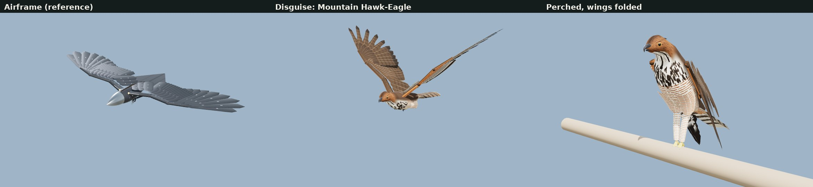
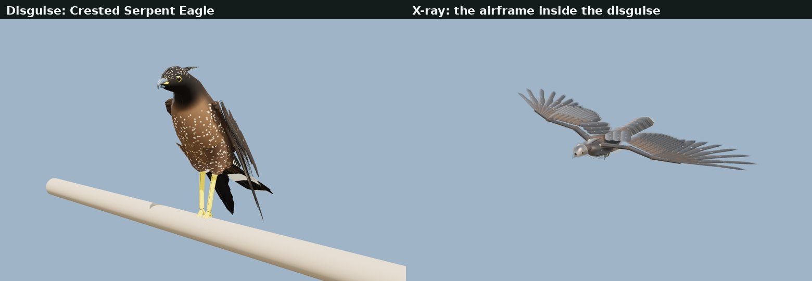

# Eagle drone model

The Eagle as a 3D model: a flapping-wing drone built to a Mountain Hawk-Eagle's size, with the bare
airframe from the team's reference render underneath and a full bird disguise on top. It flies,
glides, soars, lands on a perch, folds its wings along its back, scans with its head and takes off
again. The same model runs in simulator v2, in a standalone viewer, and as glTF files for Unreal or
Blender.



| File | What it is |
|---|---|
| [`simulator/v2/eagle_drone.js`](../simulator/v2/eagle_drone.js) | The model: skeleton, three skins, procedural animation. Plain JavaScript on three.js r128 (works with newer three.js); browser (`window.EagleDrone`) or Node (`require(...)(THREE)`) |
| [`simulator/v2/eagle_viewer.html`](../simulator/v2/eagle_viewer.html) | Standalone viewer: the full loop on a snag, single maneuvers, skins, x-ray, slow motion. Built from `eagle_viewer.src.html` by `build.js` |
| [`simulator/v2/assets/`](../simulator/v2/assets/) | `eagle_drone_hawkEagle.glb`, `eagle_drone_serpentEagle.glb`, `eagle_drone_airframe.glb`: skinned meshes with eight animation clips |
| [`simulator/v2/tools/export_glb.js`](../simulator/v2/tools/export_glb.js) | Rebuilds the `.glb` files from `eagle_drone.js` in headless Chromium |
| [`docs/images/eagle-drone-reference.jpg`](images/eagle-drone-reference.jpg) | The reference render of the bare airframe |

## Size: built to a Mountain Hawk-Eagle

The design point is an adult Mountain Hawk-Eagle (*Nisaetus nipalensis*, 熊鷹), a forest eagle of
Taiwan's mountains. No Taiwan-only measurements were found, so the Japanese sample (the race Taiwan birds
probably belong to) sets the proportions. Drone values are measured on the model in its spread
flight pose.

| | Drone (measured on the model) | Mountain Hawk-Eagle (published) |
|---|---|---|
| Wingspan | 1.60 m | 1.34–1.75 m |
| Length, bill to tail | 0.75 m | 0.69–0.84 m (Suzuka: male 0.71, female 0.76) |
| Wing, folded (wrist to longest primary) | 0.51 m | 0.49–0.52 m |
| Tail | 0.34 m | 0.34–0.36 m |
| Tarsus | 0.115 m | 0.113–0.118 m |
| Mass | 2.6 kg target (not built) | male about 2.2–2.7 kg, female 2.5–3.9 kg |
| Wingbeat | 3.0 Hz (modelled) | golden eagles 2.2–2.8 Hz measured; a lighter bird beats faster |
| Cruise / glide speed | 11 / 10 m/s (modelled) | golden eagle about 10 m/s |

The wingbeat is set on purpose: an eagle-sized shape flapping at the wrong rate gives itself away
faster than the wrong paint.

Sources: [Bird Research News, Suzuka sample](https://www.bird-research.jp/1_shiryo/seitai/kumataka.pdf)
(length, wing, tail, tarsus, mass), [BirdA](https://app.birda.org/species-guide/8267/Mountain_Hawk-Eagle)
(span, length), [Wikipedia: Mountain hawk-eagle](https://en.wikipedia.org/wiki/Mountain_hawk-eagle)
(plumage, crest), [Wikipedia: Crested serpent eagle](https://en.wikipedia.org/wiki/Crested_serpent_eagle),
[arXiv 2412.00231](https://arxiv.org/abs/2412.00231) (golden eagle wingbeat and speed).

## Skins



| Skin | What it shows |
|---|---|
| `hawkEagle` (default) | Adult Mountain Hawk-Eagle: dark brown back and upperwing with pale feather edges; rusty head with black streaks and a vestigial crest; white throat with a black mesial stripe; heavily streaked breast; whitish belly, flanks and feathered legs barred rufous; rusty underwing linings; grey flight feathers with blackish bars and dark tips; barred tail; golden eye, dark bill, dull yellow toes |
| `serpentEagle` | Crested Serpent Eagle, the livery simulator v2 used before: dark brown with small white spots, black crest with white spots, bare yellow face and legs, broad white band across the flight feathers and tail |
| `airframe` | The bare drone from the [reference render](images/eagle-drone-reference.jpg): carbon pod with a dorsal spine, chrome nose cone, silver cross-bar and wing linkage with orange lights, diamond tail, carbon lamellae on the wing joints |

**X-ray** draws the disguise translucent over the airframe. The disguise is a skin over the same
skeleton, so the bare drone and the disguised one fold and flap identically.

## How the wing folds


Each wing has a shoulder, elbow and wrist, like a bird. Feathers hang on the forearm and hand as a fan,
and each feather rotates with the fold, so the wing spreads for flight and stacks for perching.

1. **Sweep.** The upper arm swings back 86° at the shoulder.
2. **Roll.** The wing plane rolls 54°, so the folded wing lies over the back and flank instead of
   standing off the side.
3. **Z-fold.** The elbow closes to 168° and the wrist to 166°. The primaries slide under the
   secondaries; their tips end over the tail, as on a perched hawk-eagle.

Per wing: 10 primaries (P5–P10 emarginated, so six "fingers" show when soaring), 13 secondaries and
tertials, 3 humerals, greater and median coverts, underwing coverts, an alula and scapulars. The
tail has 12 feathers that fan to ±48° and tilt into a shallow roof shape. The airframe hangs carbon
lamellae on the same joints.

In flight the wrist flexes on the upstroke, the hand twists with the stroke, and the outer primaries
open into slots on the upstroke and when soaring.

## Motion

| Mode | What the bird does |
|---|---|
| `fly` | Flapping at 3.0 Hz, ±36° about +10°, wrist flexed on the upstroke, body bobbing 1 cm, head held steady |
| `glide` | Wings held at +5°, slightly swept, primaries a little apart |
| `soar` | Wings forward, fingers spread wide, tail fanned |
| `takeoff` (`takeoff(path)`) | Crouch, spring, wings unfold in 0.4 s, hard strokes at 3.4 Hz and ±48°, legs tuck, then cruise |
| `land` (`land(perch, heading, from)`) | Glide in, drop about 2 m below the perch and swoop up, flare (body up to 58°, wings cupped forward braking, tail fanned down, feet forward, toes open), touch down, two balancing beats, fold in about 1 s |
| `perched` | Upright, wings folded, tail down. The head scans in quick turns and holds, the way raptors look around; with `lookAt(point)` it keeps coming back to that point |
| `auto` | For a bird the caller moves (the relay): banks from its turn rate, flaps when climbing and now and then, soars otherwise |

Speeds along a path come from the path and its duration. Bank angle is set from turn rate and speed
(`atan(v·ω/g)`, capped at 43°). The animation is prescribed kinematics for looks, not an aerodynamic
model.

## In simulator v2

- **One bird.** The primitive perched and flying models are gone; the same bird perches and flies.
  **Run mission** now opens with Eagle-1 arriving: it flaps in over the canopy, flares onto the
  perch and folds its wings, then the listening starts. For "fly away" and "courier" it springs off
  the perch and climbs toward its destination instead of rising straight up.
- **Presenter card 3** ("Perch, motor off, listen") plays the arrival and names the disguise.
  **Cinematic** gains an arrival shot before the perch shot.
- **Relay** overhead is a second bird in `auto` mode: it banks in its orbit and flaps when it climbs.
- **Disguise** selector under *Input · the Eagle*: Mountain Hawk-Eagle, Crested Serpent Eagle, or the
  bare airframe. It is kept across presets and sent to a remote-GPU host.
- **Eagle cam** sits at the bird's eye, 0.40 m above the branch (the old model put it at 0.96 m).
  The bird faces where the camera looks.
- **Thermal and ID views** pose the skinned bird correctly: the pass shader now includes three.js's
  skinning chunks. The bird still reads as category `drone`, air temperature +1 °C.
- **Timing.** The bird animates on wall-clock frame time, capped at 0.25 s a frame, so its flights
  keep pace with the mission on a slow GPU.
- `window.__sim.eagle` and `window.__sim.relay` expose the two birds for scripted checks.

## Viewer

Open [`simulator/v2/eagle_viewer.html`](../simulator/v2/eagle_viewer.html) (on GitHub: **Download raw
file**). It needs internet for three.js and fonts. It plays the full loop on a dead snag at dusk:
perched and scanning, mantling, folding, take-off, a circuit, approach, flare, landing. **Take off**,
**Land**, **Open / fold** and the test-stand modes (**Flap**, **Glide**, **Soar**) run one maneuver
at a time; **½×** and **¼×** slow it down to watch the fold; **X-ray** shows the airframe inside the
disguise. The span, length and folded wing shown are measured off the model when the page loads.

If the browser takes the 3D view away to free graphics memory (several 3D tabs open, the simulator
in another tab), the viewer brings it back on its own within about 3 seconds. If the browser keeps
refusing, it shows still renders of the model and a **Restart 3D view** button; closing other 3D
tabs and pressing it brings the view back.

## glTF for Unreal and Blender

`simulator/v2/assets/eagle_drone_<skin>.glb`, one per skin: one skinned mesh, 95 bones,
10.7k triangles (airframe) to 12.6k (serpent eagle), textures embedded as JPEG, 2.4–2.8 MB each.
Units are metres, +Y up, +Z forward; the origin is the body centre when perched, 0.258 m above the
branch. The Khronos glTF validator reports 0 errors (one warning: the skinned mesh sits under a
group node, which glTF ignores).

| Clip | Length | Notes |
|---|---|---|
| `flap` | 1.0 s | 3 wingbeats, loops |
| `glide` | 2.0 s | loops |
| `soar` | 2.0 s | loops |
| `perch_idle` | 6.0 s | folded, head turns that return to centre, loops |
| `fold` | 1.8 s | wings out to folded, on the perch |
| `unfold` | 1.4 s | folded to wings out, on the perch |
| `land` | 5.8 s | root motion on bone `root`: from 18 m behind and 3 m up, flare, touch-down, fold; ends at the origin |
| `takeoff` | 2.4 s | root motion: from the origin, crouch, spring, climb 4.5 m over 18 m |

Rebuild after changing `eagle_drone.js`:

```bash
cd simulator/v2/tests && npm install      # playwright + three r128, as for the browser checks
node ../tools/export_glb.js               # all three skins; or: node ../tools/export_glb.js hawkEagle
```

**Unreal Engine 5:** drag the `.glb` into the Content Browser (the Interchange glTF importer makes a
Skeletal Mesh, Skeleton and one Animation Sequence per clip), check the Skeletal Mesh faces +X
forward and rotate the actor if not, then make a Blueprint with a Skeletal Mesh component playing
`perch_idle` or `flap`. To use it with the scene importer, map `eagle_perched` and `eagle_flying` to
that Blueprint in the `ASSETS` dictionary of
[`simulator/v2/unreal/ue_import_scene.py`](../simulator/v2/unreal/ue_import_scene.py). Not yet tried
in an editor.

## Using it in code

```js
// browser: three.js r128 first, then eagle_drone.js
const bird = new EagleDrone({ livery: 'hawkEagle' });     // 'serpentEagle' | 'airframe'; quality: 'high' | 'low'
scene.add(bird.object);
bird.perch(branchTop, heading);                           // toes on branchTop, body faces heading (radians, 0 = +Z)
bird.lookAt(operatorPosition);                            // head keeps coming back to this point
bird.takeoff([branchTop, p1, p2], { duration: 6, onDone }); // spring off and fly the path
bird.land(branchTop, heading, fromPoint, { duration: 5, via: [p1], onDone });
bird.hover('soar');                                       // hold still in the air: 'fly' | 'glide' | 'soar'
bird.spreadWings(true);                                   // on the perch: open (true) or fold (false)
bird.setLivery('airframe'); bird.setXray(true);
// every frame
bird.update(dt);
// numbers
bird.perchOffset;   // body centre above the branch when perched (0.258 m)
bird.eyeHeight;     // eyes above the branch when perched (0.40 m)
bird.headWorld(v);  // head position in the world
```

## Limits

- Looks, not aerodynamics. Wing motion is prescribed; lift, thrust and stall are not simulated,
  and speeds come from the path.
- The folded wing is a flat stack, so at some angles a feather edge cuts the body or a neighbour.
- Feathers are flat cards with painted detail; nothing ruffles in wind.
- The airframe skin is our reading of the reference render. Its lamella wing, linkage and legs are
  placeholders for the real mechanism, which is not designed yet.
- In-simulator flights were checked state by state headlessly at about 1 frame a second; the
  arrival has not yet been watched on the team's laptops at full frame rate.
- The `.glb` files have not been imported into Unreal yet.
