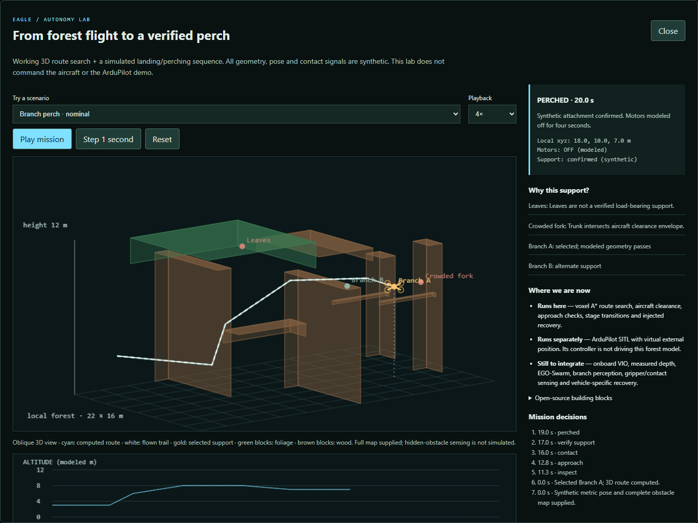

# Forest navigation and perching lab

Open [the forest lab](../simulator/forest.html) directly, or open the Jungle Simulator and choose **Forest navigation & perching → Open forest lab** below the GPS-denied navigation panel. Use **Play mission**, **Step 1 second**, scenario selection and 1×/4×/8× playback. Reset restarts the selected scenario. Closing the lab pauses playback.

For local HTTP access, run `python -m http.server 8770 --bind 127.0.0.1` from the repository root, then visit `http://127.0.0.1:8770/simulator/forest.html`.

## What changed

The original navigation panel illustrates GPS and backup-source transitions on a 2D survey. This addition computes a route through a synthetic 3D obstacle field and walks through approach, contact, support verification, perch, release and departure. It also offers a distinct clearing-landing case. The original navigation controls and sensing mission remain available.

This is executable planning and a contact state-machine demonstration. It does not run camera perception, EGO-Swarm, gripper physics or closed-loop forest flight. It does not move the perched bird in the main Three.js scene. The ArduPilot SITL viewer remains separate and receives none of these routes.

## Geometry and planning contract

All coordinates are local xyz metres with z upward; no global origin or geographic coordinates are inferred. The synthetic world is 22 × 16 × 12 m. Wood and foliage are axis-aligned solid boxes. Aircraft clearance uses a conservative axis-aligned cube with 0.45 m half-width, implemented by inflating every obstacle on all axes. These are invented presentation dimensions, not dimensions validated against the prototype.

`forest-model.js` performs six-connected A* on a 1 m grid. Manhattan distance is its heuristic. Exact line-versus-inflated-box tests check edges and line-of-sight path shortcuts. Kinematic motion follows the resulting path at 2 m/s during transit, 0.7 m/s during terminal approach/recovery/departure. Segment checks detect clearance violations throughout movement. No acceleration, wind, rotor aerodynamics, estimator error or dynamic replanning is modeled. The complete map is available before planning; this is not unknown-forest exploration.

Candidates are deliberately simple: leaves are rejected as unsupported; a crowded fork is rejected for clearance; Branch A is preferred if valid and reachable, otherwise Branch B. The moving-branch scenario injects a rejection rather than measuring or simulating branch motion. Branch strength is assumed. Candidate order is a fixed priority, not an optimized mechanical suitability score. Ground landing uses a separate clearing candidate.

## State machine

`TRANSIT → INSPECT → APPROACH → CONTACT → VERIFY_SUPPORT → PERCHED/LANDED → RELEASE → DEPART → COMPLETE`

Inspection lasts 1.5 modeled seconds, contact 1 s and support verification 2 s. Successful synthetic support confirmation permits motor shutdown for 4 s. Release models motors on and attachment released, waits 1 s, then retraces the checked approach corridor. The drawn aircraft center sits above the support; gripper geometry and physical contact are not modeled. “Motors off” is a model variable, not autopilot telemetry.

An injected grip failure leaves motors on, retreats to the inspection point and excludes Branch A before selecting Branch B. A full-height barrier makes both branch candidates unreachable and aborts before motion. Pose/depth loss at 5 s stops the illustration without claiming that a real aircraft could hold position or land safely. Physical recovery must be designed for the actual vehicle and observed clearance.

## Readiness and open-source integration

| Layer | Current state | Next integration |
|---|---|---|
| Position | Synthetic exact local pose | Calibrated onboard VIO or lidar-inertial odometry |
| Obstacles | Complete synthetic box map | Timestamped measured 3D depth/occupancy with uncertainty |
| Planning | Local voxel A* and clearance tests | Evaluate [EGO-Swarm](https://github.com/ZJU-FAST-Lab/ego-planner-swarm) with compatible pose, map and control inputs |
| Clearing selection | Scripted ground candidate | Evaluate [OpenLander](https://github.com/stephansturges/OpenLander) with geometry verification |
| Branch selection | Scripted support geometry/rejections | Evaluate [Pi/Hailo branch prototype](https://github.com/YassinBaraa/Diplomski_rad); its documented OptiTrack dependence and absent top-level license require resolution |
| Contact and recovery | Synthetic confirmation and one injected failure | Gripper/contact sensing and vehicle-specific recovery; [SLAP](https://github.com/JuliaDi/Tree-Perching-Code) is an MIT-licensed trunk-perching reference with motion-capture/operator dependencies |
| Flight controller | Actual ArduPilot SITL available separately | Bridge validated planning outputs with frame, timing, quality and failsafe handling |

These repositories are references, not bundled dependencies. EGO-Swarm is GPL-3.0; OpenLander and SLAP carry MIT licenses at repository level. Recheck dependency, model-weight and hardware-design terms before reuse. A Pi/Hailo-compatible perception prototype does not establish forest localization or reliable physical perching.

## Validation

`node simulator/test-forest.cjs` exercises all six scenarios, verifies termination, continuous segment clearance, motor shutdown only after synthetic support confirmation, failed-grip exclusion and reselection, departure, and a blocked-route result. Nominal model durations at 0.05 s steps: branch 27.3 s, moving-branch alternate 26.6 s, grip-failure retry 41.2 s, clearing landing 29.7 s. These are modeled timings, not measured flight results.

`node simulator/check-forest.cjs` checks browser playback, stepping, scenarios, reset, modal opening/closing, insertion into the existing simulator and mobile overflow, and saves desktop/mobile screenshots. Continuous main-scene Three.js animation is suppressed for the integration check; no rendering-performance claim is made. Existing navigation and sensing regression checks also pass. No hardware or SITL test is claimed for the new forest model.
