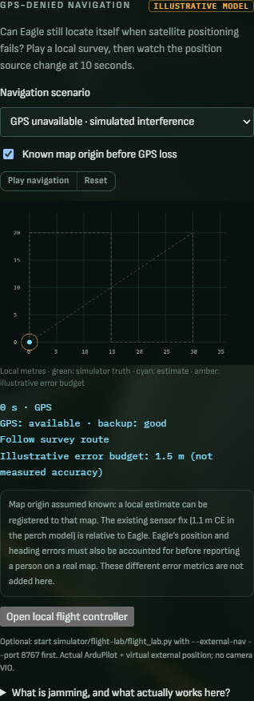

# GPS-denied navigation in the Jungle Simulator

**Current interface:** the browser now runs the [unified Eagle mission](unified-mission.md). The former standalone survey player and forest modal are no longer mounted. Navigation uses synthetic metric pose in the shared mission state; live VIO/GNSS integration is not claimed. The descriptions below record the earlier explanatory survey and the separate ArduPilot engineering test.

**Forest extension:** the same navigation area now includes **Open forest lab** for computed 3D routes, branch/clearing candidates, simulated attachment verification, recovery and departure. See [forest-navigation.md](forest-navigation.md) or [open the focused lab](../simulator/forest.html). It remains separate from the actual ArduPilot controller.

Open `simulator/index.html` through a local HTTP server. In the right **Eagle cam** panel, scroll below the camera to **GPS-denied navigation**. Choose a scenario and press **Play navigation**. The existing perched sensor mission still runs independently with **Run mission**.



## What runs

The embedded canvas is an explanatory kinematic survey. At 10 seconds, the selected scenario changes the simulated GPS source. Green is simulator truth, cyan is the estimated position, and the amber circle is an illustrative error budget. This is not a statistical confidence interval or a hardware accuracy prediction.

| Scenario | Demonstrated behavior |
|---|---|
| Baseline | GPS remains available; survey returns to local origin |
| Simulated interference | GPS becomes unavailable; synthetic visual/inertial position continues |
| Dense canopy | GPS degrades at 10 s; synthetic vision degrades at 20 s; error budget grows to abort threshold |
| Spoofing | A scripted inconsistency rejects GPS; synthetic visual/inertial position continues |
| Backup loss | GPS lost at 10 s, backup lost at 25 s, five seconds of illustrative dead reckoning, then transit abort |

No RF emissions, jammer propagation, camera features, estimator residuals or automatic spoof detection are modeled. GPS loss alone does not establish jamming. Foliage, darkness, motion blur, moving leaves, weak texture and synchronization errors can also undermine camera navigation; these are not quantitatively derived from the jungle renderer.

The flight path is a local 30 × 20 m survey at 1.5 m/s (0.7 m/s with degraded vision). The invented error-budget floor is 1.5 m, growing at 0.035 m/s with good synthetic backup or 0.22 m/s when degraded. With no backup, growth is `0.65 + 0.2 × outage_seconds` m/s. Transit stops after five seconds without backup or at an 8 m budget. These are presentation constants, not ArduPilot defaults or calibrated limits. Freezing the illustration is not a physically achievable emergency hover.

The **known map origin** control distinguishes relative navigation from absolute geolocation. The adjacent fix note reads the current perch model's sensor CE from `window.__sim.R.fix`. It does not combine that metric with an arbitrary navigation radius. Eagle position, heading, sensor geometry and origin uncertainties require a consistent covariance model before claiming a person’s map accuracy. Existing sensor physics and mission playback are unchanged.

## Actual flight controller, embedded locally

The same panel offers **Open local flight controller**, an embedded view of the separate local ArduPilot service. From `simulator/flight-lab`, on Windows x64 with Python:

```powershell
python setup_flight.py
python flight_lab.py --external-nav --port 8767
```

Then open the Jungle Simulator from a local server, for example `python -m http.server 8770` at the repository root, and visit `http://127.0.0.1:8770/simulator/`. The flight controller button opens the service inside a dialog. HTTPS-hosted browsers may block a local HTTP iframe; use the local simulator URL for this integration. The explanatory canvas works without Python or SITL. Closing the dialog does not stop the virtual flight; use its abort/land control.

This service executes actual ArduCopter firmware, multicopter dynamics, EKF, motor loops and MAVLink mission commands. GPS-disabled mode uses **virtual Vicon supplied by simulator truth**, not working camera VIO. It has no jungle collision geometry and does not move the perched Eagle in the main scene. Its source, pinned dependency manifest, tests and setup are included in [flight-lab](../simulator/flight-lab/README.md); binaries are downloaded separately and retain upstream licenses. The thermal-cam branch is not merged or consumed here.

## Hardware path and open source

- [ArduPilot external navigation](https://ardupilot.org/dev/docs/mavlink-nongps-position-estimation.html) accepts external estimates via MAVLink; its documentation prefers ODOMETRY and describes required frames, origin and estimator setup.
- [OpenVINS](https://github.com/rpng/open_vins) is a candidate visual/inertial estimator to evaluate with calibrated Camera Module 3 data and synchronized IMU samples. It is not installed in this demonstration. Pi performance and forest accuracy are unverified.
- [ArduPilot dead-reckoning failsafe](https://ardupilot.org/copter/docs/deadreckoning-failsafe.html) is a separate configured flight-controller capability; this panel's timing is not a reproduction of that implementation.

Thermal, microphone and Hailo processing support sensing; none independently solves vehicle position. A real deployment still needs an IMU/flight controller, time and camera calibration, metric estimator validation, range/depth or another collision-sensing strategy, and tested transitions/failsafes. No anti-jamming hardware or demonstrated RF resilience is claimed.

## Verification

`node simulator/test-navigation.cjs` checks GPS-denied route completion, scripted spoof rejection, failure termination, origin labeling and unchanged pre-existing sensor-model source (against Git HEAD). `node simulator/run-model.mjs` exercises all original presets. Browser checks exercised controls, the live local flight-controller iframe, desktop and mobile layout with no JavaScript errors. Continuous Three.js animation was suppressed in the headless test because software rendering was too slow; this is not a frame-rate or visual regression validation of the main jungle scene. `simulator/flight-lab/test_flight_lab.py` checks peripheral heartbeat rejection and NED telemetry preservation. The earlier SITL validation is documented separately; copying its code here does not establish camera navigation performance.
