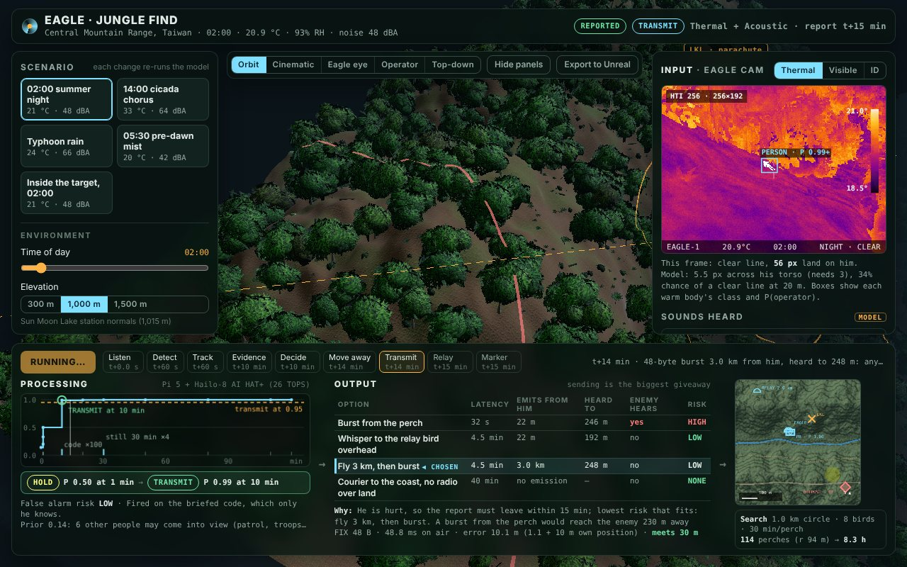
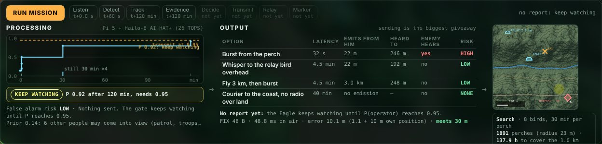
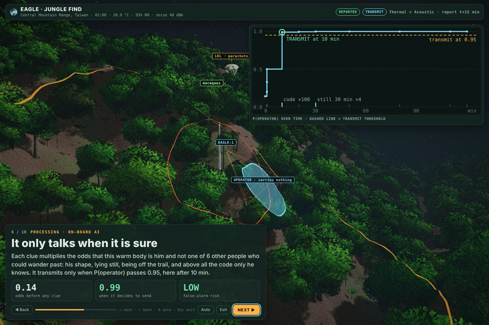
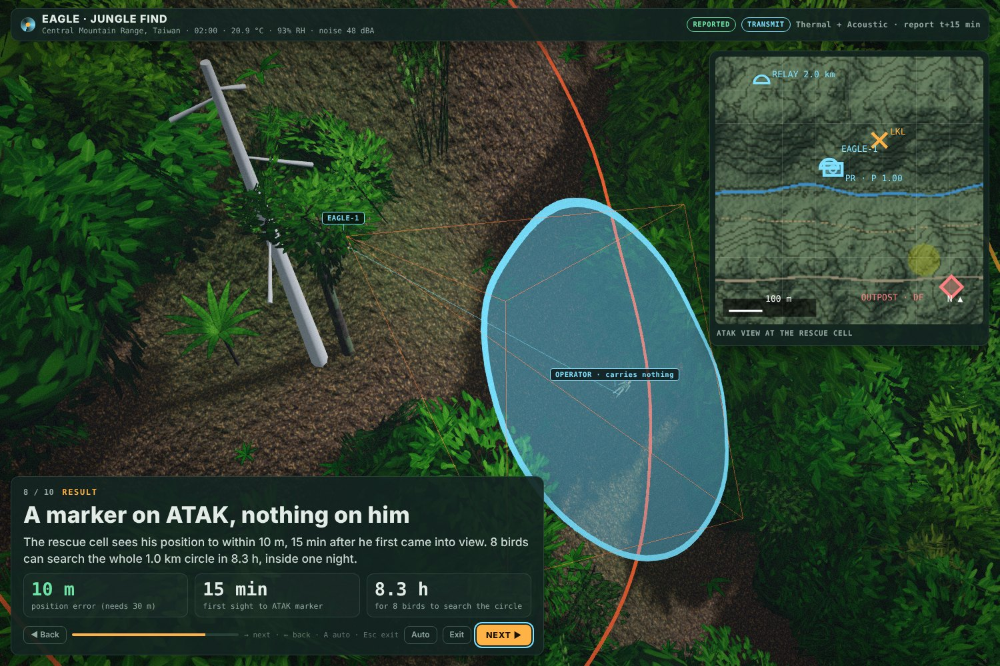

# Eagle Jungle Simulator v2: when the person carries nothing

Technical reference for [`simulator/v2/`](../simulator/v2/). Version 1 ([simulator.md](simulator.md))
assumes the isolated person carries a tag the Eagle can poll. Version 2 removes the tag. The Eagle
has to find him by heat and sound alone, decide on board that it has found the right person, and
get one short report out without pointing back at him. Every number here is **modelled**, not
measured.



## Files

| File | What it is |
|---|---|
| `index.html` | The app in one file: 3D scene, panels and model. Built from the two files below; do not edit it by hand |
| `index.src.html` | Page source (scene, interface, mission player) with a `/*@@MODEL@@*/` marker where the model goes |
| `model.js` | Physics and decision model. Plain JavaScript, no dependencies; runs in Node (`require`) or the browser (`window.EagleModel`) |
| `build.js` | `node build.js` inlines `model.js` into `index.src.html` and writes `index.html` |
| `model_table.js` | `node model_table.js` prints every preset and what-if case in the results below |
| `serve.mjs` | `node serve.mjs` serves the page on the local network and passes the connection setup between a GPU computer and a laptop for [remote GPU](#remote-gpu). Node 18 or newer, no packages |
| `tests/` | Headless browser checks: `test_present.js` (presenter, live numbers against the model) and `test_remote.js` (remote GPU). Run `npm install` in that folder first |
| `unreal/` | `ue_import_scene.py` places an exported scene in an Unreal Engine 5 level; its test; `sample_scene.json` (the default scene) |

## Run it

1. Open [`simulator/v2/index.html`](../simulator/v2/index.html), click **Download raw file** and open
   the file in Chrome, Edge, Safari or Firefox. It needs internet on first load for three.js r128
   and fonts.
2. Pick a scenario on the left; every panel updates at once. **Run mission** plays the timeline.
3. **Cinematic** plays a five-shot flythrough. **Export to Unreal** gives the scene as JSON.
4. **Present ▶** (or **P**) runs the judges' demo: ten cards with live numbers from the model
   ([Presenter mode](#presenter-mode); run sheet in [demo-runbook.md](demo-runbook.md)).

To draw the scene on a computer with a stronger graphics card and show it on a laptop, see
[Remote GPU](#remote-gpu).

Model only, with Node 18 or newer:

```bash
node simulator/v2/model_table.js
```

```js
const M = require('./simulator/v2/model.js');
const r = M.evaluate({ ...M.defaults(), hour: 14, elevation_m: 300 });   // 14:00 cicada chorus
console.log(r.processing.decision, r.output.chosen, r.timeToReport_s);    // TRANSMIT moveAway 872
```

After editing `model.js` or `index.src.html`, rebuild with `node simulator/v2/build.js`.

## Default scenario

A downed aviator in Taiwan's Central Mountain Range, about 1,000 m up, in July, at 02:00. He is
injured and lying 20 m from the Eagle, which perches on an 8 m branch under a 15 m canopy (leaf
area index 4.5, understory visibility 20 m). He carries nothing that transmits. He was briefed to
tap a code on a tree trunk (3-3-1) every 30 minutes after dark. A patrol is 250 m from him and
230 m from the perch. Eight Eagles search a 1 km circle around his parachute, 30 minutes per
perch. Each Eagle has a 256 × 192 thermal camera, six microphones and a Hailo-8 accelerator on a
Raspberry Pi 5, and no GPS.

Presets: `night` (default), `cicadaDay` (14:00, 300 m), `typhoon` (16:00, heavy rain),
`preDawn` (05:30, mist), `target` (inside the target area, troops 120 m away). `M.defaults()`
lists all 32 settings.

## How the model works

`model.js` is one pure function, `evaluate(settings)`. It returns `env`, `input`, `processing`,
`output`, `search`, `find`, `timeline` and `timeToReport_s`. Every constant sits in `PARAMS` with a
comment that gives its source or marks it as assumed.

### Environment

- Air temperature and humidity: July normals 1991-2020 from Taiwan's Central Weather
  Administration. Taichung for 300 m, Sun Moon Lake (1,015 m) for 1,000 m, and Sun Moon Lake minus
  6 °C per km for 1,500 m (estimate).
- Ambient noise by hour (estimates): 62 dBA cicada chorus by day, 56 at dusk, 48 at night, 42
  before dawn, 52 in the dawn chorus. Rain adds 54 dB, a typhoon 64 dB (Sato et al. 2021), summed
  by power.

### Input 1: heat (thermal camera, primary)

- Clothing surface temperature = air + K × (skin − air), with K = 0.45 dry and 0.12 wet. The
  forest background is 1.0 °C above the air by day and 0.8 °C below it at night.
- He is seen when the apparent contrast beats the camera's threshold and his torso (0.45 m) covers
  at least 3 pixels.
- Line of sight: through the canopy, the Beer-Lambert gap probability exp(−G·Ω·LAI / cos θ), with
  G = 0.5 and clumping Ω = 0.7 (assumed); below the canopy, exponential decay with the understory
  visibility (FM 90-5).
- At 02:00: 6.6 °C contrast against a 0.6 °C threshold, 5.5 pixels on his torso at 20 m, a 34 %
  chance of a clear line, effective range 23 m. At 14:00 the contrast is −0.7 °C against a 2.3 °C
  threshold, so heat fails.

### Input 2: sound (microphone array, secondary)

- Levels at 1 m: briefed tap code and soft whistle 85 dB (assumed), cough or groan 70 dB
  (assumed), normal voice 57 dB and shout 85 dB (Pearsons 1977), rescue whistle 104 dB.
- Loss: spherical spreading, air absorption (ISO 9613-1) and dense-foliage loss of 0.06-0.09 dB/m
  (ISO 9613-2, Table A.1). Measured foliage loss in tropical forest ranges from about half of
  this (French Guiana, Haupert et al. 2023) to several times it.
- Heard when the signal is 6 dB above the in-band noise, after the microphone array's gain.
- At 02:00: tap code 94 m, whistle 96 m, cough 30 m, normal voice 3 m. The cicada chorus cuts the
  tap code to 26 m, typhoon rain to 21 m.

### Processing: the evidence gate

The Eagle sends nothing until it is confident that what it sees and hears is *him*, rather than
anyone or anything else:

odds(him) = prior odds × the likelihood ratio of each clue; P = odds / (1 + odds).

- **Prior** = 1 / (1 + the number of other people who may come into view): 4 for a patrol, 12
  inside the target area, 2 for local farmers. That gives 0.14 by default and 0.07 inside the
  target area.
- **Likelihood ratios** (all assumed, to be tuned on recorded data): human shape in thermal ×3 at
  8 pixels or more, ×1.5 at 3-8; no other warm body within 30 m ×2; off-trail inside the parachute
  circle ×2; lying still for 30 minutes ×4, then for 2 hours ×3; the briefed tap code or whistle
  ×100; each cough or groan ×2; resting breathing from a radar pellet ×2.
- **Decision:** TRANSMIT once P reaches 0.95 (`decisionP`), otherwise KEEP WATCHING. Each decision
  carries a false-alarm rating: LOW, MEDIUM or HIGH.

### Output: getting one report out

The report is one 48-byte AES-256-GCM FIX in the [Eagle kit's](eagle-kit.md) format, 48.8 ms on
air at SF7 and 250 kHz in Taiwan's AS923-1 band (923 MHz). The model scores four ways to send it:

| Way out | Latency | Where the emission happens | Heard to | Risk (default scene) |
|---|---|---|---|---|
| Burst from the perch | 32 s | 22 m from him | 246 m | HIGH: the patrol is 230 m away |
| Whisper to the relay bird overhead | 4.5 min | 22 m from him | 192 m | LOW |
| Fly 3 km, then burst | 4.5 min | 3 km from him | 248 m | LOW (**chosen**) |
| Courier to the coast | 40 min | none over land | – | NONE |

- **Radio loss:** with both ends inside the forest, plane-earth loss plus Weissberger's tree
  attenuation (1982); with one end above the canopy, ITU-R P.833-10. "Heard to" is the distance at
  which the enemy's receiver (an energy detector by default) picks up the burst.
- **Choice:** the lowest-risk way out that meets the urgency: 15 minutes if he is hurt, 2 hours if
  he can move.
- From the relay, the fix goes out over Iridium SBD (about 30 s) to the coordinator's ATAK map.

### Accuracy

The thermal pixel (or the sound bearing) and the downward angle from the known perch height place
him 1.1 m from the truth at 20 m. The Eagle's own position without GPS dominates: 10 m with
visual-inertial odometry and map matching, 30 m with a magnetometer and dead reckoning (both
assumed). Default: 10.1 m, inside the 30 m target. With a magnetometer only: 30.1 m, just outside.

### Search

The number of perch stops needed to cover the 1 km circle around the parachute, given how far his
signal carries, times 30 minutes per stop, shared across the birds.

## Results (modelled)

From `node simulator/v2/model_table.js`. Unless stated: 02:00, 1,000 m, injured, 20 m from an 8 m
perch, taps the briefed code.

| Case | Heat | Sound | Decision | Way out | Marker on ATAK | Error | Search, 8 birds |
|---|---|---|---|---|---|---|---|
| 02:00 night (default) | 23 m | tap code 94 m | TRANSMIT at 10 min | fly 3 km, then burst | 14.5 min | 10.1 m | 114 stops, 8.3 h |
| 14:00 cicada chorus, 300 m | fails | tap code 26 m | TRANSMIT at 10 min | fly 3 km | 14.5 min | 10.5 m | 1,480 stops, 107.9 h |
| Typhoon rain | 23 m | tap code 21 m | TRANSMIT at 10 min | fly 3 km | 14.5 min | 10.1 m | 1,891 stops, 137.9 h |
| 05:30 pre-dawn mist | 23 m | tap code 133 m | TRANSMIT at 10 min | fly 3 km | 14.5 min | 10.1 m | 57 stops, 4.2 h |
| Inside the target, troops 120 m | 23 m | tap code 94 m | TRANSMIT at 10 min | fly 3 km | 14.5 min | 10.1 m | 114 stops, 8.3 h |
| Injured, silent (coughs) | 23 m | cough 30 m | TRANSMIT at 80 min (false alarm MEDIUM) | fly 3 km | 84.5 min | 10.1 m | 1,891 stops, 137.9 h |
| Unconscious, silent | 23 m | none | KEEP WATCHING (P 0.92 after 2 h) | – | not sent | – | – |
| Unconscious, radar pellet dropped | 23 m | none | TRANSMIT at 120 min (false alarm HIGH) | fly 3 km | 124.5 min | 10.1 m | – |
| Conscious, hiding, taps the code | 23 m | tap code 94 m | TRANSMIT at 10 min | courier | 50 min | 10.1 m | 114 stops, 8.3 h |
| Perch 60 m away | no clear line | tap code 92 m | TRANSMIT at 10 min | fly 3 km | 14.5 min | 14.9 m | 119 stops, 8.7 h |
| Perch 100 m away | no clear line | not heard | KEEP WATCHING | – | not sent | – | – |
| Magnetometer heading, no visual odometry | 23 m | tap code 94 m | TRANSMIT at 10 min | fly 3 km | 14.5 min | 30.1 m | 114 stops, 8.3 h |

What the model says:

- **The briefed code is what makes a fast, safe decision possible.** It multiplies the odds by
  100, so the gate opens at 10 minutes. With coughs alone it takes 80 minutes and the false-alarm
  rating rises to MEDIUM. An unconscious man stalls at P 0.92 and nothing is sent, unless a radar
  pellet confirms breathing (120 minutes, HIGH).
- **Never send from the perch.** A burst there would be heard 246 m away, past the patrol at
  230 m. Flying 3 km first costs 4.5 minutes and puts the emission 3 km from him.
- **Heat fails in the afternoon.** Sun-warmed leaves are as warm as clothing, and the cicada chorus
  cuts the tap code's range from 94 m to 26 m, so a daytime search needs 13 times as many perch
  stops.
- **The Eagle's own position is the error budget.** 10 of the 10.1 m come from flying without
  GPS. Visual-inertial odometry with map matching meets the 30 m target; a magnetometer alone does
  not.
- **Search time depends on how far his signal carries:** 4.2 hours for eight birds before dawn,
  8.3 hours at night, 108-138 hours by day or in a typhoon.



## Export to Unreal

**Export to Unreal** writes the current scene as JSON. Example: [`unreal/sample_scene.json`](../simulator/v2/unreal/sample_scene.json),
the default night scene with 25 actors.

- `units` metres; three.js axes, +Y up, north = −Z, east = +X.
- `hour`, `weather`, `sun` (compass azimuth and elevation in degrees), `fog` (exponential height
  fog: density, colour, thicker below 60 m), `canopy`, `terrain`, `camera` (position, target, field
  of view) and `model` (status, decision, chosen way out, error).
- `actors`: `id`, `kind`, `x`, `y`, `z`, `yaw_deg` and `heading_deg` (compass), plus `perch` and
  `perch_h_m` for the Eagle, `posture`, `state` and `carries` for him, `altitude_m` for the relay.
  Kinds: `eagle_perched`, `eagle_flying`, `operator`, `patrol`, `troop`, `outpost`, `df_mast`,
  `relay_bird`, `parachute_lkl`, `local`, `muntjac`, `macaque`, `wild_boar`, `sambar`.

[`unreal/ue_import_scene.py`](../simulator/v2/unreal/ue_import_scene.py) places the actors in an
Unreal Engine 5 level as engine shapes until you map your own assets. It converts the axes
(X = −z·100 north, Y = x·100 east, Z = y·100, yaw = compass heading), points the Directional Light
away from the sun (and leaves it alone when the sun is below the horizon), sets the fog and moves
the viewport camera. Setup: [`unreal/README.md`](../simulator/v2/unreal/README.md). This is separate
from the [Unreal live thermal demo](unreal-sim.md), which builds its own scene over real terrain.

## Presenter mode

**Present ▶** in the header (or the **P** key) hides the panels and tells the story on one card,
with a large visual where it helps. Every number on the cards is read from the model at that
moment, so changing a setting changes the story.

| # | Card | Scene | Large visual |
|---|---|---|---|
| 1 | Find a downed aviator who carries nothing | Overview of the valley | |
| 2 | Anything that transmits gets found | Perch and patrol, with a pulsing red ring: how far a burst beside him carries (246 m) | |
| 3 | Perch, motor off, listen | Close on the Eagle | |
| 4 | Body heat through a gap in the leaves | The Eagle and its camera cone | Eagle cam, thermal |
| 5 | 6 microphones hear his tap code | Close on him, with sound rings | |
| 6 | It only talks when it is sure | Orbit | P(operator) over time |
| 7 | Sending is the biggest giveaway | The mission plays: fly away, burst, relay, marker | |
| 8 | A marker on ATAK, nothing on him | The fix circle | ATAK-style map |
| 9 | Stress test: 14:00, the sun hides him from thermal | Switches to the 14:00 preset | Eagle cam, thermal |
| 10 | Find him without a beacon | Back to night, slow orbit | |

Keys: → / Space / Page Down next, ← / Page Up back (presentation clickers send these), 1–9 and 0
jump, A auto-advance (loops, for a booth), Esc exit. Leaving restores the settings you had. Opening
the page with `#present` at the end of the address starts it straight away. Run sheet for a live
demo: [demo-runbook.md](demo-runbook.md).





## Remote GPU

A computer with a strong graphics card draws the scene while a weaker one (a laptop at a venue)
shows it. The 3D view and the Eagle cam reach the laptop as video, and the laptop stops drawing the
scene itself.

```
laptop (viewer)                                     GPU computer (host)
camera pose ~60/s (unreliable channel)     ──────▶  draws the scene from that pose,
settings, presets, Run, cinematic,                  at the laptop's window size (≤ 2.3 MP)
presenter effects (reliable channel)       ──────▶  replays them
3D view + Eagle cam                        ◀──────  two WebRTC video tracks (H.264 preferred,
labels drawn locally, delayed to match the video     up to 14 Mbit/s and 60 fps for the scene)
```

The panels, chart, map and presenter cards stay on the laptop; they are light. The laptop draws its
labels from the camera pose of about half a round trip plus 90 ms earlier, so they line up with
the video. If no picture arrives for 3 s, or the connection fails, the laptop draws the scene
itself again, so the demo never goes blank.

How to run it (both computers on one network; Node 18 or newer on the GPU computer):

1. On the GPU computer: `node simulator/v2/serve.mjs`. It prints its addresses. Allow Node through
   the Windows firewall for private networks if asked.
2. On the GPU computer open `http://localhost:8080/#host` (or open the page and choose
   **Remote GPU → Render here**). Keep the window open and visible.
3. On the laptop open `http://<GPU computer's address>:8080/#view` (or **Remote GPU → Show stream
   here**). The badge shows frame rate, bit rate and round-trip time.

Each computer remembers its role, so a reload reconnects. `serve.mjs` serves only the files in its
own folder and passes the connection offer and answer between the two pages over Server-Sent
Events; the video goes directly between the browsers.

Limits:

- **Not inside claude.ai.** The claude.ai artifact sandbox does not allow the video connection; the
  panel says so and points here.
- **One network.** It finds a direct path with public STUN servers and has no relay (TURN) server,
  so between two different networks it works only where the routers allow it. Venue Wi-Fi often
  isolates devices from each other; a phone hotspot or a travel router avoids that.
- **Chrome pauses hidden pages.** The host window must stay open and visible and the screen
  unlocked; while the host is paused, the laptop draws locally.
- To show another computer's whole screen from anywhere, use Chrome Remote Desktop (installing its
  host needs an administrator once on that computer).

## Performance and quality

The jungle is heavy: up to about 14,000 instanced plants with alpha-tested leaves, real-time
shadows, ambient occlusion, bloom, god rays, and an Eagle cam that draws the scene again and reads
the pixels back. Auto quality keeps it smooth on laptops:

| Level | Pixel ratio | Shadows | Shadow refresh | Vegetation | Effects | Eagle cam |
|---|---|---|---|---|---|---|
| Low | 1.0 | Off | – | 45 % | None | 3 Hz |
| Medium | 1.0 | 1024² | 8 Hz | 72 % | Bloom, god rays, grade, FXAA | 5 Hz |
| High | up to 1.75 | 2048² | 20 Hz | 100 % | Ambient occlusion, bloom, god rays, grade, FXAA | 8 Hz |

- **The starting level comes from the GPU the browser reports.** Software renderers and older
  Intel graphics start low; Intel Iris, Apple and integrated Radeon medium; NVIDIA GeForce or RTX,
  Radeon RX and Intel Arc high.
- **It holds about 50 fps.** Every 1.5 s it measures the frame rate. Below 40 fps it drops ambient
  occlusion, then bloom (high only), then lowers the render resolution in steps down to half, then
  steps down a level. Above 55 fps for three checks in a row it raises the resolution again.
  Settings → Display shows the state, for example `auto · med · 72% res`. Picking a level by hand
  turns this off.
- **Shadows** are redrawn a few times a second, and at once after any change, instead of every
  frame: the plants' shadows have no wind, so only the few moving things need updates.
- **The Eagle cam** is drawn only when it is on screen (the Input panel, the cinematic's thermal
  shot, the presenter's thermal steps), a few times a second.
- **Below high,** the frosted-glass panels become solid: blurring a live 3D view behind them every
  frame costs integrated graphics a lot.

On laptops with two GPUs, Windows often runs Chrome on the integrated one. Settings → System →
Display → Graphics → Google Chrome → **High performance** gives it the discrete GPU.

## Automation hooks

`window.__sim`, for tests and scripted demos:

| Member | Does |
|---|---|
| `S`, `R` | Current settings and the model result |
| `apply({key: value})`, `preset(name)` | Change settings, load a preset |
| `run()`, `cam(mode)`, `pip(mode)`, `quality(level)` | Run the mission; camera mode; Eagle cam mode; quality |
| `exportScene()` | Scene JSON for Unreal |
| `present.start()`, `.go(i)`, `.auto(on)`, `.stop()`, `.state` | Presenter |
| `rg.host()`, `.view()`, `.stop()`, `.state` | Remote GPU: role, live, connection, stats |
| `perf` | Level, mode, effects stage, resolution scale, pixel ratio, measured fps, GPU name |
| `ready`, `frames`, `running`, `cine`, `pipStats`, `dbg()` | State for tests |

Set before the page loads: `window.__EAGLE_BOOT_Q` (starting level), `__EAGLE_MAXFPS` (frame cap)
and `__EAGLE_VEG` (vegetation multiplier; the tests use it to keep software rendering fast). URL
hashes: `#present` starts the presenter; `#host` and `#view` start remote GPU.

## Verification

- `node model_table.js` runs every preset and what-if case; all the numbers above come from that
  run.
- In-forest radio loss: Weissberger plus plane-earth gives about 136 dB at 250 m (antennas at
  0.3 m and 1.5 m), against about 138 dB measured for LoRa in Brazilian rainforest (SF12, 250 m
  maximum range).
- `index.html` was built with `build.js` and loaded in headless Chromium with software WebGL. It
  boots in about 10 s, with no console errors except the Google Fonts request the test sandbox
  blocks, and no horizontal scroll at 1280 px or 390 px. All presets, the four mission animations,
  the cinematic and the export were exercised; the screenshots here come from those runs.
- The export from that page (`sample_scene.json`) passes `python unreal/test_ue_import.py`: all 25
  actors placed and tagged; axes, anchors, headings, sun, fog, camera and re-import checked
  against a stand-in for the `unreal` module.
- `tests/test_present.js` (headless Chromium, software WebGL): no console errors; all 10 presenter
  steps; 12 card numbers checked against the model (for example 246 m, 5.5 px, +6.6 °C,
  0.14 → 0.99, 3.0 km, 10 m and, at 14:00, 108 h); leaving restores the settings. Passed.
- `tests/test_remote.js lan`, with signalling through `serve.mjs`: 12 checks, all passed. The viewer
  goes live and stops drawing; video plays; the host draws at the viewer's size and follows a drag
  on the viewer to within 1 cm; a preset, a slider, the Eagle cam mode and Run mission are
  mirrored; the presenter's thermal step shows the streamed Eagle cam; when the host stops, the
  viewer draws locally again. `room` mode runs the same checks through a stand-in for the claude.ai
  room channel and also passes; that path is unused for now, since claude.ai blocks the video.
- Auto quality in software WebGL: the controller stepped the render resolution down to its 50 %
  floor, as designed.
- **Not yet done:** frame rates measured on a real GPU (the demo laptop and the desktop), remote GPU
  between two different networks, Safari and iOS, a run inside the Unreal Editor, and any
  comparison with field recordings.

## Limitations

- **Assumptions to tune on recorded data:** every likelihood ratio, the tap code, whistle and
  cough levels, ambient noise by hour, canopy clumping (0.7) and the Eagle's own position error.
- **Detection is pass/fail** at each range. The gate weighs identity, not detection probability,
  and there are no false-alarm statistics from real data yet.
- **The 3D scene illustrates the model; it is not Unreal-grade.** The canopy reads as dense jungle
  from above and at dawn, but leaves look game-like up close, and people are simple shapes. The
  map is 800 m square, so the outpost sits about 500 m from him rather than 700 m. In whisper mode
  the relay is drawn at most 140 m overhead (the model uses 300 m). A small clearing around the
  perch keeps the Eagle in view; the model's 34 % chance of a clear line is unchanged. The
  cinematic always plays in dawn light.
- **Performance** has only been measured with software rendering. Auto quality trades effects and
  render resolution for frame rate ([Performance and quality](#performance-and-quality)); frame
  rates on the team's laptops are still to be measured.
- **Remote GPU** needs both computers on one network and a visible window on the GPU computer, and
  does not run inside claude.ai ([Remote GPU](#remote-gpu)).
- Needs internet on first load for three.js and fonts.

## Sources

- Central Weather Administration, Taiwan: climate normals 1991-2020, July (Sun Moon Lake, Taichung).
- Pearsons, Bennett and Fidell (1977), *Speech Levels in Various Noise Environments*, EPA-600/1-77-025.
- ISO 9613-1 (air absorption) and ISO 9613-2, Annex A, Table A.1 (foliage attenuation).
- Haupert et al. (2023), sound attenuation measured in French Guiana rainforest.
- Sato et al. (2021), noise level of rain by rainfall rate.
- US Army FM 90-5, *Jungle Operations* (visibility under canopy).
- Fushan and Lienhuachih forest plots, Taiwan (canopy height and leaf area index).
- Weissberger (1982), *An Initial Critical Summary of Models for Predicting the Attenuation of Radio Waves by Trees*, ESD-TR-81-101.
- ITU-R P.833-10, *Attenuation in vegetation*.
- A published LoRa range measurement in Brazilian rainforest (SF12, 250 m maximum).
- LoRa Alliance RP002 Regional Parameters (AS923-1) and Taiwan NCC LP0002 (low-power radio).
- Semtech AN1200.13, *LoRa Modem Designer's Guide* (airtime).
- Iridium 9603 (SBD messages of 340 B out and 270 B in, latency under a minute).
- Seeed MR60BHA2 wiki (breathing and heart rate to 1.5 m, presence to 6 m).
- HTI HT-203U-i specifications (256 × 192 thermal core).
