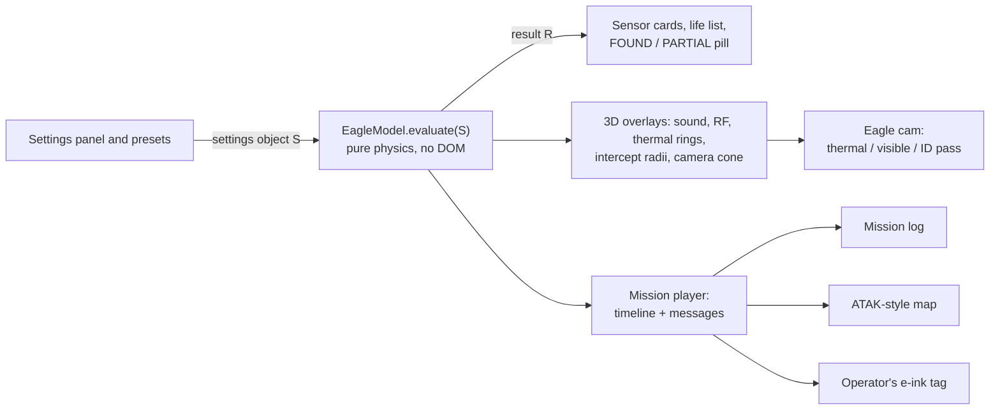
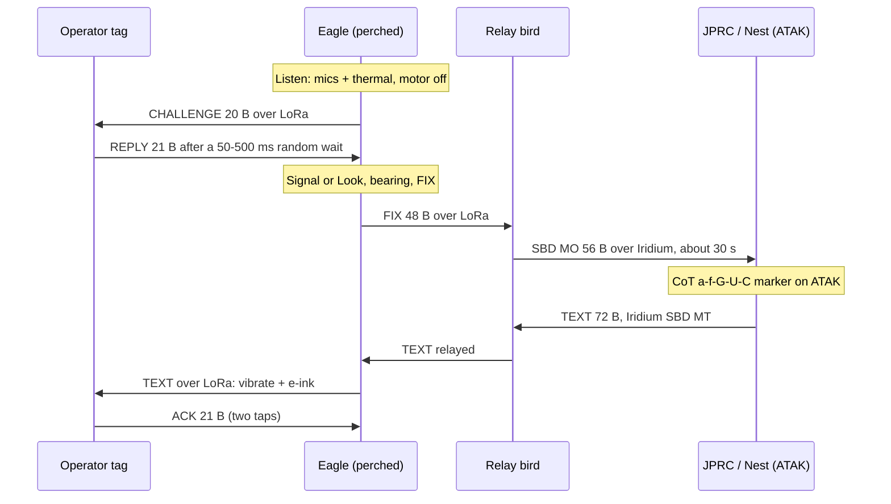
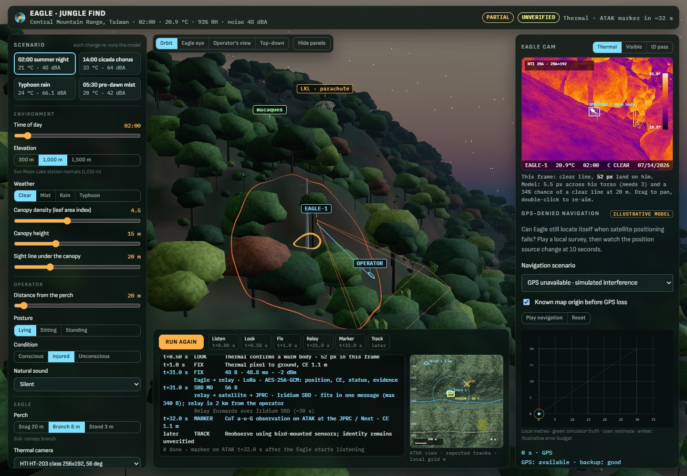
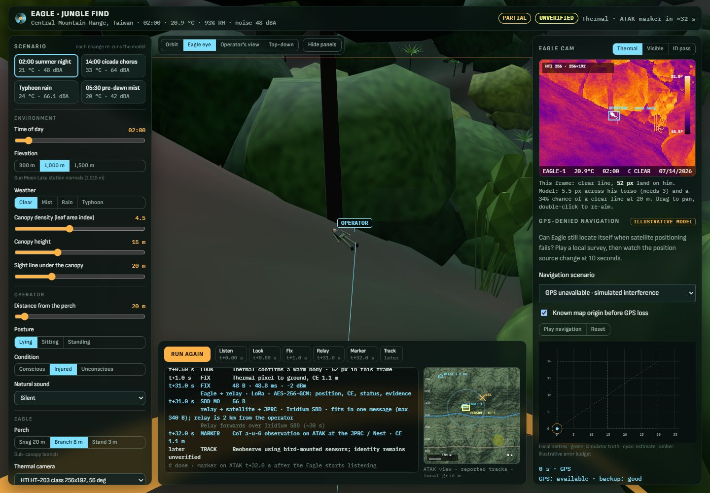
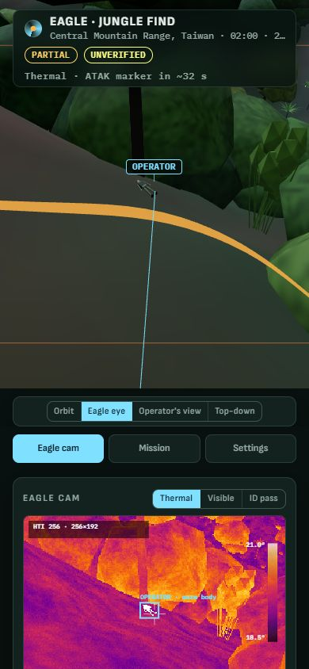

# Eagle Jungle Simulator: technical reference

`simulator/index.html` · v1 · 2026-11-07

The simulator plays out one personnel-recovery mission end to end: a perched **Eagle** drone listens for an isolated operator under Taiwan mountain jungle canopy, finds him with whichever sensors the physics allows, fixes his position, relays the fix to a coordinator's ATAK map, and carries a text message back to his tag. Every number on screen comes from a physics model whose constants are listed below with their sources.

> **All results are model estimates from the equations below, not field measurements.** Constants marked *estimate* or *assumed* in the code are flagged the same way here.

**Contents**
[Architecture](#architecture) · [Scenario](#scenario) · [Inputs](#inputs) · [Presets and results](#presets-and-results) · [Physics model](#physics-model) · [Message protocol](#message-protocol) · [Mission timeline](#mission-timeline) · [Interface guide](#interface-guide) · [Automation hooks](#automation-hooks) · [Dependencies](#dependencies) · [Limitations](#assumptions-and-known-limitations) · [Sources](#sources) · [Glossary](#glossary)

---

## Architecture

One self-contained HTML file, no build step. Three layers, each in its own block:

| Layer | Where | What it does |
|---|---|---|
| **Physics model** | `<script id="eagle-model">` (~370 lines) | `EagleModel`: pure functions, no DOM. Takes a settings object, returns every sensor result, the position fix, the message list and the mission timeline. Runs in a browser (`window.EagleModel`) or Node (`module.exports`). |
| **3D scene** | main `<script>` | three.js r128: seeded terrain and jungle, actors, weather, sensor overlays, and the Eagle's own camera rendered in thermal, visible and ID passes. |
| **Interface** | main `<script>` + HTML panels | Settings and presets, sensor cards, life list, e-ink tag, mission player, mission log, ATAK-style map. |

Data flows one way: settings in, model result out, everything on screen drawn from the result.



Because the model is DOM-free, `simulator/run-model.mjs` extracts it from `index.html` and runs it in Node. The tables in this document were generated that way, so anyone can reproduce them:

```bash
node simulator/run-model.mjs                    # all four presets
node simulator/run-model.mjs night opDist_m=80  # preset + overrides
node simulator/run-model.mjs night --json       # full result object
```

## Scenario

A downed operator lies injured in the Central Mountain Range, Taiwan. The area may be watched (an enemy patrol, or a scanner post and vehicle when the enemy "owns the area"), so every radio emission is a risk.

What is in the 3D world:

- **Terrain:** a seeded, noise-generated valley with ridges and a stream, so every load builds the same world.
- **Forest:** instanced canopy trees and understory, scaled to the canopy-height setting. The forest is one random realisation; the default scene includes a narrow gap between the default perch and the default operator spot, matching the model's 34% chance of a clear line at 20 m, so it shows the case where the camera can see him.
- **Eagle:** the perching drone in Crested Serpent Eagle livery, on one of three perches: a dead snag above the canopy, a sub-canopy branch, or a demo stand.
- **Operator:** posed lying, sitting or standing, carrying a tag with an e-ink screen.
- **Others in the area:** a patrol (×4), farm workers (×2) at a hut with crop rows, post guards and a vehicle when the enemy owns the area, and wildlife weighted like Taiwan camera-trap counts (muntjac most often, then macaques in the canopy, Formosan sambar at 1,000-2,000 m, wild boar rarer). A muntjac browses just beyond the operator as a warm decoy in the Eagle cam.
- **Last known location:** the operator's parachute hanging in the canopy.
- **Relay bird:** a second drone holding altitude kilometres away, carrying the long-haul link.
- **Atmosphere:** sky with sun, stars and moon by hour; mist, rain and fireflies by weather.

## Inputs

Every setting is a key in the settings object `S`. Changing any of them re-runs the model.

| Group | Setting | Key | Range / options | Default |
|---|---|---|---|---|
| Environment | Time of day | `hour` | 0-23.75 h in 15 min steps | 02:00 |
| | Elevation | `elevation_m` | 300 / 1,000 / 1,500 m | 1,000 m |
| | Weather | `weather` | `clear`, `mist`, `rain`, `typhoon` | clear |
| | Canopy density (leaf area index) | `LAI` | 2-8 | 4.5 |
| | Canopy height | `canopyH_m` | 8-30 m | 15 m |
| | Sight line under the canopy | `understoryVis_m` | 5-60 m | 20 m |
| Operator | Distance from the perch | `opDist_m` | 5-300 m | 20 m |
| | Posture | `opPosture` | `lying`, `sitting`, `standing` | lying |
| | Condition | `opState` | `conscious`, `injured`, `unconscious` | injured |
| | Carries the tag | `tag` | on / off | on |
| | Signal | `signal` | `none`, `softWhistle`, `rescueWhistle`, `buzzer`, `voice`, `shout` | soft whistle |
| Eagle | Perch | `perch` | `snag` 20 m, `subcanopy` 8 m, `stand` 3 m | branch 8 m |
| | Thermal camera | `camera` | `mlx55`, `hti256`, `lepton35`, `boson640` | HTI 256 |
| | Mic array | `mics` | 4 / 6 / 16 | 6 |
| | Heading source | `heading` | `mag` (magnetometer), `vio` (visual-inertial) | VIO |
| | Second perch (triangulate) | `secondPerch` | on / off | off |
| | Radar pellet dropped | `radarPellet` | on / off | off |
| | LoRa setting | `radio` | `sf7bw250`, `sf12bw125` | SF7 / 250 kHz |
| Threat | Enemy | `enemy` | `none`, `patrol`, `owns` | patrol |
| | Enemy distance from the operator | `enemyDist_m` | 50-2,000 m | 250 m |
| | Enemy receiver | `enemyDetector` | `energy`, `lora` (LoRa-aware) | energy |
| Relay | Relay bird altitude | `relayAlt_m` | 100-600 m | 300 m |
| | Relay distance | `relayDist_m` | 500-8,000 m | 2,000 m |
| | Long haul | `longHaul` | `iridium` (SBD burst), `courier` (carried out) | Iridium |

## Presets and results

Presets change only time, elevation and weather; everything else stays at the defaults above. The app opens on the 02:00 preset.

| Preset | `hour` | `elevation_m` | `weather` |
|---|---|---|---|
| 02:00 summer night | 2 | 1,000 | clear |
| 14:00 cicada chorus | 14 | 300 | clear |
| Typhoon rain | 16 | 1,000 | typhoon |
| 05:30 pre-dawn mist | 5.5 | 1,000 | mist |

Output of `node simulator/run-model.mjs`:

| Output | 02:00 summer night | 14:00 cicada chorus | Typhoon rain | 05:30 pre-dawn mist |
|---|---|---|---|---|
| Ambient | 20.9 °C, 93% RH | 33.3 °C, 65% RH | 24.1 °C, 98% RH | 20.2 °C, 98% RH |
| Ambient noise | 48 dBA | 64 dBA | 66.1 dBA | 42 dBA |
| Result | **FOUND** (RF tag + Acoustic + Thermal) | **FOUND** (RF tag + Acoustic) | **FOUND** (RF tag + Acoustic + Thermal) | **FOUND** (RF tag + Acoustic + Thermal) |
| Identity | AUTHENTICATED | AUTHENTICATED | AUTHENTICATED | AUTHENTICATED |
| Acoustic: signal heard at operator? | yes (SNR 26.1 dB) | yes (SNR 10.1 dB) | yes (SNR 8 dB) | yes (SNR 32.1 dB) |
| Acoustic: soft-whistle range | 96 m | 30 m | 25 m | 132 m |
| Acoustic: rescue-whistle range | 214 m | 110 m | 99 m | 258 m |
| Thermal: apparent contrast vs threshold | 6.6 °C vs 0.6 °C | -0.7 °C vs 2.3 °C | 1.3 °C vs 0.5 °C | 6.8 °C vs 0.6 °C |
| Thermal: P(clear line of sight) | 34% | 34% | 34% | 34% |
| Thermal: detected? | yes | no | yes | yes |
| RF: tag reply range (Eagle poll) | 355 m | 355 m | 355 m | 355 m |
| RF: tag reply power | -9 dBm | -9 dBm | -9 dBm | -9 dBm |
| RF: enemy intercept radius | 99 m | 99 m | 99 m | 99 m |
| RF: EMCON hold? | no | no | no | no |
| Fix method | Bearing + depression from one perch (8 m up) | same | same | same |
| Fix error (CE) | 3.2 m | 3.2 m | 3.2 m | 3.2 m |
| Time to ATAK marker | 34.4 s | 34.4 s | 34.4 s | 34.4 s |

### What-if cases

Each row changes one or two settings from the 02:00 night preset (`node simulator/run-model.mjs night <key>=<value>`):

| Change | Result | Fix error (CE) | ATAK marker |
|---|---|---|---|
| None (baseline) | FOUND: RF + acoustic + thermal | 3.2 m | 34.4 s |
| Operator 80 m away (`opDist_m=80`) | FOUND: RF + acoustic. Thermal lost: 1.5 px on the body, needs 3 | **42.5 m** | 34.4 s |
| 80 m away + second perch (`secondPerch=true`) | FOUND: RF + acoustic | **6.2 m** | 34.4 s |
| Patrol 60 m from the operator (`enemyDist_m=60`) | FOUND: acoustic + thermal. **EMCON hold 139 s** before the tag is polled | 3.2 m | **173.4 s** |
| Unconscious, no tag (`opState=unconscious tag=false`) | **PARTIAL**: thermal only, identity unconfirmed | 1.1 m | 32 s |
| Unconscious, with tag (`opState=unconscious`) | FOUND: the Eagle commands the tag buzzer (SNR 18 dB) | 3.2 m | 33.4 s |
| Perch on the 20 m snag (`perch=snag`) | FOUND: RF + acoustic. Thermal blocked: 11% chance of a gap through the canopy. Tag reply range 1,031 m | 2.4 m | 34.4 s |
| LoRa SF12 / 125 kHz (`radio=sf12bw125`) | FOUND. Reply range 504 m (vs 355 m) at about 47x the airtime | 3.2 m | 39.4 s |
| Courier bird instead of Iridium (`longHaul=courier`) | FOUND. No emission over land | 3.2 m | 3,604 s (~1 h) |
| Enemy owns the area: 10 m mast (`enemy=owns`) | No hold at 250 m: intercept radius 168 m | 3.2 m | 34.4 s |
| 14:00 cicadas, rescue whistle at 100 m (`cicadaDay signal=rescueWhistle opDist_m=100`) | FOUND: RF + acoustic (SNR 7.8 dB). Thermal lost: sun-warmed leaves as warm as the body | 66.1 m | 34.9 s |

### Thermal camera comparison

Default night scene, operator at 20 m:

| Camera | Pixels | HFOV | NETD | 3-px range (geometry) | Effective range | Pixels on him at 20 m | Detected |
|---|---|---|---|---|---|---|---|
| MLX90640 | 32×24 | 55° | 0.10 °C | 5 m | 0 m | 0.7 | no |
| HTI HT-203 class | 256×192 | 56° | 0.05 °C | 39 m | 23 m | 5.5 | yes |
| FLIR Lepton 3.5 | 160×120 | 57° | 0.05 °C | 24 m | 23 m | 3.4 | yes |
| FLIR Boson+ 640 | 640×512 | 32° | 0.02 °C | 172 m | 23 m | 23.9 | yes |

Under the canopy, the sight line caps thermal range, not the sensor: past ~23 m the chance of a clear line falls below 30%, so the 640×512 camera gets no more range than the 256×192 one.

## Physics model

`EagleModel.evaluate(S)` runs these sub-models in order and combines them. Every constant lives in `PARAMS` in the code with its basis.

### 1. Environment

- **Climate (July normals, CWA 1991-2020):** 300 m uses Taichung (max 33.3 °C, min 25.5 °C, 75% RH); 1,000 m uses Sun Moon Lake station at 1,015 m (28.3 / 20.1 °C, 84.5% RH); 1,500 m is an *estimate*, Sun Moon Lake minus a 6 °C/km lapse rate (25.3 / 17.1 °C, 88% RH).
- **Daily temperature curve:** a half-cosine from the minimum at 05:00 to the maximum at 14:00, then a 15-hour cosine decline back:
  `f = (1 - cos(π(h-5)/9)) / 2` for 05:00-14:00, else `f = (1 + cos(π(h-14)/15)) / 2`;
  `T_amb = T_min + (T_max - T_min)·f + offset·f`, with weather offsets of 0 (clear), -1.5 (mist), -3 (rain), -4 °C (typhoon) applied mostly to the daytime peak.
- **Humidity:** 98% in mist, rain or typhoon; otherwise the normal ±10% across the day.
- **Ambient noise (dBA):** biophony by hour, all *estimates*: 62 for 07-17 h (cicada chorus), 56 for 17-20 h, 48 for 20-03 h (insects, frogs), 42 for 03-06 h (pre-dawn lull), 52 for 06-07 h (dawn chorus); +2 dB at 300 m, -3 dB at 1,500 m. Rain adds 54 dBA (rain) or 64 dBA (typhoon) from Sato et al. 2021, combined by power sum. Canopy wind noise is not included.
- **Solar heating of the canopy:** 0 before 06:30 and after 19:00, ramping to 1 between 09:00 and 16:30; ×0.3 under cloud, mist or rain. Day is 05:30-18:45 (July sunrise ~05:20, sunset ~18:45).

### 2. Acoustic

The Eagle's mic array listens for the operator's signal.

- **Path:** slant distance `d = √(r² + h²)` from the operator to a perch `h` metres up.
- **Loss:** spherical spreading `20·log10(d)` plus air absorption (ISO 9613-1: 0.005-0.020 dB/m from 1-4 kHz). Beyond 20 m, dense-foliage attenuation is added (ISO 9613-2 Table A.1: 0.06-0.09 dB/m); between 10 and 20 m foliage adds 1 dB. `vegFactor = 1.0`; measured rainforest values range from about half that (French Guiana, Haupert 2023) to several times more at other tropical sites.
- **Gains:** array gain `10·log10(N mics)`; in-band noise is 8-12 dB below the broadband dBA figure, because insects and cicadas sing mostly above the speech band.
- **Detection:** `SNR = SL - loss + array gain + band gain - noise ≥ 6 dB`. Range is found by bisection.
- **Unconscious operator:** cannot signal. If he carries the tag, the Eagle commands the tag's buzzer instead.

| Signal | Source level at 1 m | Frequency | Duration | Basis |
|---|---|---|---|---|
| Soft whistle code (3 short) | 85 dB | 2.5 kHz | 2.5 s | assumed |
| Rescue whistle (3 blasts) | 104 dB | 3 kHz | 3 s | Fox 40: 115 dB sound power |
| Tag buzzer (Eagle-commanded) | 75 dB | 3 kHz | 1.5 s | assumed piezo |
| Normal voice | 57 dBA | 1 kHz | 3 s | Pearsons 1977 |
| Shout | 85 dBA | 1 kHz | 2 s | Pearsons 1977 |

### 3. Thermal

- **Resolution:** `IFOV = HFOV / pixels across`; pixels on a lying torso (0.45 m wide) = `0.45 / (slant range × IFOV)`. Detection needs **3 px** (2 px is optimistic).
- **Target temperature:** clothing surface `= T_amb + K·(34 °C skin - T_amb)` with `K = 0.45` dry, `0.12` soaked (wet clothing sits near air temperature).
- **Background:** forest `= T_amb - 0.8 °C` at night, rising to `T_amb + 1.0 °C` in full sun.
- **Clutter:** 0.4 °C at night rising to 1.5 °C in sun; 0.3 °C when wet. **Threshold** `= max(4·NETD, 1.5·clutter)`.
- **Atmosphere:** apparent contrast `= ΔT·exp(-β·d)`, `β = 0.6 /km` in hot humid air, plus 1.0 (mist), 2.0 (rain) or 6.0 /km (typhoon).
- **Line of sight:** from above the canopy, Beer-Lambert gap probability `exp(-G·Ω·LAI / cos θ)` with `G = 0.5`, clumping `Ω = 0.7`; from below the canopy, `exp(-d / sight line)` for trunks and shrubs. Detection needs at least a **30%** chance of a clear line.
- **Result:** detected when pixels, contrast and line of sight all pass; the effective range is the farthest distance where all three still pass.

The Eagle cam in the interface renders the actual scene through a thermal shader: per-material temperatures (leaf, trunk, ground, rock, water, clothing, skin, fur, drone, metal, engine, roof, parachute) driven by the same ambient, sun and wetness values, with sensor noise and histogram AGC (2nd-98th percentile).

### 4. Radar pellet

An optional mmWave radar pellet (Seeed MR60BHA2) dropped next to the operator: vital signs within 1.5 m, presence within 6 m. v1 assumes the pellet lands within 1 m when dropped, so it always detects; it reports breathing (~16/min, ~10/min unconscious) and heart rate.

### 5. RF: tag poll, interception, relay

- **Band:** 923 MHz (Taiwan AS923, 920-925 MHz). Radios: LoRa SF7 / 250 kHz (sensitivity -121.5 dBm) or SF12 / 125 kHz (-137 dBm).
- **Base path loss:** free space `20·log10(d) + 20·log10(f MHz) - 27.55`, switching to plane-earth `40·log10(d) - 20·log10(h_T·h_R)` beyond the breakpoint `4·h_T·h_R/λ`.
- **Vegetation:**
  - One terminal in woodland (ITU-R P.833-10): `A_max·(1 - exp(-γ·d_veg / A_max))`, `A_max = 0.18·f^0.752` (f in MHz), `γ = 0.3 dB/m` (*assumed*), with `d_veg` the path length inside the canopy.
  - Both terminals inside the forest (Weissberger 1982): `0.45·F^0.284·d` up to 14 m, `1.33·F^0.284·d^0.588` beyond (F in GHz). With plane-earth spreading this gives ~136 dB at 250 m for antennas at 0.3 and 1.5 m, against ~138 dB measured for LoRa in Brazilian rainforest.
- **Poll:** the Eagle transmits at +14 dBm; the poll budget is `14 dBm - sensitivity`, and the tag reply range is the farthest point where path loss fits in it.
- **Tag power control:** the tag replies at `sensitivity + 10 dB margin + path loss`, clamped to -9 ... +22 dBm. Tag antenna height: 0.3 m lying, 0.9 m sitting, 1.3 m standing.
- **Interception:** an enemy receiver at 1.5 m (patrol) or 10 m (owns the area: mast), threshold -115 dBm (energy detector) or -124 dBm (LoRa-aware). The intercept radius is the farthest distance at which the tag's reply clears that threshold. The model also reports how far the Eagle's own poll carries to a ground receiver.
- **EMCON hold:** if the enemy is inside the reply intercept radius, the Eagle does not poll. Hold time `= (intercept radius - enemy distance + 100 m) / 1 m/s` patrol speed.
- **Relay hop:** Eagle to relay bird over the slant distance, plus canopy loss climbing out of the forest when the perch is below canopy top. The model reports the Eagle's transmit power and link margin, and the wide-area poll range from relay altitude (flat ground, before terrain masking).

### 6. Position fix

Bearing error `σ_az = √(σ_DOA² + σ_heading²)`, with `σ_DOA = 3°` and heading from a magnetometer (8°) or visual-inertial odometry (1°).

| Method | When | Range error | Cross-range error |
|---|---|---|---|
| Two perches, crossing bearings | second perch on, acoustic or thermal detection | `r·σ_az` | `r·σ_az` |
| Bearing + depression from one perch | acoustic detection | `σ_DOA·(r² + h²) / h` | `r·σ_az` |
| Thermal pixel to ground | thermal only | `σ_tilt·(r² + h²) / h`, `σ_tilt = 1°` | `r·σ_heading` |
| RF signal strength only | tag only | `0.5·r` | `r` |

`CE = √(range error² + cross-range error²)`. The single-perch range error grows with `r²/h`, which is why CE jumps from 3.2 m at 20 m to 42.5 m at 80 m, and why a second perch or a higher perch matters.

### 7. LoRa airtime

Semtech AN1200.13, coding rate 4/5, explicit header, CRC on, 8-symbol preamble, low-data-rate optimisation when a symbol exceeds 16 ms:

`T_sym = 2^SF / BW`;
`n_payload = 8 + max(ceil((8·bytes - 4·SF + 44) / (4·(SF - 2·DE))) · 5, 0)`;
`T = (12.25 + n_payload) · T_sym`.

### 8. Decision

- **Status:** FOUND when two or more of RF tag, acoustic, thermal and radar detect; PARTIAL with one; NOT FOUND with none.
- **Identity:** AUTHENTICATED only when the tag answers the poll; otherwise UNCONFIRMED.

## Message protocol

The simulator models size, airtime and transmit power of each message. **It does not implement the cryptography**; HMAC and AES-256-GCM describe the intended protocol.

| Message | Direction | Bytes | Airtime SF7/250 | Airtime SF12/125 | Content |
|---|---|---|---|---|---|
| CHALLENGE | Eagle → tag | 20 | 28.3 ms | 1,318.9 ms | nonce + 64-bit HMAC; can ask the tag to chirp |
| REPLY | tag → Eagle | 21 | 28.3 ms | 1,482.8 ms | status masked for the Nest (OK / INJURED / DURESS); sent after a 50-500 ms random wait at the lowest power that closes the link |
| FIX | Eagle → relay | 48 | 48.8 ms | 2,302 ms | AES-256-GCM: position, CE, status, evidence |
| SBD MO | relay → satellite → JPRC | 56 | n/a | n/a | Iridium Short Burst Data, one message (MO max 340 B), ~30 s |
| COURIER | relay → Nest | 48 | n/a | n/a | alternative long haul: carried out by flight, no emission over land |
| TEXT | JPRC → relay → Eagle → tag | 72 | 66.7 ms | 3,121.2 ms | e.g. `FRIENDLY EAGLE. RALLY DAR-2 0300. ACK: 2 TAPS` (SBD MT max 270 B) |
| ACK | tag → Eagle | 21 | 28.3 ms | 1,482.8 ms | two taps on the tag |
| LIFE | n/a | 88 | 76.9 ms | 3,612.7 ms | size reserved for the life list; not sent in v1 |



## Mission timeline

`evaluate()` builds the timeline the mission player animates. Default (02:00 night) timings:

| Step | t | What happens |
|---|---|---|
| Listen | 0 s | Perched, motor off, passive: mics and thermal (and radar pellet if dropped) |
| EMCON hold | +hold | Only when unknowns are inside the intercept radius: no poll until they move off |
| Poll | 0.0 s | CHALLENGE, 28.3 ms airtime |
| Reply | 0.3 s | REPLY after the mean 275 ms random wait |
| Signal / Look | 2.8 s | Signal heard (adds its duration) gives a bearing; or thermal confirms a warm body (+0.5 s) |
| Fix | 3.3 s | Position + CE |
| Relay | 33.4 s | FIX to the relay, then Iridium SBD (~30 s) or courier flight (~1 h) |
| Marker | 34.4 s | CoT `a-f-G-U-C` marker on ATAK at the JPRC / Nest |
| Coordinator reply | 94.4 s | If the JPRC answers within a minute: TEXT to the tag, vibrate + e-ink; ACK by two taps |
| Track | later | Re-poll every 10 min; send a new FIX only when he moves more than 25 m |

The ~30 s Iridium latency is 87% of the time to marker.

## Interface guide



**Top bar:** scenario, time, temperature, humidity, noise; the result pill (FOUND / PARTIAL / NOT FOUND, AUTHENTICATED / UNCONFIRMED) with the sensors that found him and the time to the ATAK marker.

**Camera bar:** Orbit (drag to rotate; the camera also flies to each step during a mission), Eagle eye (the perched drone's viewpoint), Operator's view, Top-down. **Hide panels** or press **H** for a clean view.



**Left panel, Scenario:** the four presets (each shows its temperature and noise), then every input above, then Display: quality (Auto / Low / Med / High) and overlay toggles: RF ring, sound ring, thermal ring, reply intercept, poll intercept, camera cone, labels.

**Right panel:**
- **Eagle cam:** a live render from the Eagle's camera, at the selected sensor's resolution, ~8 Hz. *Thermal* (shader-based thermal image with noise and AGC), *Visible* (daylight, or starlight with no IR lamp), *ID pass* (ground truth: which object each pixel belongs to, used to count pixels on target). Drag to pan, double-click to re-aim. Notes under the image compare this frame with the model.
- **Operator's tag (e-ink):** what the operator sees: standby, poll received, EMCON standby, or the coordinator's message.
- **Sensors:** one card per sensor with range, margin and the model's explanation of why it did or didn't detect.
- **Life list:** everything the Eagle reports: the operator, unknown groups (patrol, farm workers, post guards) with evidence (voices, heat, pixels in the Eagle cam), and animals rejected on shape and no tag.

**Bottom dock, Mission:** **Run mission** steps through the timeline, animating sound and RF rings, the relay beam and the message hops; the log prints every message with size, airtime and power; the ATAK-style map shows the LKL, Eagle, relay, the operator estimate inside its CE circle (cyan when authenticated, yellow when not), reported unknowns, and the enemy post when the enemy owns the area, on an 800 m local grid with 100 m squares.

**Colours:** MIL-STD-2525 affiliation colours (friendly cyan, hostile red, unknown yellow, neutral green) plus thermal amber.

**Phones:** below 1,100 px wide, the 3D view sits on top and the panels become tabs (Eagle cam, Mission, Settings).



## Automation hooks

`window.__sim` exposes the app for scripted runs and screenshots:

| Member | Use |
|---|---|
| `ready` | `true` once the scene has booted |
| `S`, `R` | current settings and model result |
| `preset(key)` | apply a preset: `night`, `cicadaDay`, `typhoon`, `preDawn` |
| `apply({...})` | merge settings and re-run |
| `run()` | play the mission |
| `cam(mode)` | `orbit`, `eagle`, `operator`, `top` |
| `pip(mode)` | Eagle cam: `thermal`, `visible`, `id` |
| `quality(level)` | `auto`, `low`, `med`, `high` |
| `life`, `pipStats` | life-list tracks; Eagle cam pixel counts per object |

## Dependencies

- three.js r128 from cdnjs, plus `OrbitControls`, `Sky` and `BufferGeometryUtils` from jsDelivr.
- Fonts: IBM Plex Mono and Sofia Sans Semi Condensed from Google Fonts (falls back to system fonts offline).
- No build step, no server, no API keys. A WebGL-capable browser.

## Assumptions and known limitations

- **Model estimates only.** Nothing has been field-tested yet. Several inputs are labelled *estimate* or *assumed* in `PARAMS`: biophony levels, soft-whistle and buzzer source levels, the vegetation constant γ, and the 1,500 m climate.
- **July only.** Climate normals are for July.
- **Flat-ground RF.** No terrain masking; ridges would cut both the enemy's intercept radius and the relay's wide-area poll.
- **EMCON hold looks at the tag's reply only.** In the default scene the Eagle's own +14 dBm poll reaches an energy detector out to ~413 m, farther than the patrol at 250 m, and the hold logic does not yet consider it.
- **Threshold detection.** Sensors pass or fail on fixed thresholds (SNR ≥ 6 dB, ≥ 3 px, ≥ 30% clear line). Detection probability curves and false-alarm rates are not modelled; wildlife appears in the scene and life list, not in the statistics.
- **Radar pellet always lands within 1 m** when dropped.
- **One forest.** Line of sight in the model is a probability; the 3D scene is one seeded realisation of it.
- **Needs internet on first load** for three.js and fonts. Vendoring them into the repo would make it run fully offline.
- **No cryptography implemented;** message contents and sizes describe the intended protocol.

## Sources

As cited in `PARAMS`:

- Central Weather Administration (Taiwan) climate normals 1991-2020: Taichung, Sun Moon Lake.
- ISO 9613-1, atmospheric absorption of sound; ISO 9613-2 Table A.1, attenuation through foliage.
- Haupert et al. 2023, sound attenuation in French Guiana rainforest.
- Sato et al. 2021, rain noise level against rain rate.
- Pearsons et al. 1977, speech levels.
- Fox 40 whistle sound-power specification.
- ITU-R P.833-10, attenuation in vegetation.
- Weissberger 1982, foliage loss model.
- LoRa propagation measurements in Brazilian rainforest (SF12, 250 m).
- Semtech AN1200.13, LoRa modem designer's guide (airtime).
- Seeed Studio MR60BHA2 60 GHz radar wiki.
- Iridium 9603 SBD transceiver specifications.
- Thermal cores: Melexis MLX90640; HTI HT-203 class phone imager; Teledyne FLIR Lepton 3.5; Teledyne FLIR Boson+ 640.

## Glossary

| Term | Meaning |
|---|---|
| ATAK | Android Team Awareness Kit, the map app the coordinator sees |
| CoT `a-f-G-U-C` | Cursor on Target event type: friendly ground unit |
| CE | circular error of the position fix |
| DAR | designated area for recovery |
| DOA | direction of arrival (acoustic bearing) |
| EMCON | emissions control: staying silent on radio |
| HFOV / IFOV | horizontal / instantaneous (per-pixel) field of view |
| JPRC | Joint Personnel Recovery Center |
| LAI | leaf area index: leaf area per unit ground area |
| LKL | last known location |
| NETD | noise-equivalent temperature difference (thermal sensor noise) |
| Nest | the team's home base for the drones |
| SBD MO / MT | Iridium Short Burst Data, mobile-originated / mobile-terminated |
| SF / BW | LoRa spreading factor / bandwidth |
| VIO | visual-inertial odometry |
