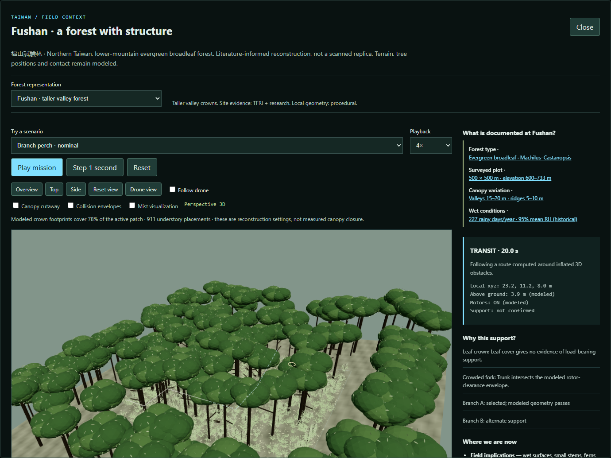
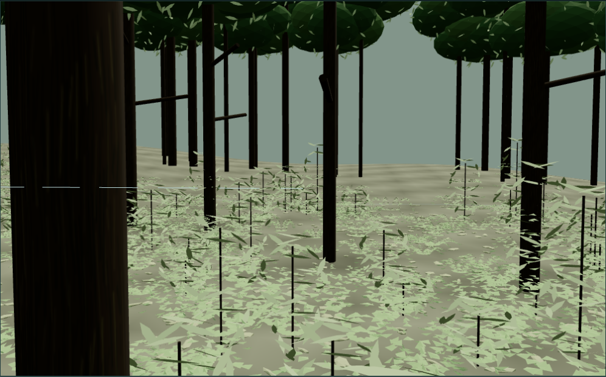

# Fushan forest: what the drone actually has to deal with

Research and implementation date: November 7, 2026. The selected reference is Fushan Experimental Forest in northern Taiwan. This is an evidence-based site analysis and an ecological reconstruction, not a measured flight corridor or digital twin.

## Site evidence

Fushan's permanent research plot is a 500 × 500 m old-growth submontane evergreen broadleaf forest, classified in the Machilus–Castanopsis zone. Its surveyed elevation range is 600–733 m. TFRI reports a very wet historical climate: 227 rainy days annually and about 95% mean relative humidity. The institute's first census counted 114,354 woody individuals, including tree ferns, with a diameter threshold of 1 cm. These are not 114,354 mature canopy trees. Counts and climatic summaries depend on census and measurement period. [TFRI](https://www.tfri.gov.tw/en/cp.aspx?n=7574).

Canopy height is not uniform. Published comparative research reports approximately 15–20 m in Fushan valleys/flat areas and 5–10 m on ridges. Exposure and disturbance produce substantial structural variation; one universal canopy height is inappropriate. [Hogan et al., 2018](https://www.columbia.edu/~mu2126/publications_files/Hogan%20et%20al%202018%20Forests.pdf).

Fushan is repeatedly affected by typhoons. Research examining multiple storms relates canopy damage to storm characteristics, topography and pre-existing forest condition. Consequently a crown gap cannot be assumed permanent or mechanically stable, and a map made before a major storm needs re-observation. This is a navigation implication, not a tested drone result. [Peereman et al., 2020](https://www.mdpi.com/2072-4292/12/10/1654).

Understory light measurements found considerable spatial variation and relatively high light beneath the canopy compared with many other mature forests, associated with typhoon disturbance. More light should not be confused with an empty understory or guaranteed camera tracking. Ferns, shrubs, small woody stems and irregular branches still occupy potential flight space. [Lin et al., 2006](https://ws.tfri.gov.tw/Download.ashx?n=VW5kZXJzdG9yeSBsaWdodCBhdCB0aGUgRnVzaGFuIEV4cGVyaW1lbnRhbCBGb3Jlc3QgaW4gbm9ydGhlYXN0ZXJuIFRhaXdhbl8gd2F0ZXJzaGVkIGFuZCBsYW5kc2NhcGUgcGVyc3BlY3RpdmVzLnBkZg%3D%3D&u=LzAwMS9VcGxvYWQvNDM4L3JlbGZpbGUvMTI2ODgvMjQxMzkvOGYwYzdjYWYtNGQ4NC00N2RkLTkzYjgtN2ZkMDI2OTk3ZjhhLnBkZg%3D%3D).

Fushan is a lower-mountain northern broadleaf reference. Do not transfer its height ranges, stem structure or weather summaries to Taiwan's high-elevation conifer forests, cypress cloud forests, southern monsoon forests or bamboo stands without a separate site profile.

## Engineering assessment

The following are design implications inferred from the site evidence, not measured hardware performance.

| Forest condition | Consequence for the aircraft | Evidence needed before flight |
|---|---|---|
| Uneven ground and overlapping crowns | Constant height above launch point is not constant terrain clearance; a 2D obstacle map misses overhangs. | Local 3D geometry, terrain clearance and overhead space along the full vehicle envelope. |
| Small stems, forks and layered leaves | Avoiding the large trunks is insufficient. Sparse mapping may miss rotor hazards. | Thin-obstacle detection at operating distance, measurement freshness and an explicit policy for unknown space. |
| Occlusion and repeated vegetation texture | A plausible camera pose may become poorly constrained or lost. | Synchronized VIO/depth replay, independent error references and tracking-loss behavior. |
| Persistent wet conditions | Wet bark and vegetation may change attachment mechanics and sensor performance. | Contact/friction tests on relevant bark, humidity/rain tests and a support-confirmation sensor. No wet-grip coefficient is assumed here. |
| Storm disturbance and moving foliage | Previous routes/perches can become blocked or damaged. | Re-observation, branch-motion checks and abort paths. Storm-flight capability is not implied. |
| Sloped, cluttered forest floor | A visually open patch need not be level, solid or accessible. | Landing-footprint geometry and support checks, not an RGB “safe” class alone. |
| Branch near the canopy | Leaves can obscure the contact region, aircraft clearance and departure corridor. | A visible structural support, gripper-compatible geometry, approach clearance and verified release/departure. |

A useful flight requirement is therefore “reach an observable structural support with a verified approach and departure,” rather than “land on the canopy.” The planner needs to reason about unknown space and the transition from free flight to physical support. Thermal sensing contributes observations; it does not remove the need for metric geometry.

## What the revised lab represents

The default scene is a 48 × 40 m procedural patch with sloping ground, 54 major stems, branching wood, overlapping broadleaf crowns, 911 retained understory placements and three fallen logs. Of 950 seeded planting attempts, immediate launch/landing/contact footprints exclude 39. Low plants continue beneath the former broad demonstration corridors; taller represented understory is included in the planner's obstacle envelopes. These counts, local slopes, dimensions and placements are **model choices**, not census-derived density or actual Fushan tree positions. Major-stem approach spaces remain deliberately reserved. This is not evidence that those gaps exist in the field.

The sum-of-union crown-footprint model covers approximately 78% of the active patch when sampled on a 1 m horizontal grid. This is an estimate of projected modeled crown envelopes, not measured Fushan canopy closure, leaf-area index or hemispherical light transmission. Visual context adds 100 trees outside the flight bounds and extends the rendered ground, so the scene does not end at a bare rectangular diorama. Those outer trees are not part of flight planning.

Valley and exposed-ridge presets retain the same modeled terrain and major stem positions while changing canopy height, support examples and the starting point. The ridge entry point is a clear synthetic patch. Its terminal approach has been lowered to pass beneath the enlarged crown envelopes rather than descending through them. These are demonstration setups, not measured routes or launch sites. The presets support inspecting structural differences, not a controlled performance comparison between actual valley and ridge routes.

The 3D renderer offers orbit, pan, zoom, drone viewpoint, canopy cutaway, collision envelopes and a mist visualization. Crowns and branches have visible volume; the underlying collision geometry remains conservative axis-aligned boxes. Visual leaves/ground litter do not add individually resolved collision surfaces. Neither photorealism nor complete thin-branch detection is claimed.

Planning uses a 2 m grid with segment shortcut checks against inflated boxes. Terrain clearance is checked at 0.25 m intervals along a segment. The 0.45 m aircraft half-width is inherited from the illustrative lab; it is not a measurement of Alex's craft. Transit is set to 1.2 m/s, terminal motion to 0.7 m/s. These are demonstration settings, not validated forest speeds. A complete synthetic map and exact pose are still supplied.

The original block scene remains selectable as a comparison baseline. Mist changes rendering only; it does not calibrate depth range or odometry error. The blocked scenario injects an unvalidated transit boundary rather than recreating an observed windfall. Contact, grip failure and motor state remain synthetic, separate from ArduPilot SITL.

## What actual site reconstruction still requires

TFRI lists individual tree census positions and 1,710 surveyed topographic stakes as available through an application process. Those records were not obtained in this task. Tree census xy and DBH would improve placement but would still not supply individual branch, crown or gripper-contact geometry. That requires suitably resolved terrestrial/aerial lidar or photogrammetry and field verification. [TFRI data-access description](https://www.tfri.gov.tw/en/cp.aspx?n=7574).

A coarse terrain-tile spot check at the published reference coordinate returned approximately 520 m, which did not match the published plot elevation range. The reference coordinate was not established as a surveyed plot origin, and source resolution/registration were not resolved. That coarse tile was **not incorporated or silently rescaled** into the scene. Site survey data is the appropriate basis for a registered model; a global elevation raster cannot validate a branch-clearance corridor.

The next defensible integration is a registered measured point-cloud patch plus actual vehicle dimensions, sensor coverage and gripper limits. Until then this lab supports reviewing requirements and failure cases, not certifying an autonomous route in Taiwan.
