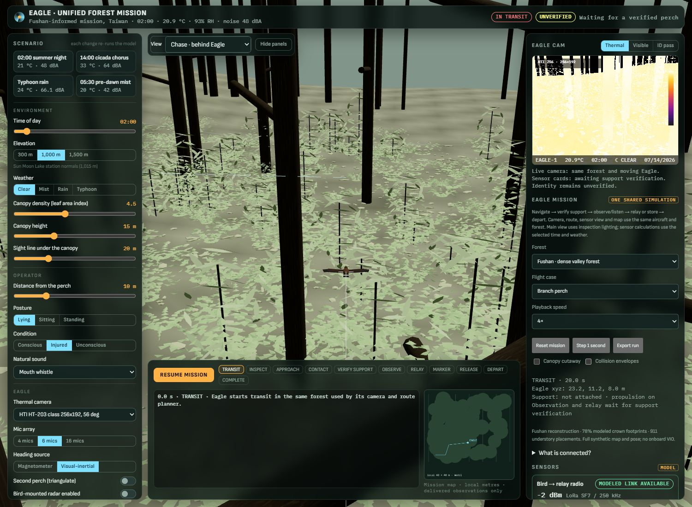
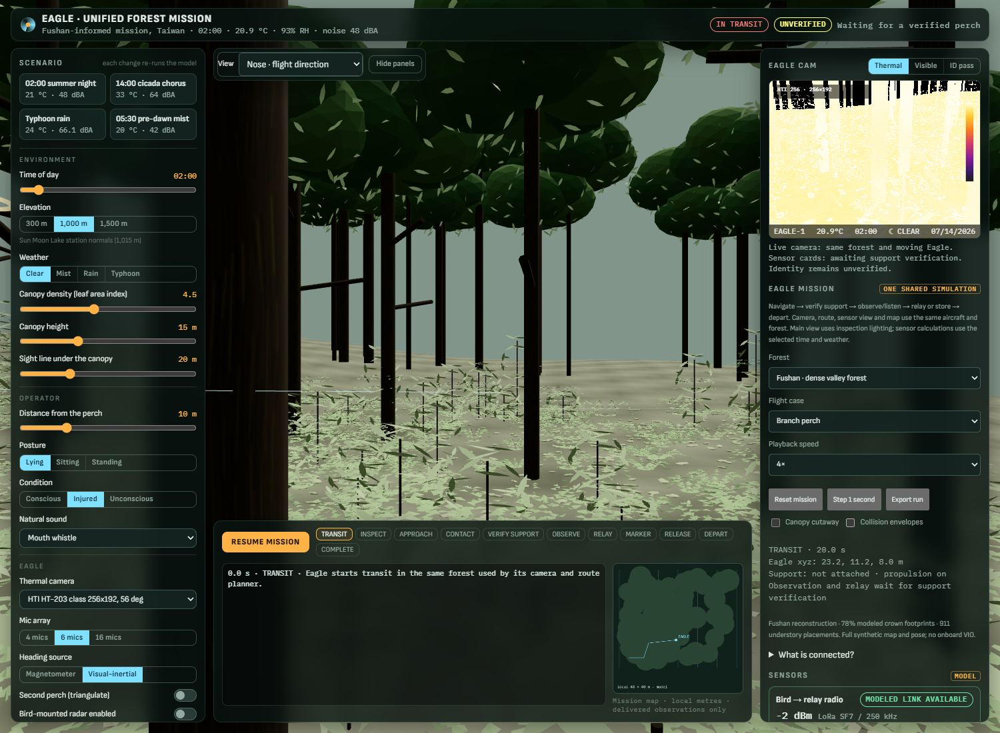

# One Eagle mission, from flight to observation

The browser entry point is [simulator/index.html](../simulator/index.html). The old `forest.html` link redirects here. Forest navigation and the Eagle mission no longer have separate playbacks, aircraft or scenes.

From the repository root, run `python -m http.server 8770 --bind 127.0.0.1`, then open `http://127.0.0.1:8770/simulator/`. Three.js and its existing example libraries are locally bundled at version r128 with the upstream MIT license. External web fonts are optional.

## Mission flow

**Run mission** starts or pauses one shared simulation clock. **Step 1 second**, speed selection, reset and JSON export operate on that same state. Settings changes reset the mission rather than altering an already captured observation. The two forest profiles and six flight cases remain selectable.

`TRANSIT → INSPECT → APPROACH → CONTACT → VERIFY_SUPPORT → OBSERVE → RELAY / STORE → RELEASE → DEPART → COMPLETE`

An unreachable support or pose/depth failure produces an abort without an observation or report. A grip failure retreats and selects another support before observation can begin. Ground landing uses verified ground support instead of a branch.

The forest model's previous four-second automatic perch release is disabled during the mission. Eagle remains attached, with modeled propulsion off, until its observation and transport timeline finishes. A modeled courier can therefore require a long supported wait; it does not disappear into a separate animation. Departure then retraces the checked terminal corridor.

## One geometry and coordinate contract

`mission-model.js` owns the forest state, person location, mission time, captured sensor result, transport events and delivery status. The numerical observation functions are the existing `EagleModel` from `index.html`; their default behavior is retained for the headless sensor runner.

Forest coordinates are local `[x, y, z-up]` metres. The original Three.js mission uses `[x, y-up, z]`, so the host transforms poses to `[x, z, -y]` and rotates the same forest geometry accordingly. There is no separate animated route or inferred geographic registration. The original Eagle and person actors are placed in that forest. The standalone forest's quadrotor symbol is hidden; one Eagle is visible.

The main view, gimbal image, thermal render and ID pass use the same scene and current aircraft pose. The thermal sensor origin is 0.35 modeled metres above the flight reference point. The modeled center ray uses the same origin and posture-dependent person aim point. A box occlusion test can veto a thermal detection before the existing position-fix calculation. It is a conservative center-ray gate, not a complete optical/material model. Fine leaves remain unresolved by collision geometry, and visible pixels elsewhere on the person can differ from center-ray visibility.

At supported observation, the system supplies the actual modeled horizontal separation and aircraft height above the person's ground to `EagleModel`, instead of using an unrelated nominal perch height. The active patch limits target placement to 5–25 m; the settings control reflects this. The sensor cards show the last supported observation; the camera continues to show the current pose during departure.

The inspection view keeps readable lighting. Thermal/environment calculations use the chosen time and weather. Statistical foliage, acoustic and thermal parameters remain model assumptions; changing them does not regenerate a surveyed forest. See [the Fushan analysis](taiwan-forest-analysis.md).

## Viewpoints

The main **View** selector offers twelve choices: chase, nose/flight direction, person-facing gimbal, left shoulder, right shoulder, front looking back, overhead follow, belly/downward, perch approach, person's viewpoint, high overview and free orbit. These are different cameras on the same state. Dragging the main scene switches to free orbit without advancing a paused mission. Camera changes work during flight and while paused.

**Canopy cutaway** and **Collision envelopes** change the view, not the obstacle model. The high overview is an inspection camera, not a claimed camera mounted on the distant relay. Camera offsets may pass through vegetation because inspection cameras are not simulated aircraft.

## Observation and delivery are separate

Before support verification, the UI reports in-transit/aborted rather than accepting sensor predictions as observations. Passive camera rendering remains available in flight, but the mission accepts evidence only in its supported observation stage. The missing person carries no technology; the default remains silent. Optional mouth whistles, voice and shouting are natural acoustic cases, not required equipment.

A usable modeled fix plus an available modeled link schedules the existing relay/marker events on the common clock. The local mission map displays a person marker only when delivery occurs. It uses the model's illustrative along/cross-bearing offset and error budget, rather than plotting simulator truth as an exact measured fix. A failed link records **STORE**, retains the observation and publishes no coordinator marker. Individual identity remains **UNVERIFIED** in every case. No actual radio or satellite packets are sent.

The map uses local coordinates and shows the planned aircraft trail. Export includes model provenance, settings used for the observation, geometry checks, events, aircraft trail and transport state. It is a simulation record, not flight telemetry.

## Validation and remaining integration

`node simulator/test-mission.cjs` checks support-before-observation, shared terrain clearance, successful modeled delivery, retained observations on failed links, grip-failure reselection, blocked/pose-loss aborts, silent-person default, a long courier wait, reported-position export and invalid time steps. Positive acoustic tests explicitly use the valid `softWhistle` case; default silent cases are not forced to succeed.

`node simulator/check-mission.cjs` checks the old-route redirect, one rendered aircraft pose, all twelve viewpoints, drag-to-orbit, shared play/pause/step state, supported observation, the actual thermal-render path, delivery, aborts and widths 320/375/414/768 px. It needs Playwright and Chrome; it first resolves a normal `playwright` package, then falls back to the local Codex bundled runtime if present. Browser checks suppress continuous software rendering and advance the shared controller explicitly; they are not frame-rate benchmarks. `check-browser.cjs` and `check-forest.cjs` now forward to that integration check. The 18 forest-component cases and the original sensor/navigation regression checks remain available.

This connects the browser mission and forest model. It does not connect the separate ArduPilot SITL process, live VIO/depth, real branch-contact sensing, real communications or Unreal Editor execution. The obstacle map and pose are supplied synthetically. Those boundaries remain explicit instead of treating scene rendering as validation of flight hardware.
